<!--
  Everything under assets/generated is rebuilt daily by .github/workflows/cards.yml
  (python .github/scripts/build.py). The seal block at the bottom is rewritten too.
  Light mode shows the passport in daylight; dark mode shows it under a UV lamp.
-->

<picture>
  <source media="(prefers-color-scheme: dark)" srcset="assets/generated/passport-uv.svg" />
  
</picture>

<p align="center"><b>Don't trust this page.</b> &nbsp;<a href="#dont-trust-this-page-verify-it">Verify it</a> &nbsp;or&nbsp; <a href="https://github.com/alenissacsam-2/alenissacsam-2/issues/new?title=stamp+me&body=Stamp+my+passport.">get stamped</a>.</p>

I build systems where trust is something you check instead of something you are asked for:
decentralized identity on **Algorand** and **Ethereum**, an on-chain certificate registry,
and around them, AI agents, neural nets from first principles, and market-microstructure tools.

[LinkedIn](https://www.linkedin.com/in/alenissacsam050/) &nbsp;/&nbsp; [X](https://x.com/alenissacsam) &nbsp;/&nbsp; [alenissacsam12@gmail.com](mailto:alenissacsam12@gmail.com)

<br />

## Visas

<p align="center">
<a href="https://github.com/alenissacsam-2/algorand-identity-verification"><picture><source media="(prefers-color-scheme: dark)" srcset="assets/generated/visa-1-uv.svg" /></picture></a>
<a href="https://github.com/alenissacsam-2/blockchain-certificate-verification"><picture><source media="(prefers-color-scheme: dark)" srcset="assets/generated/visa-2-uv.svg" /></picture></a>
<a href="https://github.com/alenissacsam-2/ethereum-identity-dapp"><picture><source media="(prefers-color-scheme: dark)" srcset="assets/generated/visa-3-uv.svg" /></picture></a>
<a href="https://github.com/alenissacsam-2/AI-Powered-Infrastructure-Design-with-Google-ADK"><picture><source media="(prefers-color-scheme: dark)" srcset="assets/generated/visa-4-uv.svg" /></picture></a>
<a href="https://github.com/alenissacsam-2/txline-prediction-markets"><picture><source media="(prefers-color-scheme: dark)" srcset="assets/generated/visa-5-uv.svg" /></picture></a>
<a href="https://github.com/alenissacsam-2/NN-From-Scratch-for-MNIST"><picture><source media="(prefers-color-scheme: dark)" srcset="assets/generated/visa-6-uv.svg" /></picture></a>
</p>

## Entry log

<picture>
  <source media="(prefers-color-scheme: dark)" srcset="assets/generated/log-uv.svg" />
  
</picture>

## Don't trust this page. Verify it.

Every build of this README is signed with [Sigstore](https://www.sigstore.dev/) by GitHub Actions.
The document number on the passport is the first nine characters of the file's SHA-256.

```bash
curl -sLO https://raw.githubusercontent.com/alenissacsam-2/alenissacsam-2/main/README.md
gh attestation verify README.md -R alenissacsam-2/alenissacsam-2
```

## Get stamped

[Open an issue titled **stamp me**](https://github.com/alenissacsam-2/alenissacsam-2/issues/new?title=stamp+me&body=Stamp+my+passport.) and a workflow issues you a signed visa stamp.
It replies with an image you can put in your own README and a command that proves it came from here.

<picture>
  <source media="(prefers-color-scheme: dark)" srcset="assets/generated/registry-uv.svg" />
  
</picture>

## The year, in relief

One tower per week of commits, rebuilt every day. Drag to turn it.

<!-- seal:start -->
```stl
solid seal
facet normal 0 0 1
outer loop
vertex 0 0 3
vertex 46 0 3
vertex 45.8 4 3
endloop
endfacet
facet normal 0 0 -1
outer loop
vertex 0 0 0
vertex 45.8 4 0
vertex 46 0 0
endloop
endfacet
facet normal 1 0 0
outer loop
vertex 46 0 0
vertex 45.8 4 0
vertex 45.8 4 3
endloop
endfacet
facet normal 1 0 -0
outer loop
vertex 46 0 0
vertex 45.8 4 3
vertex 46 0 3
endloop
endfacet
facet normal 0 0 1
outer loop
vertex 0 0 3
vertex 45.8 4 3
vertex 45.3 8 3
endloop
endfacet
facet normal 0 0 -1
outer loop
vertex 0 0 0
vertex 45.3 8 0
vertex 45.8 4 0
endloop
endfacet
facet normal 1 0.1 0
outer loop
vertex 45.8 4 0
vertex 45.3 8 0
vertex 45.3 8 3
endloop
endfacet
facet normal 1 0.1 -0
outer loop
vertex 45.8 4 0
vertex 45.3 8 3
vertex 45.8 4 3
endloop
endfacet
facet normal 0 0 1
outer loop
vertex 0 0 3
vertex 45.3 8 3
vertex 44.4 11.9 3
endloop
endfacet
facet normal 0 0 -1
outer loop
vertex 0 0 0
vertex 44.4 11.9 0
vertex 45.3 8 0
endloop
endfacet
facet normal 1 0.2 0
outer loop
vertex 45.3 8 0
vertex 44.4 11.9 0
vertex 44.4 11.9 3
endloop
endfacet
facet normal 1 0.2 -0
outer loop
vertex 45.3 8 0
vertex 44.4 11.9 3
vertex 45.3 8 3
endloop
endfacet
facet normal 0 0 1
outer loop
vertex 0 0 3
vertex 44.4 11.9 3
vertex 43.2 15.7 3
endloop
endfacet
facet normal 0 0 -1
outer loop
vertex 0 0 0
vertex 43.2 15.7 0
vertex 44.4 11.9 0
endloop
endfacet
facet normal 1 0.3 0
outer loop
vertex 44.4 11.9 0
vertex 43.2 15.7 0
vertex 43.2 15.7 3
endloop
endfacet
facet normal 1 0.3 -0
outer loop
vertex 44.4 11.9 0
vertex 43.2 15.7 3
vertex 44.4 11.9 3
endloop
endfacet
facet normal 0 0 1
outer loop
vertex 0 0 3
vertex 43.2 15.7 3
vertex 41.7 19.4 3
endloop
endfacet
facet normal 0 0 -1
outer loop
vertex 0 0 0
vertex 41.7 19.4 0
vertex 43.2 15.7 0
endloop
endfacet
facet normal 0.9 0.4 0
outer loop
vertex 43.2 15.7 0
vertex 41.7 19.4 0
vertex 41.7 19.4 3
endloop
endfacet
facet normal 0.9 0.4 -0
outer loop
vertex 43.2 15.7 0
vertex 41.7 19.4 3
vertex 43.2 15.7 3
endloop
endfacet
facet normal 0 0 1
outer loop
vertex 0 0 3
vertex 41.7 19.4 3
vertex 39.8 23 3
endloop
endfacet
facet normal 0 0 -1
outer loop
vertex 0 0 0
vertex 39.8 23 0
vertex 41.7 19.4 0
endloop
endfacet
facet normal 0.9 0.5 0
outer loop
vertex 41.7 19.4 0
vertex 39.8 23 0
vertex 39.8 23 3
endloop
endfacet
facet normal 0.9 0.5 -0
outer loop
vertex 41.7 19.4 0
vertex 39.8 23 3
vertex 41.7 19.4 3
endloop
endfacet
facet normal 0 0 1
outer loop
vertex 0 0 3
vertex 39.8 23 3
vertex 37.7 26.4 3
endloop
endfacet
facet normal 0 0 -1
outer loop
vertex 0 0 0
vertex 37.7 26.4 0
vertex 39.8 23 0
endloop
endfacet
facet normal 0.8 0.5 0
outer loop
vertex 39.8 23 0
vertex 37.7 26.4 0
vertex 37.7 26.4 3
endloop
endfacet
facet normal 0.8 0.5 -0
outer loop
vertex 39.8 23 0
vertex 37.7 26.4 3
vertex 39.8 23 3
endloop
endfacet
facet normal 0 0 1
outer loop
vertex 0 0 3
vertex 37.7 26.4 3
vertex 35.2 29.6 3
endloop
endfacet
facet normal 0 0 -1
outer loop
vertex 0 0 0
vertex 35.2 29.6 0
vertex 37.7 26.4 0
endloop
endfacet
facet normal 0.8 0.6 0
outer loop
vertex 37.7 26.4 0
vertex 35.2 29.6 0
vertex 35.2 29.6 3
endloop
endfacet
facet normal 0.8 0.6 -0
outer loop
vertex 37.7 26.4 0
vertex 35.2 29.6 3
vertex 37.7 26.4 3
endloop
endfacet
facet normal 0 0 1
outer loop
vertex 0 0 3
vertex 35.2 29.6 3
vertex 32.5 32.5 3
endloop
endfacet
facet normal 0 0 -1
outer loop
vertex 0 0 0
vertex 32.5 32.5 0
vertex 35.2 29.6 0
endloop
endfacet
facet normal 0.7 0.7 0
outer loop
vertex 35.2 29.6 0
vertex 32.5 32.5 0
vertex 32.5 32.5 3
endloop
endfacet
facet normal 0.7 0.7 -0
outer loop
vertex 35.2 29.6 0
vertex 32.5 32.5 3
vertex 35.2 29.6 3
endloop
endfacet
facet normal 0 0 1
outer loop
vertex 0 0 3
vertex 32.5 32.5 3
vertex 29.6 35.2 3
endloop
endfacet
facet normal 0 0 -1
outer loop
vertex 0 0 0
vertex 29.6 35.2 0
vertex 32.5 32.5 0
endloop
endfacet
facet normal 0.7 0.7 0
outer loop
vertex 32.5 32.5 0
vertex 29.6 35.2 0
vertex 29.6 35.2 3
endloop
endfacet
facet normal 0.7 0.7 -0
outer loop
vertex 32.5 32.5 0
vertex 29.6 35.2 3
vertex 32.5 32.5 3
endloop
endfacet
facet normal 0 0 1
outer loop
vertex 0 0 3
vertex 29.6 35.2 3
vertex 26.4 37.7 3
endloop
endfacet
facet normal 0 0 -1
outer loop
vertex 0 0 0
vertex 26.4 37.7 0
vertex 29.6 35.2 0
endloop
endfacet
facet normal 0.6 0.8 0
outer loop
vertex 29.6 35.2 0
vertex 26.4 37.7 0
vertex 26.4 37.7 3
endloop
endfacet
facet normal 0.6 0.8 -0
outer loop
vertex 29.6 35.2 0
vertex 26.4 37.7 3
vertex 29.6 35.2 3
endloop
endfacet
facet normal 0 0 1
outer loop
vertex 0 0 3
vertex 26.4 37.7 3
vertex 23 39.8 3
endloop
endfacet
facet normal 0 0 -1
outer loop
vertex 0 0 0
vertex 23 39.8 0
vertex 26.4 37.7 0
endloop
endfacet
facet normal 0.5 0.8 0
outer loop
vertex 26.4 37.7 0
vertex 23 39.8 0
vertex 23 39.8 3
endloop
endfacet
facet normal 0.5 0.8 -0
outer loop
vertex 26.4 37.7 0
vertex 23 39.8 3
vertex 26.4 37.7 3
endloop
endfacet
facet normal 0 0 1
outer loop
vertex 0 0 3
vertex 23 39.8 3
vertex 19.4 41.7 3
endloop
endfacet
facet normal 0 0 -1
outer loop
vertex 0 0 0
vertex 19.4 41.7 0
vertex 23 39.8 0
endloop
endfacet
facet normal 0.5 0.9 0
outer loop
vertex 23 39.8 0
vertex 19.4 41.7 0
vertex 19.4 41.7 3
endloop
endfacet
facet normal 0.5 0.9 -0
outer loop
vertex 23 39.8 0
vertex 19.4 41.7 3
vertex 23 39.8 3
endloop
endfacet
facet normal 0 0 1
outer loop
vertex 0 0 3
vertex 19.4 41.7 3
vertex 15.7 43.2 3
endloop
endfacet
facet normal 0 0 -1
outer loop
vertex 0 0 0
vertex 15.7 43.2 0
vertex 19.4 41.7 0
endloop
endfacet
facet normal 0.4 0.9 0
outer loop
vertex 19.4 41.7 0
vertex 15.7 43.2 0
vertex 15.7 43.2 3
endloop
endfacet
facet normal 0.4 0.9 -0
outer loop
vertex 19.4 41.7 0
vertex 15.7 43.2 3
vertex 19.4 41.7 3
endloop
endfacet
facet normal 0 0 1
outer loop
vertex 0 0 3
vertex 15.7 43.2 3
vertex 11.9 44.4 3
endloop
endfacet
facet normal 0 0 -1
outer loop
vertex 0 0 0
vertex 11.9 44.4 0
vertex 15.7 43.2 0
endloop
endfacet
facet normal 0.3 1 0
outer loop
vertex 15.7 43.2 0
vertex 11.9 44.4 0
vertex 11.9 44.4 3
endloop
endfacet
facet normal 0.3 1 -0
outer loop
vertex 15.7 43.2 0
vertex 11.9 44.4 3
vertex 15.7 43.2 3
endloop
endfacet
facet normal 0 0 1
outer loop
vertex 0 0 3
vertex 11.9 44.4 3
vertex 8 45.3 3
endloop
endfacet
facet normal 0 0 -1
outer loop
vertex 0 0 0
vertex 8 45.3 0
vertex 11.9 44.4 0
endloop
endfacet
facet normal 0.2 1 0
outer loop
vertex 11.9 44.4 0
vertex 8 45.3 0
vertex 8 45.3 3
endloop
endfacet
facet normal 0.2 1 -0
outer loop
vertex 11.9 44.4 0
vertex 8 45.3 3
vertex 11.9 44.4 3
endloop
endfacet
facet normal 0 0 1
outer loop
vertex 0 0 3
vertex 8 45.3 3
vertex 4 45.8 3
endloop
endfacet
facet normal 0 0 -1
outer loop
vertex 0 0 0
vertex 4 45.8 0
vertex 8 45.3 0
endloop
endfacet
facet normal 0.1 1 0
outer loop
vertex 8 45.3 0
vertex 4 45.8 0
vertex 4 45.8 3
endloop
endfacet
facet normal 0.1 1 -0
outer loop
vertex 8 45.3 0
vertex 4 45.8 3
vertex 8 45.3 3
endloop
endfacet
facet normal 0 0 1
outer loop
vertex 0 0 3
vertex 4 45.8 3
vertex 0 46 3
endloop
endfacet
facet normal 0 0 -1
outer loop
vertex 0 0 0
vertex 0 46 0
vertex 4 45.8 0
endloop
endfacet
facet normal 0 1 0
outer loop
vertex 4 45.8 0
vertex 0 46 0
vertex 0 46 3
endloop
endfacet
facet normal 0 1 -0
outer loop
vertex 4 45.8 0
vertex 0 46 3
vertex 4 45.8 3
endloop
endfacet
facet normal 0 -0 1
outer loop
vertex 0 0 3
vertex 0 46 3
vertex -4 45.8 3
endloop
endfacet
facet normal 0 0 -1
outer loop
vertex 0 0 0
vertex -4 45.8 0
vertex 0 46 0
endloop
endfacet
facet normal -0 1 0
outer loop
vertex 0 46 0
vertex -4 45.8 0
vertex -4 45.8 3
endloop
endfacet
facet normal -0 1 0
outer loop
vertex 0 46 0
vertex -4 45.8 3
vertex 0 46 3
endloop
endfacet
facet normal 0 0 1
outer loop
vertex 0 0 3
vertex -4 45.8 3
vertex -8 45.3 3
endloop
endfacet
facet normal 0 0 -1
outer loop
vertex 0 0 0
vertex -8 45.3 0
vertex -4 45.8 0
endloop
endfacet
facet normal -0.1 1 0
outer loop
vertex -4 45.8 0
vertex -8 45.3 0
vertex -8 45.3 3
endloop
endfacet
facet normal -0.1 1 0
outer loop
vertex -4 45.8 0
vertex -8 45.3 3
vertex -4 45.8 3
endloop
endfacet
facet normal 0 0 1
outer loop
vertex 0 0 3
vertex -8 45.3 3
vertex -11.9 44.4 3
endloop
endfacet
facet normal 0 0 -1
outer loop
vertex 0 0 0
vertex -11.9 44.4 0
vertex -8 45.3 0
endloop
endfacet
facet normal -0.2 1 0
outer loop
vertex -8 45.3 0
vertex -11.9 44.4 0
vertex -11.9 44.4 3
endloop
endfacet
facet normal -0.2 1 0
outer loop
vertex -8 45.3 0
vertex -11.9 44.4 3
vertex -8 45.3 3
endloop
endfacet
facet normal 0 0 1
outer loop
vertex 0 0 3
vertex -11.9 44.4 3
vertex -15.7 43.2 3
endloop
endfacet
facet normal 0 0 -1
outer loop
vertex 0 0 0
vertex -15.7 43.2 0
vertex -11.9 44.4 0
endloop
endfacet
facet normal -0.3 1 0
outer loop
vertex -11.9 44.4 0
vertex -15.7 43.2 0
vertex -15.7 43.2 3
endloop
endfacet
facet normal -0.3 1 0
outer loop
vertex -11.9 44.4 0
vertex -15.7 43.2 3
vertex -11.9 44.4 3
endloop
endfacet
facet normal 0 0 1
outer loop
vertex 0 0 3
vertex -15.7 43.2 3
vertex -19.4 41.7 3
endloop
endfacet
facet normal 0 0 -1
outer loop
vertex 0 0 0
vertex -19.4 41.7 0
vertex -15.7 43.2 0
endloop
endfacet
facet normal -0.4 0.9 0
outer loop
vertex -15.7 43.2 0
vertex -19.4 41.7 0
vertex -19.4 41.7 3
endloop
endfacet
facet normal -0.4 0.9 0
outer loop
vertex -15.7 43.2 0
vertex -19.4 41.7 3
vertex -15.7 43.2 3
endloop
endfacet
facet normal 0 0 1
outer loop
vertex 0 0 3
vertex -19.4 41.7 3
vertex -23 39.8 3
endloop
endfacet
facet normal 0 0 -1
outer loop
vertex 0 0 0
vertex -23 39.8 0
vertex -19.4 41.7 0
endloop
endfacet
facet normal -0.5 0.9 0
outer loop
vertex -19.4 41.7 0
vertex -23 39.8 0
vertex -23 39.8 3
endloop
endfacet
facet normal -0.5 0.9 0
outer loop
vertex -19.4 41.7 0
vertex -23 39.8 3
vertex -19.4 41.7 3
endloop
endfacet
facet normal 0 0 1
outer loop
vertex 0 0 3
vertex -23 39.8 3
vertex -26.4 37.7 3
endloop
endfacet
facet normal 0 0 -1
outer loop
vertex 0 0 0
vertex -26.4 37.7 0
vertex -23 39.8 0
endloop
endfacet
facet normal -0.5 0.8 0
outer loop
vertex -23 39.8 0
vertex -26.4 37.7 0
vertex -26.4 37.7 3
endloop
endfacet
facet normal -0.5 0.8 0
outer loop
vertex -23 39.8 0
vertex -26.4 37.7 3
vertex -23 39.8 3
endloop
endfacet
facet normal 0 0 1
outer loop
vertex 0 0 3
vertex -26.4 37.7 3
vertex -29.6 35.2 3
endloop
endfacet
facet normal 0 0 -1
outer loop
vertex 0 0 0
vertex -29.6 35.2 0
vertex -26.4 37.7 0
endloop
endfacet
facet normal -0.6 0.8 0
outer loop
vertex -26.4 37.7 0
vertex -29.6 35.2 0
vertex -29.6 35.2 3
endloop
endfacet
facet normal -0.6 0.8 0
outer loop
vertex -26.4 37.7 0
vertex -29.6 35.2 3
vertex -26.4 37.7 3
endloop
endfacet
facet normal 0 0 1
outer loop
vertex 0 0 3
vertex -29.6 35.2 3
vertex -32.5 32.5 3
endloop
endfacet
facet normal 0 0 -1
outer loop
vertex 0 0 0
vertex -32.5 32.5 0
vertex -29.6 35.2 0
endloop
endfacet
facet normal -0.7 0.7 0
outer loop
vertex -29.6 35.2 0
vertex -32.5 32.5 0
vertex -32.5 32.5 3
endloop
endfacet
facet normal -0.7 0.7 0
outer loop
vertex -29.6 35.2 0
vertex -32.5 32.5 3
vertex -29.6 35.2 3
endloop
endfacet
facet normal 0 0 1
outer loop
vertex 0 0 3
vertex -32.5 32.5 3
vertex -35.2 29.6 3
endloop
endfacet
facet normal 0 0 -1
outer loop
vertex 0 0 0
vertex -35.2 29.6 0
vertex -32.5 32.5 0
endloop
endfacet
facet normal -0.7 0.7 0
outer loop
vertex -32.5 32.5 0
vertex -35.2 29.6 0
vertex -35.2 29.6 3
endloop
endfacet
facet normal -0.7 0.7 0
outer loop
vertex -32.5 32.5 0
vertex -35.2 29.6 3
vertex -32.5 32.5 3
endloop
endfacet
facet normal 0 0 1
outer loop
vertex 0 0 3
vertex -35.2 29.6 3
vertex -37.7 26.4 3
endloop
endfacet
facet normal 0 0 -1
outer loop
vertex 0 0 0
vertex -37.7 26.4 0
vertex -35.2 29.6 0
endloop
endfacet
facet normal -0.8 0.6 0
outer loop
vertex -35.2 29.6 0
vertex -37.7 26.4 0
vertex -37.7 26.4 3
endloop
endfacet
facet normal -0.8 0.6 0
outer loop
vertex -35.2 29.6 0
vertex -37.7 26.4 3
vertex -35.2 29.6 3
endloop
endfacet
facet normal 0 0 1
outer loop
vertex 0 0 3
vertex -37.7 26.4 3
vertex -39.8 23 3
endloop
endfacet
facet normal 0 0 -1
outer loop
vertex 0 0 0
vertex -39.8 23 0
vertex -37.7 26.4 0
endloop
endfacet
facet normal -0.8 0.5 0
outer loop
vertex -37.7 26.4 0
vertex -39.8 23 0
vertex -39.8 23 3
endloop
endfacet
facet normal -0.8 0.5 0
outer loop
vertex -37.7 26.4 0
vertex -39.8 23 3
vertex -37.7 26.4 3
endloop
endfacet
facet normal 0 0 1
outer loop
vertex 0 0 3
vertex -39.8 23 3
vertex -41.7 19.4 3
endloop
endfacet
facet normal 0 0 -1
outer loop
vertex 0 0 0
vertex -41.7 19.4 0
vertex -39.8 23 0
endloop
endfacet
facet normal -0.9 0.5 0
outer loop
vertex -39.8 23 0
vertex -41.7 19.4 0
vertex -41.7 19.4 3
endloop
endfacet
facet normal -0.9 0.5 0
outer loop
vertex -39.8 23 0
vertex -41.7 19.4 3
vertex -39.8 23 3
endloop
endfacet
facet normal 0 0 1
outer loop
vertex 0 0 3
vertex -41.7 19.4 3
vertex -43.2 15.7 3
endloop
endfacet
facet normal 0 0 -1
outer loop
vertex 0 0 0
vertex -43.2 15.7 0
vertex -41.7 19.4 0
endloop
endfacet
facet normal -0.9 0.4 0
outer loop
vertex -41.7 19.4 0
vertex -43.2 15.7 0
vertex -43.2 15.7 3
endloop
endfacet
facet normal -0.9 0.4 0
outer loop
vertex -41.7 19.4 0
vertex -43.2 15.7 3
vertex -41.7 19.4 3
endloop
endfacet
facet normal 0 0 1
outer loop
vertex 0 0 3
vertex -43.2 15.7 3
vertex -44.4 11.9 3
endloop
endfacet
facet normal 0 0 -1
outer loop
vertex 0 0 0
vertex -44.4 11.9 0
vertex -43.2 15.7 0
endloop
endfacet
facet normal -1 0.3 0
outer loop
vertex -43.2 15.7 0
vertex -44.4 11.9 0
vertex -44.4 11.9 3
endloop
endfacet
facet normal -1 0.3 0
outer loop
vertex -43.2 15.7 0
vertex -44.4 11.9 3
vertex -43.2 15.7 3
endloop
endfacet
facet normal 0 0 1
outer loop
vertex 0 0 3
vertex -44.4 11.9 3
vertex -45.3 8 3
endloop
endfacet
facet normal 0 0 -1
outer loop
vertex 0 0 0
vertex -45.3 8 0
vertex -44.4 11.9 0
endloop
endfacet
facet normal -1 0.2 0
outer loop
vertex -44.4 11.9 0
vertex -45.3 8 0
vertex -45.3 8 3
endloop
endfacet
facet normal -1 0.2 0
outer loop
vertex -44.4 11.9 0
vertex -45.3 8 3
vertex -44.4 11.9 3
endloop
endfacet
facet normal 0 0 1
outer loop
vertex 0 0 3
vertex -45.3 8 3
vertex -45.8 4 3
endloop
endfacet
facet normal 0 0 -1
outer loop
vertex 0 0 0
vertex -45.8 4 0
vertex -45.3 8 0
endloop
endfacet
facet normal -1 0.1 0
outer loop
vertex -45.3 8 0
vertex -45.8 4 0
vertex -45.8 4 3
endloop
endfacet
facet normal -1 0.1 0
outer loop
vertex -45.3 8 0
vertex -45.8 4 3
vertex -45.3 8 3
endloop
endfacet
facet normal 0 0 1
outer loop
vertex 0 0 3
vertex -45.8 4 3
vertex -46 0 3
endloop
endfacet
facet normal 0 0 -1
outer loop
vertex 0 0 0
vertex -46 0 0
vertex -45.8 4 0
endloop
endfacet
facet normal -1 0 0
outer loop
vertex -45.8 4 0
vertex -46 0 0
vertex -46 0 3
endloop
endfacet
facet normal -1 0 0
outer loop
vertex -45.8 4 0
vertex -46 0 3
vertex -45.8 4 3
endloop
endfacet
facet normal 0 0 1
outer loop
vertex 0 0 3
vertex -46 0 3
vertex -45.8 -4 3
endloop
endfacet
facet normal -0 0 -1
outer loop
vertex 0 0 0
vertex -45.8 -4 0
vertex -46 0 0
endloop
endfacet
facet normal -1 -0 0
outer loop
vertex -46 0 0
vertex -45.8 -4 0
vertex -45.8 -4 3
endloop
endfacet
facet normal -1 -0 0
outer loop
vertex -46 0 0
vertex -45.8 -4 3
vertex -46 0 3
endloop
endfacet
facet normal 0 0 1
outer loop
vertex 0 0 3
vertex -45.8 -4 3
vertex -45.3 -8 3
endloop
endfacet
facet normal 0 0 -1
outer loop
vertex 0 0 0
vertex -45.3 -8 0
vertex -45.8 -4 0
endloop
endfacet
facet normal -1 -0.1 0
outer loop
vertex -45.8 -4 0
vertex -45.3 -8 0
vertex -45.3 -8 3
endloop
endfacet
facet normal -1 -0.1 0
outer loop
vertex -45.8 -4 0
vertex -45.3 -8 3
vertex -45.8 -4 3
endloop
endfacet
facet normal 0 0 1
outer loop
vertex 0 0 3
vertex -45.3 -8 3
vertex -44.4 -11.9 3
endloop
endfacet
facet normal 0 0 -1
outer loop
vertex 0 0 0
vertex -44.4 -11.9 0
vertex -45.3 -8 0
endloop
endfacet
facet normal -1 -0.2 0
outer loop
vertex -45.3 -8 0
vertex -44.4 -11.9 0
vertex -44.4 -11.9 3
endloop
endfacet
facet normal -1 -0.2 0
outer loop
vertex -45.3 -8 0
vertex -44.4 -11.9 3
vertex -45.3 -8 3
endloop
endfacet
facet normal 0 0 1
outer loop
vertex 0 0 3
vertex -44.4 -11.9 3
vertex -43.2 -15.7 3
endloop
endfacet
facet normal 0 0 -1
outer loop
vertex 0 0 0
vertex -43.2 -15.7 0
vertex -44.4 -11.9 0
endloop
endfacet
facet normal -1 -0.3 0
outer loop
vertex -44.4 -11.9 0
vertex -43.2 -15.7 0
vertex -43.2 -15.7 3
endloop
endfacet
facet normal -1 -0.3 0
outer loop
vertex -44.4 -11.9 0
vertex -43.2 -15.7 3
vertex -44.4 -11.9 3
endloop
endfacet
facet normal 0 0 1
outer loop
vertex 0 0 3
vertex -43.2 -15.7 3
vertex -41.7 -19.4 3
endloop
endfacet
facet normal 0 0 -1
outer loop
vertex 0 0 0
vertex -41.7 -19.4 0
vertex -43.2 -15.7 0
endloop
endfacet
facet normal -0.9 -0.4 0
outer loop
vertex -43.2 -15.7 0
vertex -41.7 -19.4 0
vertex -41.7 -19.4 3
endloop
endfacet
facet normal -0.9 -0.4 0
outer loop
vertex -43.2 -15.7 0
vertex -41.7 -19.4 3
vertex -43.2 -15.7 3
endloop
endfacet
facet normal 0 0 1
outer loop
vertex 0 0 3
vertex -41.7 -19.4 3
vertex -39.8 -23 3
endloop
endfacet
facet normal 0 0 -1
outer loop
vertex 0 0 0
vertex -39.8 -23 0
vertex -41.7 -19.4 0
endloop
endfacet
facet normal -0.9 -0.5 0
outer loop
vertex -41.7 -19.4 0
vertex -39.8 -23 0
vertex -39.8 -23 3
endloop
endfacet
facet normal -0.9 -0.5 0
outer loop
vertex -41.7 -19.4 0
vertex -39.8 -23 3
vertex -41.7 -19.4 3
endloop
endfacet
facet normal 0 0 1
outer loop
vertex 0 0 3
vertex -39.8 -23 3
vertex -37.7 -26.4 3
endloop
endfacet
facet normal 0 0 -1
outer loop
vertex 0 0 0
vertex -37.7 -26.4 0
vertex -39.8 -23 0
endloop
endfacet
facet normal -0.8 -0.5 0
outer loop
vertex -39.8 -23 0
vertex -37.7 -26.4 0
vertex -37.7 -26.4 3
endloop
endfacet
facet normal -0.8 -0.5 0
outer loop
vertex -39.8 -23 0
vertex -37.7 -26.4 3
vertex -39.8 -23 3
endloop
endfacet
facet normal 0 0 1
outer loop
vertex 0 0 3
vertex -37.7 -26.4 3
vertex -35.2 -29.6 3
endloop
endfacet
facet normal 0 0 -1
outer loop
vertex 0 0 0
vertex -35.2 -29.6 0
vertex -37.7 -26.4 0
endloop
endfacet
facet normal -0.8 -0.6 0
outer loop
vertex -37.7 -26.4 0
vertex -35.2 -29.6 0
vertex -35.2 -29.6 3
endloop
endfacet
facet normal -0.8 -0.6 0
outer loop
vertex -37.7 -26.4 0
vertex -35.2 -29.6 3
vertex -37.7 -26.4 3
endloop
endfacet
facet normal 0 0 1
outer loop
vertex 0 0 3
vertex -35.2 -29.6 3
vertex -32.5 -32.5 3
endloop
endfacet
facet normal 0 0 -1
outer loop
vertex 0 0 0
vertex -32.5 -32.5 0
vertex -35.2 -29.6 0
endloop
endfacet
facet normal -0.7 -0.7 0
outer loop
vertex -35.2 -29.6 0
vertex -32.5 -32.5 0
vertex -32.5 -32.5 3
endloop
endfacet
facet normal -0.7 -0.7 0
outer loop
vertex -35.2 -29.6 0
vertex -32.5 -32.5 3
vertex -35.2 -29.6 3
endloop
endfacet
facet normal 0 0 1
outer loop
vertex 0 0 3
vertex -32.5 -32.5 3
vertex -29.6 -35.2 3
endloop
endfacet
facet normal 0 0 -1
outer loop
vertex 0 0 0
vertex -29.6 -35.2 0
vertex -32.5 -32.5 0
endloop
endfacet
facet normal -0.7 -0.7 0
outer loop
vertex -32.5 -32.5 0
vertex -29.6 -35.2 0
vertex -29.6 -35.2 3
endloop
endfacet
facet normal -0.7 -0.7 0
outer loop
vertex -32.5 -32.5 0
vertex -29.6 -35.2 3
vertex -32.5 -32.5 3
endloop
endfacet
facet normal 0 0 1
outer loop
vertex 0 0 3
vertex -29.6 -35.2 3
vertex -26.4 -37.7 3
endloop
endfacet
facet normal 0 0 -1
outer loop
vertex 0 0 0
vertex -26.4 -37.7 0
vertex -29.6 -35.2 0
endloop
endfacet
facet normal -0.6 -0.8 0
outer loop
vertex -29.6 -35.2 0
vertex -26.4 -37.7 0
vertex -26.4 -37.7 3
endloop
endfacet
facet normal -0.6 -0.8 0
outer loop
vertex -29.6 -35.2 0
vertex -26.4 -37.7 3
vertex -29.6 -35.2 3
endloop
endfacet
facet normal 0 0 1
outer loop
vertex 0 0 3
vertex -26.4 -37.7 3
vertex -23 -39.8 3
endloop
endfacet
facet normal 0 0 -1
outer loop
vertex 0 0 0
vertex -23 -39.8 0
vertex -26.4 -37.7 0
endloop
endfacet
facet normal -0.5 -0.8 0
outer loop
vertex -26.4 -37.7 0
vertex -23 -39.8 0
vertex -23 -39.8 3
endloop
endfacet
facet normal -0.5 -0.8 0
outer loop
vertex -26.4 -37.7 0
vertex -23 -39.8 3
vertex -26.4 -37.7 3
endloop
endfacet
facet normal 0 0 1
outer loop
vertex 0 0 3
vertex -23 -39.8 3
vertex -19.4 -41.7 3
endloop
endfacet
facet normal 0 0 -1
outer loop
vertex 0 0 0
vertex -19.4 -41.7 0
vertex -23 -39.8 0
endloop
endfacet
facet normal -0.5 -0.9 0
outer loop
vertex -23 -39.8 0
vertex -19.4 -41.7 0
vertex -19.4 -41.7 3
endloop
endfacet
facet normal -0.5 -0.9 0
outer loop
vertex -23 -39.8 0
vertex -19.4 -41.7 3
vertex -23 -39.8 3
endloop
endfacet
facet normal 0 0 1
outer loop
vertex 0 0 3
vertex -19.4 -41.7 3
vertex -15.7 -43.2 3
endloop
endfacet
facet normal 0 0 -1
outer loop
vertex 0 0 0
vertex -15.7 -43.2 0
vertex -19.4 -41.7 0
endloop
endfacet
facet normal -0.4 -0.9 0
outer loop
vertex -19.4 -41.7 0
vertex -15.7 -43.2 0
vertex -15.7 -43.2 3
endloop
endfacet
facet normal -0.4 -0.9 0
outer loop
vertex -19.4 -41.7 0
vertex -15.7 -43.2 3
vertex -19.4 -41.7 3
endloop
endfacet
facet normal 0 0 1
outer loop
vertex 0 0 3
vertex -15.7 -43.2 3
vertex -11.9 -44.4 3
endloop
endfacet
facet normal 0 0 -1
outer loop
vertex 0 0 0
vertex -11.9 -44.4 0
vertex -15.7 -43.2 0
endloop
endfacet
facet normal -0.3 -1 0
outer loop
vertex -15.7 -43.2 0
vertex -11.9 -44.4 0
vertex -11.9 -44.4 3
endloop
endfacet
facet normal -0.3 -1 0
outer loop
vertex -15.7 -43.2 0
vertex -11.9 -44.4 3
vertex -15.7 -43.2 3
endloop
endfacet
facet normal 0 0 1
outer loop
vertex 0 0 3
vertex -11.9 -44.4 3
vertex -8 -45.3 3
endloop
endfacet
facet normal 0 0 -1
outer loop
vertex 0 0 0
vertex -8 -45.3 0
vertex -11.9 -44.4 0
endloop
endfacet
facet normal -0.2 -1 0
outer loop
vertex -11.9 -44.4 0
vertex -8 -45.3 0
vertex -8 -45.3 3
endloop
endfacet
facet normal -0.2 -1 0
outer loop
vertex -11.9 -44.4 0
vertex -8 -45.3 3
vertex -11.9 -44.4 3
endloop
endfacet
facet normal 0 0 1
outer loop
vertex 0 0 3
vertex -8 -45.3 3
vertex -4 -45.8 3
endloop
endfacet
facet normal 0 0 -1
outer loop
vertex 0 0 0
vertex -4 -45.8 0
vertex -8 -45.3 0
endloop
endfacet
facet normal -0.1 -1 0
outer loop
vertex -8 -45.3 0
vertex -4 -45.8 0
vertex -4 -45.8 3
endloop
endfacet
facet normal -0.1 -1 0
outer loop
vertex -8 -45.3 0
vertex -4 -45.8 3
vertex -8 -45.3 3
endloop
endfacet
facet normal 0 0 1
outer loop
vertex 0 0 3
vertex -4 -45.8 3
vertex -0 -46 3
endloop
endfacet
facet normal 0 0 -1
outer loop
vertex 0 0 0
vertex -0 -46 0
vertex -4 -45.8 0
endloop
endfacet
facet normal -0 -1 0
outer loop
vertex -4 -45.8 0
vertex -0 -46 0
vertex -0 -46 3
endloop
endfacet
facet normal -0 -1 0
outer loop
vertex -4 -45.8 0
vertex -0 -46 3
vertex -4 -45.8 3
endloop
endfacet
facet normal 0 0 1
outer loop
vertex 0 0 3
vertex -0 -46 3
vertex 4 -45.8 3
endloop
endfacet
facet normal 0 -0 -1
outer loop
vertex 0 0 0
vertex 4 -45.8 0
vertex -0 -46 0
endloop
endfacet
facet normal 0 -1 0
outer loop
vertex -0 -46 0
vertex 4 -45.8 0
vertex 4 -45.8 3
endloop
endfacet
facet normal 0 -1 0
outer loop
vertex -0 -46 0
vertex 4 -45.8 3
vertex -0 -46 3
endloop
endfacet
facet normal 0 0 1
outer loop
vertex 0 0 3
vertex 4 -45.8 3
vertex 8 -45.3 3
endloop
endfacet
facet normal 0 0 -1
outer loop
vertex 0 0 0
vertex 8 -45.3 0
vertex 4 -45.8 0
endloop
endfacet
facet normal 0.1 -1 0
outer loop
vertex 4 -45.8 0
vertex 8 -45.3 0
vertex 8 -45.3 3
endloop
endfacet
facet normal 0.1 -1 0
outer loop
vertex 4 -45.8 0
vertex 8 -45.3 3
vertex 4 -45.8 3
endloop
endfacet
facet normal 0 0 1
outer loop
vertex 0 0 3
vertex 8 -45.3 3
vertex 11.9 -44.4 3
endloop
endfacet
facet normal 0 0 -1
outer loop
vertex 0 0 0
vertex 11.9 -44.4 0
vertex 8 -45.3 0
endloop
endfacet
facet normal 0.2 -1 0
outer loop
vertex 8 -45.3 0
vertex 11.9 -44.4 0
vertex 11.9 -44.4 3
endloop
endfacet
facet normal 0.2 -1 0
outer loop
vertex 8 -45.3 0
vertex 11.9 -44.4 3
vertex 8 -45.3 3
endloop
endfacet
facet normal 0 0 1
outer loop
vertex 0 0 3
vertex 11.9 -44.4 3
vertex 15.7 -43.2 3
endloop
endfacet
facet normal 0 0 -1
outer loop
vertex 0 0 0
vertex 15.7 -43.2 0
vertex 11.9 -44.4 0
endloop
endfacet
facet normal 0.3 -1 0
outer loop
vertex 11.9 -44.4 0
vertex 15.7 -43.2 0
vertex 15.7 -43.2 3
endloop
endfacet
facet normal 0.3 -1 0
outer loop
vertex 11.9 -44.4 0
vertex 15.7 -43.2 3
vertex 11.9 -44.4 3
endloop
endfacet
facet normal 0 0 1
outer loop
vertex 0 0 3
vertex 15.7 -43.2 3
vertex 19.4 -41.7 3
endloop
endfacet
facet normal 0 0 -1
outer loop
vertex 0 0 0
vertex 19.4 -41.7 0
vertex 15.7 -43.2 0
endloop
endfacet
facet normal 0.4 -0.9 0
outer loop
vertex 15.7 -43.2 0
vertex 19.4 -41.7 0
vertex 19.4 -41.7 3
endloop
endfacet
facet normal 0.4 -0.9 0
outer loop
vertex 15.7 -43.2 0
vertex 19.4 -41.7 3
vertex 15.7 -43.2 3
endloop
endfacet
facet normal 0 0 1
outer loop
vertex 0 0 3
vertex 19.4 -41.7 3
vertex 23 -39.8 3
endloop
endfacet
facet normal 0 0 -1
outer loop
vertex 0 0 0
vertex 23 -39.8 0
vertex 19.4 -41.7 0
endloop
endfacet
facet normal 0.5 -0.9 0
outer loop
vertex 19.4 -41.7 0
vertex 23 -39.8 0
vertex 23 -39.8 3
endloop
endfacet
facet normal 0.5 -0.9 0
outer loop
vertex 19.4 -41.7 0
vertex 23 -39.8 3
vertex 19.4 -41.7 3
endloop
endfacet
facet normal 0 0 1
outer loop
vertex 0 0 3
vertex 23 -39.8 3
vertex 26.4 -37.7 3
endloop
endfacet
facet normal 0 0 -1
outer loop
vertex 0 0 0
vertex 26.4 -37.7 0
vertex 23 -39.8 0
endloop
endfacet
facet normal 0.5 -0.8 0
outer loop
vertex 23 -39.8 0
vertex 26.4 -37.7 0
vertex 26.4 -37.7 3
endloop
endfacet
facet normal 0.5 -0.8 0
outer loop
vertex 23 -39.8 0
vertex 26.4 -37.7 3
vertex 23 -39.8 3
endloop
endfacet
facet normal 0 0 1
outer loop
vertex 0 0 3
vertex 26.4 -37.7 3
vertex 29.6 -35.2 3
endloop
endfacet
facet normal 0 0 -1
outer loop
vertex 0 0 0
vertex 29.6 -35.2 0
vertex 26.4 -37.7 0
endloop
endfacet
facet normal 0.6 -0.8 0
outer loop
vertex 26.4 -37.7 0
vertex 29.6 -35.2 0
vertex 29.6 -35.2 3
endloop
endfacet
facet normal 0.6 -0.8 0
outer loop
vertex 26.4 -37.7 0
vertex 29.6 -35.2 3
vertex 26.4 -37.7 3
endloop
endfacet
facet normal 0 0 1
outer loop
vertex 0 0 3
vertex 29.6 -35.2 3
vertex 32.5 -32.5 3
endloop
endfacet
facet normal 0 0 -1
outer loop
vertex 0 0 0
vertex 32.5 -32.5 0
vertex 29.6 -35.2 0
endloop
endfacet
facet normal 0.7 -0.7 0
outer loop
vertex 29.6 -35.2 0
vertex 32.5 -32.5 0
vertex 32.5 -32.5 3
endloop
endfacet
facet normal 0.7 -0.7 0
outer loop
vertex 29.6 -35.2 0
vertex 32.5 -32.5 3
vertex 29.6 -35.2 3
endloop
endfacet
facet normal 0 0 1
outer loop
vertex 0 0 3
vertex 32.5 -32.5 3
vertex 35.2 -29.6 3
endloop
endfacet
facet normal 0 0 -1
outer loop
vertex 0 0 0
vertex 35.2 -29.6 0
vertex 32.5 -32.5 0
endloop
endfacet
facet normal 0.7 -0.7 0
outer loop
vertex 32.5 -32.5 0
vertex 35.2 -29.6 0
vertex 35.2 -29.6 3
endloop
endfacet
facet normal 0.7 -0.7 0
outer loop
vertex 32.5 -32.5 0
vertex 35.2 -29.6 3
vertex 32.5 -32.5 3
endloop
endfacet
facet normal 0 0 1
outer loop
vertex 0 0 3
vertex 35.2 -29.6 3
vertex 37.7 -26.4 3
endloop
endfacet
facet normal 0 0 -1
outer loop
vertex 0 0 0
vertex 37.7 -26.4 0
vertex 35.2 -29.6 0
endloop
endfacet
facet normal 0.8 -0.6 0
outer loop
vertex 35.2 -29.6 0
vertex 37.7 -26.4 0
vertex 37.7 -26.4 3
endloop
endfacet
facet normal 0.8 -0.6 0
outer loop
vertex 35.2 -29.6 0
vertex 37.7 -26.4 3
vertex 35.2 -29.6 3
endloop
endfacet
facet normal 0 0 1
outer loop
vertex 0 0 3
vertex 37.7 -26.4 3
vertex 39.8 -23 3
endloop
endfacet
facet normal 0 0 -1
outer loop
vertex 0 0 0
vertex 39.8 -23 0
vertex 37.7 -26.4 0
endloop
endfacet
facet normal 0.8 -0.5 0
outer loop
vertex 37.7 -26.4 0
vertex 39.8 -23 0
vertex 39.8 -23 3
endloop
endfacet
facet normal 0.8 -0.5 0
outer loop
vertex 37.7 -26.4 0
vertex 39.8 -23 3
vertex 37.7 -26.4 3
endloop
endfacet
facet normal 0 0 1
outer loop
vertex 0 0 3
vertex 39.8 -23 3
vertex 41.7 -19.4 3
endloop
endfacet
facet normal 0 0 -1
outer loop
vertex 0 0 0
vertex 41.7 -19.4 0
vertex 39.8 -23 0
endloop
endfacet
facet normal 0.9 -0.5 0
outer loop
vertex 39.8 -23 0
vertex 41.7 -19.4 0
vertex 41.7 -19.4 3
endloop
endfacet
facet normal 0.9 -0.5 0
outer loop
vertex 39.8 -23 0
vertex 41.7 -19.4 3
vertex 39.8 -23 3
endloop
endfacet
facet normal 0 0 1
outer loop
vertex 0 0 3
vertex 41.7 -19.4 3
vertex 43.2 -15.7 3
endloop
endfacet
facet normal 0 0 -1
outer loop
vertex 0 0 0
vertex 43.2 -15.7 0
vertex 41.7 -19.4 0
endloop
endfacet
facet normal 0.9 -0.4 0
outer loop
vertex 41.7 -19.4 0
vertex 43.2 -15.7 0
vertex 43.2 -15.7 3
endloop
endfacet
facet normal 0.9 -0.4 0
outer loop
vertex 41.7 -19.4 0
vertex 43.2 -15.7 3
vertex 41.7 -19.4 3
endloop
endfacet
facet normal 0 0 1
outer loop
vertex 0 0 3
vertex 43.2 -15.7 3
vertex 44.4 -11.9 3
endloop
endfacet
facet normal 0 0 -1
outer loop
vertex 0 0 0
vertex 44.4 -11.9 0
vertex 43.2 -15.7 0
endloop
endfacet
facet normal 1 -0.3 0
outer loop
vertex 43.2 -15.7 0
vertex 44.4 -11.9 0
vertex 44.4 -11.9 3
endloop
endfacet
facet normal 1 -0.3 0
outer loop
vertex 43.2 -15.7 0
vertex 44.4 -11.9 3
vertex 43.2 -15.7 3
endloop
endfacet
facet normal 0 0 1
outer loop
vertex 0 0 3
vertex 44.4 -11.9 3
vertex 45.3 -8 3
endloop
endfacet
facet normal 0 0 -1
outer loop
vertex 0 0 0
vertex 45.3 -8 0
vertex 44.4 -11.9 0
endloop
endfacet
facet normal 1 -0.2 0
outer loop
vertex 44.4 -11.9 0
vertex 45.3 -8 0
vertex 45.3 -8 3
endloop
endfacet
facet normal 1 -0.2 0
outer loop
vertex 44.4 -11.9 0
vertex 45.3 -8 3
vertex 44.4 -11.9 3
endloop
endfacet
facet normal 0 0 1
outer loop
vertex 0 0 3
vertex 45.3 -8 3
vertex 45.8 -4 3
endloop
endfacet
facet normal 0 0 -1
outer loop
vertex 0 0 0
vertex 45.8 -4 0
vertex 45.3 -8 0
endloop
endfacet
facet normal 1 -0.1 0
outer loop
vertex 45.3 -8 0
vertex 45.8 -4 0
vertex 45.8 -4 3
endloop
endfacet
facet normal 1 -0.1 0
outer loop
vertex 45.3 -8 0
vertex 45.8 -4 3
vertex 45.3 -8 3
endloop
endfacet
facet normal 0 0 1
outer loop
vertex 0 0 3
vertex 45.8 -4 3
vertex 46 -0 3
endloop
endfacet
facet normal 0 0 -1
outer loop
vertex 0 0 0
vertex 46 -0 0
vertex 45.8 -4 0
endloop
endfacet
facet normal 1 -0 0
outer loop
vertex 45.8 -4 0
vertex 46 -0 0
vertex 46 -0 3
endloop
endfacet
facet normal 1 -0 0
outer loop
vertex 45.8 -4 0
vertex 46 -0 3
vertex 45.8 -4 3
endloop
endfacet
facet normal 0 0 1
outer loop
vertex 26 0.3 5.1
vertex 42 0.5 5.1
vertex 41.8 4.5 5.1
endloop
endfacet
facet normal 0 -0 1
outer loop
vertex 26 0.3 5.1
vertex 41.8 4.5 5.1
vertex 25.9 2.8 5.1
endloop
endfacet
facet normal 0 -1 0
outer loop
vertex 26 0.3 3
vertex 42 0.5 3
vertex 42 0.5 5.1
endloop
endfacet
facet normal 0 -1 0
outer loop
vertex 26 0.3 3
vertex 42 0.5 5.1
vertex 26 0.3 5.1
endloop
endfacet
facet normal 1 0.1 0
outer loop
vertex 42 0.5 3
vertex 41.8 4.5 3
vertex 41.8 4.5 5.1
endloop
endfacet
facet normal 1 0.1 -0
outer loop
vertex 42 0.5 3
vertex 41.8 4.5 5.1
vertex 42 0.5 5.1
endloop
endfacet
facet normal -0.1 1 0
outer loop
vertex 41.8 4.5 3
vertex 25.9 2.8 3
vertex 25.9 2.8 5.1
endloop
endfacet
facet normal -0.1 1 0
outer loop
vertex 41.8 4.5 3
vertex 25.9 2.8 5.1
vertex 41.8 4.5 5.1
endloop
endfacet
facet normal -1 -0.1 0
outer loop
vertex 25.9 2.8 3
vertex 26 0.3 3
vertex 26 0.3 5.1
endloop
endfacet
facet normal -1 -0.1 0
outer loop
vertex 25.9 2.8 3
vertex 26 0.3 5.1
vertex 25.9 2.8 5.1
endloop
endfacet
facet normal 0 0 1
outer loop
vertex 25.8 3.4 4.2
vertex 41.6 5.5 4.2
vertex 40.9 9.4 4.2
endloop
endfacet
facet normal 0 -0 1
outer loop
vertex 25.8 3.4 4.2
vertex 40.9 9.4 4.2
vertex 25.3 5.8 4.2
endloop
endfacet
facet normal 0.1 -1 0
outer loop
vertex 25.8 3.4 3
vertex 41.6 5.5 3
vertex 41.6 5.5 4.2
endloop
endfacet
facet normal 0.1 -1 0
outer loop
vertex 25.8 3.4 3
vertex 41.6 5.5 4.2
vertex 25.8 3.4 4.2
endloop
endfacet
facet normal 1 0.2 0
outer loop
vertex 41.6 5.5 3
vertex 40.9 9.4 3
vertex 40.9 9.4 4.2
endloop
endfacet
facet normal 1 0.2 -0
outer loop
vertex 41.6 5.5 3
vertex 40.9 9.4 4.2
vertex 41.6 5.5 4.2
endloop
endfacet
facet normal -0.2 1 0
outer loop
vertex 40.9 9.4 3
vertex 25.3 5.8 3
vertex 25.3 5.8 4.2
endloop
endfacet
facet normal -0.2 1 0
outer loop
vertex 40.9 9.4 3
vertex 25.3 5.8 4.2
vertex 40.9 9.4 4.2
endloop
endfacet
facet normal -1 -0.2 0
outer loop
vertex 25.3 5.8 3
vertex 25.8 3.4 3
vertex 25.8 3.4 4.2
endloop
endfacet
facet normal -1 -0.2 0
outer loop
vertex 25.3 5.8 3
vertex 25.8 3.4 4.2
vertex 25.3 5.8 4.2
endloop
endfacet
facet normal 0 0 1
outer loop
vertex 25.2 6.4 4.2
vertex 40.7 10.4 4.2
vertex 39.5 14.2 4.2
endloop
endfacet
facet normal 0 -0 1
outer loop
vertex 25.2 6.4 4.2
vertex 39.5 14.2 4.2
vertex 24.5 8.8 4.2
endloop
endfacet
facet normal 0.2 -1 0
outer loop
vertex 25.2 6.4 3
vertex 40.7 10.4 3
vertex 40.7 10.4 4.2
endloop
endfacet
facet normal 0.2 -1 0
outer loop
vertex 25.2 6.4 3
vertex 40.7 10.4 4.2
vertex 25.2 6.4 4.2
endloop
endfacet
facet normal 1 0.3 0
outer loop
vertex 40.7 10.4 3
vertex 39.5 14.2 3
vertex 39.5 14.2 4.2
endloop
endfacet
facet normal 1 0.3 -0
outer loop
vertex 40.7 10.4 3
vertex 39.5 14.2 4.2
vertex 40.7 10.4 4.2
endloop
endfacet
facet normal -0.3 0.9 0
outer loop
vertex 39.5 14.2 3
vertex 24.5 8.8 3
vertex 24.5 8.8 4.2
endloop
endfacet
facet normal -0.3 0.9 0
outer loop
vertex 39.5 14.2 3
vertex 24.5 8.8 4.2
vertex 39.5 14.2 4.2
endloop
endfacet
facet normal -1 -0.3 0
outer loop
vertex 24.5 8.8 3
vertex 25.2 6.4 3
vertex 25.2 6.4 4.2
endloop
endfacet
facet normal -1 -0.3 0
outer loop
vertex 24.5 8.8 3
vertex 25.2 6.4 4.2
vertex 24.5 8.8 4.2
endloop
endfacet
facet normal 0 0 1
outer loop
vertex 24.3 9.3 4.2
vertex 39.2 15.1 4.2
vertex 37.6 18.7 4.2
endloop
endfacet
facet normal 0 -0 1
outer loop
vertex 24.3 9.3 4.2
vertex 37.6 18.7 4.2
vertex 23.3 11.6 4.2
endloop
endfacet
facet normal 0.4 -0.9 0
outer loop
vertex 24.3 9.3 3
vertex 39.2 15.1 3
vertex 39.2 15.1 4.2
endloop
endfacet
facet normal 0.4 -0.9 0
outer loop
vertex 24.3 9.3 3
vertex 39.2 15.1 4.2
vertex 24.3 9.3 4.2
endloop
endfacet
facet normal 0.9 0.4 0
outer loop
vertex 39.2 15.1 3
vertex 37.6 18.7 3
vertex 37.6 18.7 4.2
endloop
endfacet
facet normal 0.9 0.4 -0
outer loop
vertex 39.2 15.1 3
vertex 37.6 18.7 4.2
vertex 39.2 15.1 4.2
endloop
endfacet
facet normal -0.4 0.9 0
outer loop
vertex 37.6 18.7 3
vertex 23.3 11.6 3
vertex 23.3 11.6 4.2
endloop
endfacet
facet normal -0.4 0.9 0
outer loop
vertex 37.6 18.7 3
vertex 23.3 11.6 4.2
vertex 37.6 18.7 4.2
endloop
endfacet
facet normal -0.9 -0.4 0
outer loop
vertex 23.3 11.6 3
vertex 24.3 9.3 3
vertex 24.3 9.3 4.2
endloop
endfacet
facet normal -0.9 -0.4 0
outer loop
vertex 23.3 11.6 3
vertex 24.3 9.3 4.2
vertex 23.3 11.6 4.2
endloop
endfacet
facet normal 0 0 1
outer loop
vertex 23 12.1 4.2
vertex 37.1 19.6 4.2
vertex 35.1 23 4.2
endloop
endfacet
facet normal 0 -0 1
outer loop
vertex 23 12.1 4.2
vertex 35.1 23 4.2
vertex 21.7 14.3 4.2
endloop
endfacet
facet normal 0.5 -0.9 0
outer loop
vertex 23 12.1 3
vertex 37.1 19.6 3
vertex 37.1 19.6 4.2
endloop
endfacet
facet normal 0.5 -0.9 0
outer loop
vertex 23 12.1 3
vertex 37.1 19.6 4.2
vertex 23 12.1 4.2
endloop
endfacet
facet normal 0.9 0.5 0
outer loop
vertex 37.1 19.6 3
vertex 35.1 23 3
vertex 35.1 23 4.2
endloop
endfacet
facet normal 0.9 0.5 -0
outer loop
vertex 37.1 19.6 3
vertex 35.1 23 4.2
vertex 37.1 19.6 4.2
endloop
endfacet
facet normal -0.5 0.8 0
outer loop
vertex 35.1 23 3
vertex 21.7 14.3 3
vertex 21.7 14.3 4.2
endloop
endfacet
facet normal -0.5 0.8 0
outer loop
vertex 35.1 23 3
vertex 21.7 14.3 4.2
vertex 35.1 23 4.2
endloop
endfacet
facet normal -0.9 -0.5 0
outer loop
vertex 21.7 14.3 3
vertex 23 12.1 3
vertex 23 12.1 4.2
endloop
endfacet
facet normal -0.9 -0.5 0
outer loop
vertex 21.7 14.3 3
vertex 23 12.1 4.2
vertex 21.7 14.3 4.2
endloop
endfacet
facet normal 0 0 1
outer loop
vertex 21.4 14.8 4.2
vertex 34.6 23.9 4.2
vertex 32.1 27 4.2
endloop
endfacet
facet normal 0 -0 1
outer loop
vertex 21.4 14.8 4.2
vertex 32.1 27 4.2
vertex 19.9 16.7 4.2
endloop
endfacet
facet normal 0.6 -0.8 0
outer loop
vertex 21.4 14.8 3
vertex 34.6 23.9 3
vertex 34.6 23.9 4.2
endloop
endfacet
facet normal 0.6 -0.8 0
outer loop
vertex 21.4 14.8 3
vertex 34.6 23.9 4.2
vertex 21.4 14.8 4.2
endloop
endfacet
facet normal 0.8 0.6 0
outer loop
vertex 34.6 23.9 3
vertex 32.1 27 3
vertex 32.1 27 4.2
endloop
endfacet
facet normal 0.8 0.6 -0
outer loop
vertex 34.6 23.9 3
vertex 32.1 27 4.2
vertex 34.6 23.9 4.2
endloop
endfacet
facet normal -0.6 0.8 0
outer loop
vertex 32.1 27 3
vertex 19.9 16.7 3
vertex 19.9 16.7 4.2
endloop
endfacet
facet normal -0.6 0.8 0
outer loop
vertex 32.1 27 3
vertex 19.9 16.7 4.2
vertex 32.1 27 4.2
endloop
endfacet
facet normal -0.8 -0.6 0
outer loop
vertex 19.9 16.7 3
vertex 21.4 14.8 3
vertex 21.4 14.8 4.2
endloop
endfacet
facet normal -0.8 -0.6 0
outer loop
vertex 19.9 16.7 3
vertex 21.4 14.8 4.2
vertex 19.9 16.7 4.2
endloop
endfacet
facet normal 0 0 1
outer loop
vertex 19.5 17.2 4.2
vertex 31.5 27.8 4.2
vertex 28.7 30.6 4.2
endloop
endfacet
facet normal 0 -0 1
outer loop
vertex 19.5 17.2 4.2
vertex 28.7 30.6 4.2
vertex 17.8 19 4.2
endloop
endfacet
facet normal 0.7 -0.7 0
outer loop
vertex 19.5 17.2 3
vertex 31.5 27.8 3
vertex 31.5 27.8 4.2
endloop
endfacet
facet normal 0.7 -0.7 0
outer loop
vertex 19.5 17.2 3
vertex 31.5 27.8 4.2
vertex 19.5 17.2 4.2
endloop
endfacet
facet normal 0.7 0.7 0
outer loop
vertex 31.5 27.8 3
vertex 28.7 30.6 3
vertex 28.7 30.6 4.2
endloop
endfacet
facet normal 0.7 0.7 -0
outer loop
vertex 31.5 27.8 3
vertex 28.7 30.6 4.2
vertex 31.5 27.8 4.2
endloop
endfacet
facet normal -0.7 0.7 0
outer loop
vertex 28.7 30.6 3
vertex 17.8 19 3
vertex 17.8 19 4.2
endloop
endfacet
facet normal -0.7 0.7 0
outer loop
vertex 28.7 30.6 3
vertex 17.8 19 4.2
vertex 28.7 30.6 4.2
endloop
endfacet
facet normal -0.7 -0.7 0
outer loop
vertex 17.8 19 3
vertex 19.5 17.2 3
vertex 19.5 17.2 4.2
endloop
endfacet
facet normal -0.7 -0.7 0
outer loop
vertex 17.8 19 3
vertex 19.5 17.2 4.2
vertex 17.8 19 4.2
endloop
endfacet
facet normal 0 0 1
outer loop
vertex 17.3 19.4 4.2
vertex 28 31.3 4.2
vertex 24.9 33.8 4.2
endloop
endfacet
facet normal 0 -0 1
outer loop
vertex 17.3 19.4 4.2
vertex 24.9 33.8 4.2
vertex 15.4 20.9 4.2
endloop
endfacet
facet normal 0.7 -0.7 0
outer loop
vertex 17.3 19.4 3
vertex 28 31.3 3
vertex 28 31.3 4.2
endloop
endfacet
facet normal 0.7 -0.7 0
outer loop
vertex 17.3 19.4 3
vertex 28 31.3 4.2
vertex 17.3 19.4 4.2
endloop
endfacet
facet normal 0.6 0.8 0
outer loop
vertex 28 31.3 3
vertex 24.9 33.8 3
vertex 24.9 33.8 4.2
endloop
endfacet
facet normal 0.6 0.8 -0
outer loop
vertex 28 31.3 3
vertex 24.9 33.8 4.2
vertex 28 31.3 4.2
endloop
endfacet
facet normal -0.8 0.6 0
outer loop
vertex 24.9 33.8 3
vertex 15.4 20.9 3
vertex 15.4 20.9 4.2
endloop
endfacet
facet normal -0.8 0.6 0
outer loop
vertex 24.9 33.8 3
vertex 15.4 20.9 4.2
vertex 24.9 33.8 4.2
endloop
endfacet
facet normal -0.6 -0.8 0
outer loop
vertex 15.4 20.9 3
vertex 17.3 19.4 3
vertex 17.3 19.4 4.2
endloop
endfacet
facet normal -0.6 -0.8 0
outer loop
vertex 15.4 20.9 3
vertex 17.3 19.4 4.2
vertex 15.4 20.9 4.2
endloop
endfacet
facet normal 0 0 1
outer loop
vertex 14.9 21.3 4.2
vertex 24.1 34.4 4.2
vertex 20.7 36.5 4.2
endloop
endfacet
facet normal 0 -0 1
outer loop
vertex 14.9 21.3 4.2
vertex 20.7 36.5 4.2
vertex 12.8 22.6 4.2
endloop
endfacet
facet normal 0.8 -0.6 0
outer loop
vertex 14.9 21.3 3
vertex 24.1 34.4 3
vertex 24.1 34.4 4.2
endloop
endfacet
facet normal 0.8 -0.6 0
outer loop
vertex 14.9 21.3 3
vertex 24.1 34.4 4.2
vertex 14.9 21.3 4.2
endloop
endfacet
facet normal 0.5 0.8 0
outer loop
vertex 24.1 34.4 3
vertex 20.7 36.5 3
vertex 20.7 36.5 4.2
endloop
endfacet
facet normal 0.5 0.8 -0
outer loop
vertex 24.1 34.4 3
vertex 20.7 36.5 4.2
vertex 24.1 34.4 4.2
endloop
endfacet
facet normal -0.9 0.5 0
outer loop
vertex 20.7 36.5 3
vertex 12.8 22.6 3
vertex 12.8 22.6 4.2
endloop
endfacet
facet normal -0.9 0.5 0
outer loop
vertex 20.7 36.5 3
vertex 12.8 22.6 4.2
vertex 20.7 36.5 4.2
endloop
endfacet
facet normal -0.5 -0.8 0
outer loop
vertex 12.8 22.6 3
vertex 14.9 21.3 3
vertex 14.9 21.3 4.2
endloop
endfacet
facet normal -0.5 -0.8 0
outer loop
vertex 12.8 22.6 3
vertex 14.9 21.3 4.2
vertex 12.8 22.6 4.2
endloop
endfacet
facet normal 0 0 1
outer loop
vertex 12.3 22.9 4.2
vertex 19.8 37 4.2
vertex 16.3 38.7 4.2
endloop
endfacet
facet normal 0 -0 1
outer loop
vertex 12.3 22.9 4.2
vertex 16.3 38.7 4.2
vertex 10.1 24 4.2
endloop
endfacet
facet normal 0.9 -0.5 0
outer loop
vertex 12.3 22.9 3
vertex 19.8 37 3
vertex 19.8 37 4.2
endloop
endfacet
facet normal 0.9 -0.5 0
outer loop
vertex 12.3 22.9 3
vertex 19.8 37 4.2
vertex 12.3 22.9 4.2
endloop
endfacet
facet normal 0.4 0.9 0
outer loop
vertex 19.8 37 3
vertex 16.3 38.7 3
vertex 16.3 38.7 4.2
endloop
endfacet
facet normal 0.4 0.9 -0
outer loop
vertex 19.8 37 3
vertex 16.3 38.7 4.2
vertex 19.8 37 4.2
endloop
endfacet
facet normal -0.9 0.4 0
outer loop
vertex 16.3 38.7 3
vertex 10.1 24 3
vertex 10.1 24 4.2
endloop
endfacet
facet normal -0.9 0.4 0
outer loop
vertex 16.3 38.7 3
vertex 10.1 24 4.2
vertex 16.3 38.7 4.2
endloop
endfacet
facet normal -0.4 -0.9 0
outer loop
vertex 10.1 24 3
vertex 12.3 22.9 3
vertex 12.3 22.9 4.2
endloop
endfacet
facet normal -0.4 -0.9 0
outer loop
vertex 10.1 24 3
vertex 12.3 22.9 4.2
vertex 10.1 24 4.2
endloop
endfacet
facet normal 0 0 1
outer loop
vertex 9.5 24.2 4.2
vertex 15.3 39.1 4.2
vertex 11.6 40.4 4.2
endloop
endfacet
facet normal 0 -0 1
outer loop
vertex 9.5 24.2 4.2
vertex 11.6 40.4 4.2
vertex 7.2 25 4.2
endloop
endfacet
facet normal 0.9 -0.4 0
outer loop
vertex 9.5 24.2 3
vertex 15.3 39.1 3
vertex 15.3 39.1 4.2
endloop
endfacet
facet normal 0.9 -0.4 0
outer loop
vertex 9.5 24.2 3
vertex 15.3 39.1 4.2
vertex 9.5 24.2 4.2
endloop
endfacet
facet normal 0.3 0.9 0
outer loop
vertex 15.3 39.1 3
vertex 11.6 40.4 3
vertex 11.6 40.4 4.2
endloop
endfacet
facet normal 0.3 0.9 -0
outer loop
vertex 15.3 39.1 3
vertex 11.6 40.4 4.2
vertex 15.3 39.1 4.2
endloop
endfacet
facet normal -1 0.3 0
outer loop
vertex 11.6 40.4 3
vertex 7.2 25 3
vertex 7.2 25 4.2
endloop
endfacet
facet normal -1 0.3 0
outer loop
vertex 11.6 40.4 3
vertex 7.2 25 4.2
vertex 11.6 40.4 4.2
endloop
endfacet
facet normal -0.3 -0.9 0
outer loop
vertex 7.2 25 3
vertex 9.5 24.2 3
vertex 9.5 24.2 4.2
endloop
endfacet
facet normal -0.3 -0.9 0
outer loop
vertex 7.2 25 3
vertex 9.5 24.2 4.2
vertex 7.2 25 4.2
endloop
endfacet
facet normal 0 0 1
outer loop
vertex 6.6 25.2 4.2
vertex 10.6 40.6 4.2
vertex 6.7 41.5 4.2
endloop
endfacet
facet normal 0 -0 1
outer loop
vertex 6.6 25.2 4.2
vertex 6.7 41.5 4.2
vertex 4.1 25.7 4.2
endloop
endfacet
facet normal 1 -0.3 0
outer loop
vertex 6.6 25.2 3
vertex 10.6 40.6 3
vertex 10.6 40.6 4.2
endloop
endfacet
facet normal 1 -0.3 0
outer loop
vertex 6.6 25.2 3
vertex 10.6 40.6 4.2
vertex 6.6 25.2 4.2
endloop
endfacet
facet normal 0.2 1 0
outer loop
vertex 10.6 40.6 3
vertex 6.7 41.5 3
vertex 6.7 41.5 4.2
endloop
endfacet
facet normal 0.2 1 -0
outer loop
vertex 10.6 40.6 3
vertex 6.7 41.5 4.2
vertex 10.6 40.6 4.2
endloop
endfacet
facet normal -1 0.2 0
outer loop
vertex 6.7 41.5 3
vertex 4.1 25.7 3
vertex 4.1 25.7 4.2
endloop
endfacet
facet normal -1 0.2 0
outer loop
vertex 6.7 41.5 3
vertex 4.1 25.7 4.2
vertex 6.7 41.5 4.2
endloop
endfacet
facet normal -0.2 -1 0
outer loop
vertex 4.1 25.7 3
vertex 6.6 25.2 3
vertex 6.6 25.2 4.2
endloop
endfacet
facet normal -0.2 -1 0
outer loop
vertex 4.1 25.7 3
vertex 6.6 25.2 4.2
vertex 4.1 25.7 4.2
endloop
endfacet
facet normal 0 -0 1
outer loop
vertex 3.5 25.8 4.2
vertex 5.7 41.6 4.2
vertex 1.7 42 4.2
endloop
endfacet
facet normal 0 0 1
outer loop
vertex 3.5 25.8 4.2
vertex 1.7 42 4.2
vertex 1.1 26 4.2
endloop
endfacet
facet normal 1 -0.1 0
outer loop
vertex 3.5 25.8 3
vertex 5.7 41.6 3
vertex 5.7 41.6 4.2
endloop
endfacet
facet normal 1 -0.1 0
outer loop
vertex 3.5 25.8 3
vertex 5.7 41.6 4.2
vertex 3.5 25.8 4.2
endloop
endfacet
facet normal 0.1 1 0
outer loop
vertex 5.7 41.6 3
vertex 1.7 42 3
vertex 1.7 42 4.2
endloop
endfacet
facet normal 0.1 1 -0
outer loop
vertex 5.7 41.6 3
vertex 1.7 42 4.2
vertex 5.7 41.6 4.2
endloop
endfacet
facet normal -1 0 0
outer loop
vertex 1.7 42 3
vertex 1.1 26 3
vertex 1.1 26 4.2
endloop
endfacet
facet normal -1 0 0
outer loop
vertex 1.7 42 3
vertex 1.1 26 4.2
vertex 1.7 42 4.2
endloop
endfacet
facet normal -0.1 -1 0
outer loop
vertex 1.1 26 3
vertex 3.5 25.8 3
vertex 3.5 25.8 4.2
endloop
endfacet
facet normal -0.1 -1 0
outer loop
vertex 1.1 26 3
vertex 3.5 25.8 4.2
vertex 1.1 26 4.2
endloop
endfacet
facet normal 0 -0 1
outer loop
vertex 0.5 26 4.2
vertex 0.7 42 4.2
vertex -3.2 41.9 4.2
endloop
endfacet
facet normal 0 0 1
outer loop
vertex 0.5 26 4.2
vertex -3.2 41.9 4.2
vertex -2 25.9 4.2
endloop
endfacet
facet normal 1 -0 0
outer loop
vertex 0.5 26 3
vertex 0.7 42 3
vertex 0.7 42 4.2
endloop
endfacet
facet normal 1 -0 0
outer loop
vertex 0.5 26 3
vertex 0.7 42 4.2
vertex 0.5 26 4.2
endloop
endfacet
facet normal -0 1 0
outer loop
vertex 0.7 42 3
vertex -3.2 41.9 3
vertex -3.2 41.9 4.2
endloop
endfacet
facet normal -0 1 0
outer loop
vertex 0.7 42 3
vertex -3.2 41.9 4.2
vertex 0.7 42 4.2
endloop
endfacet
facet normal -1 -0.1 0
outer loop
vertex -3.2 41.9 3
vertex -2 25.9 3
vertex -2 25.9 4.2
endloop
endfacet
facet normal -1 -0.1 0
outer loop
vertex -3.2 41.9 3
vertex -2 25.9 4.2
vertex -3.2 41.9 4.2
endloop
endfacet
facet normal 0 -1 0
outer loop
vertex -2 25.9 3
vertex 0.5 26 3
vertex 0.5 26 4.2
endloop
endfacet
facet normal 0 -1 0
outer loop
vertex -2 25.9 3
vertex 0.5 26 4.2
vertex -2 25.9 4.2
endloop
endfacet
facet normal 0 0 1
outer loop
vertex -2.6 25.9 4.2
vertex -4.2 41.8 4.2
vertex -8.2 41.2 4.2
endloop
endfacet
facet normal 0 0 1
outer loop
vertex -2.6 25.9 4.2
vertex -8.2 41.2 4.2
vertex -5 25.5 4.2
endloop
endfacet
facet normal 1 0.1 0
outer loop
vertex -2.6 25.9 3
vertex -4.2 41.8 3
vertex -4.2 41.8 4.2
endloop
endfacet
facet normal 1 0.1 -0
outer loop
vertex -2.6 25.9 3
vertex -4.2 41.8 4.2
vertex -2.6 25.9 4.2
endloop
endfacet
facet normal -0.1 1 0
outer loop
vertex -4.2 41.8 3
vertex -8.2 41.2 3
vertex -8.2 41.2 4.2
endloop
endfacet
facet normal -0.1 1 0
outer loop
vertex -4.2 41.8 3
vertex -8.2 41.2 4.2
vertex -4.2 41.8 4.2
endloop
endfacet
facet normal -1 -0.2 0
outer loop
vertex -8.2 41.2 3
vertex -5 25.5 3
vertex -5 25.5 4.2
endloop
endfacet
facet normal -1 -0.2 0
outer loop
vertex -8.2 41.2 3
vertex -5 25.5 4.2
vertex -8.2 41.2 4.2
endloop
endfacet
facet normal 0.1 -1 0
outer loop
vertex -5 25.5 3
vertex -2.6 25.9 3
vertex -2.6 25.9 4.2
endloop
endfacet
facet normal 0.1 -1 0
outer loop
vertex -5 25.5 3
vertex -2.6 25.9 4.2
vertex -5 25.5 4.2
endloop
endfacet
facet normal 0 0 1
outer loop
vertex -5.7 25.4 4.2
vertex -9.1 41 4.2
vertex -13 39.9 4.2
endloop
endfacet
facet normal 0 0 1
outer loop
vertex -5.7 25.4 4.2
vertex -13 39.9 4.2
vertex -8 24.7 4.2
endloop
endfacet
facet normal 1 0.2 0
outer loop
vertex -5.7 25.4 3
vertex -9.1 41 3
vertex -9.1 41 4.2
endloop
endfacet
facet normal 1 0.2 -0
outer loop
vertex -5.7 25.4 3
vertex -9.1 41 4.2
vertex -5.7 25.4 4.2
endloop
endfacet
facet normal -0.3 1 0
outer loop
vertex -9.1 41 3
vertex -13 39.9 3
vertex -13 39.9 4.2
endloop
endfacet
facet normal -0.3 1 0
outer loop
vertex -9.1 41 3
vertex -13 39.9 4.2
vertex -9.1 41 4.2
endloop
endfacet
facet normal -1 -0.3 0
outer loop
vertex -13 39.9 3
vertex -8 24.7 3
vertex -8 24.7 4.2
endloop
endfacet
facet normal -1 -0.3 0
outer loop
vertex -13 39.9 3
vertex -8 24.7 4.2
vertex -13 39.9 4.2
endloop
endfacet
facet normal 0.3 -1 0
outer loop
vertex -8 24.7 3
vertex -5.7 25.4 3
vertex -5.7 25.4 4.2
endloop
endfacet
facet normal 0.3 -1 0
outer loop
vertex -8 24.7 3
vertex -5.7 25.4 4.2
vertex -8 24.7 4.2
endloop
endfacet
facet normal 0 0 1
outer loop
vertex -8.6 24.5 4.2
vertex -13.9 39.6 4.2
vertex -17.6 38.1 4.2
endloop
endfacet
facet normal 0 0 1
outer loop
vertex -8.6 24.5 4.2
vertex -17.6 38.1 4.2
vertex -10.9 23.6 4.2
endloop
endfacet
facet normal 0.9 0.3 0
outer loop
vertex -8.6 24.5 3
vertex -13.9 39.6 3
vertex -13.9 39.6 4.2
endloop
endfacet
facet normal 0.9 0.3 -0
outer loop
vertex -8.6 24.5 3
vertex -13.9 39.6 4.2
vertex -8.6 24.5 4.2
endloop
endfacet
facet normal -0.4 0.9 0
outer loop
vertex -13.9 39.6 3
vertex -17.6 38.1 3
vertex -17.6 38.1 4.2
endloop
endfacet
facet normal -0.4 0.9 0
outer loop
vertex -13.9 39.6 3
vertex -17.6 38.1 4.2
vertex -13.9 39.6 4.2
endloop
endfacet
facet normal -0.9 -0.4 0
outer loop
vertex -17.6 38.1 3
vertex -10.9 23.6 3
vertex -10.9 23.6 4.2
endloop
endfacet
facet normal -0.9 -0.4 0
outer loop
vertex -17.6 38.1 3
vertex -10.9 23.6 4.2
vertex -17.6 38.1 4.2
endloop
endfacet
facet normal 0.4 -0.9 0
outer loop
vertex -10.9 23.6 3
vertex -8.6 24.5 3
vertex -8.6 24.5 4.2
endloop
endfacet
facet normal 0.4 -0.9 0
outer loop
vertex -10.9 23.6 3
vertex -8.6 24.5 4.2
vertex -10.9 23.6 4.2
endloop
endfacet
facet normal 0 0 1
outer loop
vertex -11.5 23.3 4.2
vertex -18.5 37.7 4.2
vertex -22 35.8 4.2
endloop
endfacet
facet normal 0 0 1
outer loop
vertex -11.5 23.3 4.2
vertex -22 35.8 4.2
vertex -13.6 22.2 4.2
endloop
endfacet
facet normal 0.9 0.4 0
outer loop
vertex -11.5 23.3 3
vertex -18.5 37.7 3
vertex -18.5 37.7 4.2
endloop
endfacet
facet normal 0.9 0.4 -0
outer loop
vertex -11.5 23.3 3
vertex -18.5 37.7 4.2
vertex -11.5 23.3 4.2
endloop
endfacet
facet normal -0.5 0.9 0
outer loop
vertex -18.5 37.7 3
vertex -22 35.8 3
vertex -22 35.8 4.2
endloop
endfacet
facet normal -0.5 0.9 0
outer loop
vertex -18.5 37.7 3
vertex -22 35.8 4.2
vertex -18.5 37.7 4.2
endloop
endfacet
facet normal -0.9 -0.5 0
outer loop
vertex -22 35.8 3
vertex -13.6 22.2 3
vertex -13.6 22.2 4.2
endloop
endfacet
facet normal -0.9 -0.5 0
outer loop
vertex -22 35.8 3
vertex -13.6 22.2 4.2
vertex -22 35.8 4.2
endloop
endfacet
facet normal 0.5 -0.9 0
outer loop
vertex -13.6 22.2 3
vertex -11.5 23.3 3
vertex -11.5 23.3 4.2
endloop
endfacet
facet normal 0.5 -0.9 0
outer loop
vertex -13.6 22.2 3
vertex -11.5 23.3 4.2
vertex -13.6 22.2 4.2
endloop
endfacet
facet normal 0 0 1
outer loop
vertex -14.1 21.8 4.2
vertex -22.8 35.2 4.2
vertex -26.1 32.9 4.2
endloop
endfacet
facet normal 0 0 1
outer loop
vertex -14.1 21.8 4.2
vertex -26.1 32.9 4.2
vertex -16.1 20.4 4.2
endloop
endfacet
facet normal 0.8 0.5 0
outer loop
vertex -14.1 21.8 3
vertex -22.8 35.2 3
vertex -22.8 35.2 4.2
endloop
endfacet
facet normal 0.8 0.5 -0
outer loop
vertex -14.1 21.8 3
vertex -22.8 35.2 4.2
vertex -14.1 21.8 4.2
endloop
endfacet
facet normal -0.6 0.8 0
outer loop
vertex -22.8 35.2 3
vertex -26.1 32.9 3
vertex -26.1 32.9 4.2
endloop
endfacet
facet normal -0.6 0.8 0
outer loop
vertex -22.8 35.2 3
vertex -26.1 32.9 4.2
vertex -22.8 35.2 4.2
endloop
endfacet
facet normal -0.8 -0.6 0
outer loop
vertex -26.1 32.9 3
vertex -16.1 20.4 3
vertex -16.1 20.4 4.2
endloop
endfacet
facet normal -0.8 -0.6 0
outer loop
vertex -26.1 32.9 3
vertex -16.1 20.4 4.2
vertex -26.1 32.9 4.2
endloop
endfacet
facet normal 0.6 -0.8 0
outer loop
vertex -16.1 20.4 3
vertex -14.1 21.8 3
vertex -14.1 21.8 4.2
endloop
endfacet
facet normal 0.6 -0.8 0
outer loop
vertex -16.1 20.4 3
vertex -14.1 21.8 4.2
vertex -16.1 20.4 4.2
endloop
endfacet
facet normal 0 0 1
outer loop
vertex -16.6 20 4.2
vertex -26.9 32.3 4.2
vertex -29.8 29.6 4.2
endloop
endfacet
facet normal 0 0 1
outer loop
vertex -16.6 20 4.2
vertex -29.8 29.6 4.2
vertex -18.4 18.3 4.2
endloop
endfacet
facet normal 0.8 0.6 0
outer loop
vertex -16.6 20 3
vertex -26.9 32.3 3
vertex -26.9 32.3 4.2
endloop
endfacet
facet normal 0.8 0.6 -0
outer loop
vertex -16.6 20 3
vertex -26.9 32.3 4.2
vertex -16.6 20 4.2
endloop
endfacet
facet normal -0.7 0.7 0
outer loop
vertex -26.9 32.3 3
vertex -29.8 29.6 3
vertex -29.8 29.6 4.2
endloop
endfacet
facet normal -0.7 0.7 0
outer loop
vertex -26.9 32.3 3
vertex -29.8 29.6 4.2
vertex -26.9 32.3 4.2
endloop
endfacet
facet normal -0.7 -0.7 0
outer loop
vertex -29.8 29.6 3
vertex -18.4 18.3 3
vertex -18.4 18.3 4.2
endloop
endfacet
facet normal -0.7 -0.7 0
outer loop
vertex -29.8 29.6 3
vertex -18.4 18.3 4.2
vertex -29.8 29.6 4.2
endloop
endfacet
facet normal 0.7 -0.7 0
outer loop
vertex -18.4 18.3 3
vertex -16.6 20 3
vertex -16.6 20 4.2
endloop
endfacet
facet normal 0.7 -0.7 0
outer loop
vertex -18.4 18.3 3
vertex -16.6 20 4.2
vertex -18.4 18.3 4.2
endloop
endfacet
facet normal 0 0 1
outer loop
vertex -18.9 17.9 4.2
vertex -30.5 28.9 4.2
vertex -33.1 25.9 4.2
endloop
endfacet
facet normal 0 0 1
outer loop
vertex -18.9 17.9 4.2
vertex -33.1 25.9 4.2
vertex -20.5 16 4.2
endloop
endfacet
facet normal 0.7 0.7 0
outer loop
vertex -18.9 17.9 3
vertex -30.5 28.9 3
vertex -30.5 28.9 4.2
endloop
endfacet
facet normal 0.7 0.7 -0
outer loop
vertex -18.9 17.9 3
vertex -30.5 28.9 4.2
vertex -18.9 17.9 4.2
endloop
endfacet
facet normal -0.8 0.7 0
outer loop
vertex -30.5 28.9 3
vertex -33.1 25.9 3
vertex -33.1 25.9 4.2
endloop
endfacet
facet normal -0.8 0.7 0
outer loop
vertex -30.5 28.9 3
vertex -33.1 25.9 4.2
vertex -30.5 28.9 4.2
endloop
endfacet
facet normal -0.6 -0.8 0
outer loop
vertex -33.1 25.9 3
vertex -20.5 16 3
vertex -20.5 16 4.2
endloop
endfacet
facet normal -0.6 -0.8 0
outer loop
vertex -33.1 25.9 3
vertex -20.5 16 4.2
vertex -33.1 25.9 4.2
endloop
endfacet
facet normal 0.8 -0.7 0
outer loop
vertex -20.5 16 3
vertex -18.9 17.9 3
vertex -18.9 17.9 4.2
endloop
endfacet
facet normal 0.8 -0.7 0
outer loop
vertex -20.5 16 3
vertex -18.9 17.9 4.2
vertex -20.5 16 4.2
endloop
endfacet
facet normal 0 0 1
outer loop
vertex -20.9 15.5 4.2
vertex -33.7 25.1 4.2
vertex -35.9 21.8 4.2
endloop
endfacet
facet normal 0 0 1
outer loop
vertex -20.9 15.5 4.2
vertex -35.9 21.8 4.2
vertex -22.2 13.5 4.2
endloop
endfacet
facet normal 0.6 0.8 0
outer loop
vertex -20.9 15.5 3
vertex -33.7 25.1 3
vertex -33.7 25.1 4.2
endloop
endfacet
facet normal 0.6 0.8 -0
outer loop
vertex -20.9 15.5 3
vertex -33.7 25.1 4.2
vertex -20.9 15.5 4.2
endloop
endfacet
facet normal -0.8 0.6 0
outer loop
vertex -33.7 25.1 3
vertex -35.9 21.8 3
vertex -35.9 21.8 4.2
endloop
endfacet
facet normal -0.8 0.6 0
outer loop
vertex -33.7 25.1 3
vertex -35.9 21.8 4.2
vertex -33.7 25.1 4.2
endloop
endfacet
facet normal -0.5 -0.9 0
outer loop
vertex -35.9 21.8 3
vertex -22.2 13.5 3
vertex -22.2 13.5 4.2
endloop
endfacet
facet normal -0.5 -0.9 0
outer loop
vertex -35.9 21.8 3
vertex -22.2 13.5 4.2
vertex -35.9 21.8 4.2
endloop
endfacet
facet normal 0.8 -0.6 0
outer loop
vertex -22.2 13.5 3
vertex -20.9 15.5 3
vertex -20.9 15.5 4.2
endloop
endfacet
facet normal 0.8 -0.6 0
outer loop
vertex -22.2 13.5 3
vertex -20.9 15.5 4.2
vertex -22.2 13.5 4.2
endloop
endfacet
facet normal 0 0 1
outer loop
vertex -22.5 13 4.2
vertex -36.4 20.9 4.2
vertex -38.2 17.4 4.2
endloop
endfacet
facet normal 0 0 1
outer loop
vertex -22.5 13 4.2
vertex -38.2 17.4 4.2
vertex -23.7 10.8 4.2
endloop
endfacet
facet normal 0.5 0.9 0
outer loop
vertex -22.5 13 3
vertex -36.4 20.9 3
vertex -36.4 20.9 4.2
endloop
endfacet
facet normal 0.5 0.9 -0
outer loop
vertex -22.5 13 3
vertex -36.4 20.9 4.2
vertex -22.5 13 4.2
endloop
endfacet
facet normal -0.9 0.5 0
outer loop
vertex -36.4 20.9 3
vertex -38.2 17.4 3
vertex -38.2 17.4 4.2
endloop
endfacet
facet normal -0.9 0.5 0
outer loop
vertex -36.4 20.9 3
vertex -38.2 17.4 4.2
vertex -36.4 20.9 4.2
endloop
endfacet
facet normal -0.4 -0.9 0
outer loop
vertex -38.2 17.4 3
vertex -23.7 10.8 3
vertex -23.7 10.8 4.2
endloop
endfacet
facet normal -0.4 -0.9 0
outer loop
vertex -38.2 17.4 3
vertex -23.7 10.8 4.2
vertex -38.2 17.4 4.2
endloop
endfacet
facet normal 0.9 -0.5 0
outer loop
vertex -23.7 10.8 3
vertex -22.5 13 3
vertex -22.5 13 4.2
endloop
endfacet
facet normal 0.9 -0.5 0
outer loop
vertex -23.7 10.8 3
vertex -22.5 13 4.2
vertex -23.7 10.8 4.2
endloop
endfacet
facet normal 0 0 1
outer loop
vertex -23.9 10.2 4.2
vertex -38.6 16.5 4.2
vertex -40 12.7 4.2
endloop
endfacet
facet normal 0 0 1
outer loop
vertex -23.9 10.2 4.2
vertex -40 12.7 4.2
vertex -24.8 7.9 4.2
endloop
endfacet
facet normal 0.4 0.9 0
outer loop
vertex -23.9 10.2 3
vertex -38.6 16.5 3
vertex -38.6 16.5 4.2
endloop
endfacet
facet normal 0.4 0.9 -0
outer loop
vertex -23.9 10.2 3
vertex -38.6 16.5 4.2
vertex -23.9 10.2 4.2
endloop
endfacet
facet normal -0.9 0.3 0
outer loop
vertex -38.6 16.5 3
vertex -40 12.7 3
vertex -40 12.7 4.2
endloop
endfacet
facet normal -0.9 0.3 0
outer loop
vertex -38.6 16.5 3
vertex -40 12.7 4.2
vertex -38.6 16.5 4.2
endloop
endfacet
facet normal -0.3 -1 0
outer loop
vertex -40 12.7 3
vertex -24.8 7.9 3
vertex -24.8 7.9 4.2
endloop
endfacet
facet normal -0.3 -1 0
outer loop
vertex -40 12.7 3
vertex -24.8 7.9 4.2
vertex -40 12.7 4.2
endloop
endfacet
facet normal 0.9 -0.3 0
outer loop
vertex -24.8 7.9 3
vertex -23.9 10.2 3
vertex -23.9 10.2 4.2
endloop
endfacet
facet normal 0.9 -0.3 0
outer loop
vertex -24.8 7.9 3
vertex -23.9 10.2 4.2
vertex -24.8 7.9 4.2
endloop
endfacet
facet normal 0 0 1
outer loop
vertex -25 7.3 4.2
vertex -40.3 11.8 4.2
vertex -41.2 7.9 4.2
endloop
endfacet
facet normal 0 0 1
outer loop
vertex -25 7.3 4.2
vertex -41.2 7.9 4.2
vertex -25.5 4.9 4.2
endloop
endfacet
facet normal 0.3 1 0
outer loop
vertex -25 7.3 3
vertex -40.3 11.8 3
vertex -40.3 11.8 4.2
endloop
endfacet
facet normal 0.3 1 -0
outer loop
vertex -25 7.3 3
vertex -40.3 11.8 4.2
vertex -25 7.3 4.2
endloop
endfacet
facet normal -1 0.2 0
outer loop
vertex -40.3 11.8 3
vertex -41.2 7.9 3
vertex -41.2 7.9 4.2
endloop
endfacet
facet normal -1 0.2 0
outer loop
vertex -40.3 11.8 3
vertex -41.2 7.9 4.2
vertex -40.3 11.8 4.2
endloop
endfacet
facet normal -0.2 -1 0
outer loop
vertex -41.2 7.9 3
vertex -25.5 4.9 3
vertex -25.5 4.9 4.2
endloop
endfacet
facet normal -0.2 -1 0
outer loop
vertex -41.2 7.9 3
vertex -25.5 4.9 4.2
vertex -41.2 7.9 4.2
endloop
endfacet
facet normal 1 -0.2 0
outer loop
vertex -25.5 4.9 3
vertex -25 7.3 3
vertex -25 7.3 4.2
endloop
endfacet
facet normal 1 -0.2 0
outer loop
vertex -25.5 4.9 3
vertex -25 7.3 4.2
vertex -25.5 4.9 4.2
endloop
endfacet
facet normal 0 0 1
outer loop
vertex -25.6 4.3 4.2
vertex -41.4 6.9 4.2
vertex -41.9 3 4.2
endloop
endfacet
facet normal 0 0 1
outer loop
vertex -25.6 4.3 4.2
vertex -41.9 3 4.2
vertex -25.9 1.9 4.2
endloop
endfacet
facet normal 0.2 1 0
outer loop
vertex -25.6 4.3 3
vertex -41.4 6.9 3
vertex -41.4 6.9 4.2
endloop
endfacet
facet normal 0.2 1 -0
outer loop
vertex -25.6 4.3 3
vertex -41.4 6.9 4.2
vertex -25.6 4.3 4.2
endloop
endfacet
facet normal -1 0.1 0
outer loop
vertex -41.4 6.9 3
vertex -41.9 3 3
vertex -41.9 3 4.2
endloop
endfacet
facet normal -1 0.1 0
outer loop
vertex -41.4 6.9 3
vertex -41.9 3 4.2
vertex -41.4 6.9 4.2
endloop
endfacet
facet normal -0.1 -1 0
outer loop
vertex -41.9 3 3
vertex -25.9 1.9 3
vertex -25.9 1.9 4.2
endloop
endfacet
facet normal -0.1 -1 0
outer loop
vertex -41.9 3 3
vertex -25.9 1.9 4.2
vertex -41.9 3 4.2
endloop
endfacet
facet normal 1 -0.1 0
outer loop
vertex -25.9 1.9 3
vertex -25.6 4.3 3
vertex -25.6 4.3 4.2
endloop
endfacet
facet normal 1 -0.1 0
outer loop
vertex -25.9 1.9 3
vertex -25.6 4.3 4.2
vertex -25.9 1.9 4.2
endloop
endfacet
facet normal 0 0 1
outer loop
vertex -26 1.2 4.2
vertex -42 2 4.2
vertex -42 -2 4.2
endloop
endfacet
facet normal 0 0 1
outer loop
vertex -26 1.2 4.2
vertex -42 -2 4.2
vertex -26 -1.2 4.2
endloop
endfacet
facet normal 0 1 0
outer loop
vertex -26 1.2 3
vertex -42 2 3
vertex -42 2 4.2
endloop
endfacet
facet normal 0 1 -0
outer loop
vertex -26 1.2 3
vertex -42 2 4.2
vertex -26 1.2 4.2
endloop
endfacet
facet normal -1 0 0
outer loop
vertex -42 2 3
vertex -42 -2 3
vertex -42 -2 4.2
endloop
endfacet
facet normal -1 0 0
outer loop
vertex -42 2 3
vertex -42 -2 4.2
vertex -42 2 4.2
endloop
endfacet
facet normal 0 -1 0
outer loop
vertex -42 -2 3
vertex -26 -1.2 3
vertex -26 -1.2 4.2
endloop
endfacet
facet normal 0 -1 0
outer loop
vertex -42 -2 3
vertex -26 -1.2 4.2
vertex -42 -2 4.2
endloop
endfacet
facet normal 1 0 0
outer loop
vertex -26 -1.2 3
vertex -26 1.2 3
vertex -26 1.2 4.2
endloop
endfacet
facet normal 1 0 0
outer loop
vertex -26 -1.2 3
vertex -26 1.2 4.2
vertex -26 -1.2 4.2
endloop
endfacet
facet normal 0 0 1
outer loop
vertex -25.9 -1.9 4.2
vertex -41.9 -3 4.2
vertex -41.4 -6.9 4.2
endloop
endfacet
facet normal 0 0 1
outer loop
vertex -25.9 -1.9 4.2
vertex -41.4 -6.9 4.2
vertex -25.6 -4.3 4.2
endloop
endfacet
facet normal -0.1 1 0
outer loop
vertex -25.9 -1.9 3
vertex -41.9 -3 3
vertex -41.9 -3 4.2
endloop
endfacet
facet normal -0.1 1 0
outer loop
vertex -25.9 -1.9 3
vertex -41.9 -3 4.2
vertex -25.9 -1.9 4.2
endloop
endfacet
facet normal -1 -0.1 0
outer loop
vertex -41.9 -3 3
vertex -41.4 -6.9 3
vertex -41.4 -6.9 4.2
endloop
endfacet
facet normal -1 -0.1 0
outer loop
vertex -41.9 -3 3
vertex -41.4 -6.9 4.2
vertex -41.9 -3 4.2
endloop
endfacet
facet normal 0.2 -1 0
outer loop
vertex -41.4 -6.9 3
vertex -25.6 -4.3 3
vertex -25.6 -4.3 4.2
endloop
endfacet
facet normal 0.2 -1 0
outer loop
vertex -41.4 -6.9 3
vertex -25.6 -4.3 4.2
vertex -41.4 -6.9 4.2
endloop
endfacet
facet normal 1 0.1 0
outer loop
vertex -25.6 -4.3 3
vertex -25.9 -1.9 3
vertex -25.9 -1.9 4.2
endloop
endfacet
facet normal 1 0.1 -0
outer loop
vertex -25.6 -4.3 3
vertex -25.9 -1.9 4.2
vertex -25.6 -4.3 4.2
endloop
endfacet
facet normal 0 0 1
outer loop
vertex -25.5 -4.9 4.2
vertex -41.2 -7.9 4.2
vertex -40.3 -11.8 4.2
endloop
endfacet
facet normal 0 0 1
outer loop
vertex -25.5 -4.9 4.2
vertex -40.3 -11.8 4.2
vertex -25 -7.3 4.2
endloop
endfacet
facet normal -0.2 1 0
outer loop
vertex -25.5 -4.9 3
vertex -41.2 -7.9 3
vertex -41.2 -7.9 4.2
endloop
endfacet
facet normal -0.2 1 0
outer loop
vertex -25.5 -4.9 3
vertex -41.2 -7.9 4.2
vertex -25.5 -4.9 4.2
endloop
endfacet
facet normal -1 -0.2 0
outer loop
vertex -41.2 -7.9 3
vertex -40.3 -11.8 3
vertex -40.3 -11.8 4.2
endloop
endfacet
facet normal -1 -0.2 0
outer loop
vertex -41.2 -7.9 3
vertex -40.3 -11.8 4.2
vertex -41.2 -7.9 4.2
endloop
endfacet
facet normal 0.3 -1 0
outer loop
vertex -40.3 -11.8 3
vertex -25 -7.3 3
vertex -25 -7.3 4.2
endloop
endfacet
facet normal 0.3 -1 0
outer loop
vertex -40.3 -11.8 3
vertex -25 -7.3 4.2
vertex -40.3 -11.8 4.2
endloop
endfacet
facet normal 1 0.2 0
outer loop
vertex -25 -7.3 3
vertex -25.5 -4.9 3
vertex -25.5 -4.9 4.2
endloop
endfacet
facet normal 1 0.2 -0
outer loop
vertex -25 -7.3 3
vertex -25.5 -4.9 4.2
vertex -25 -7.3 4.2
endloop
endfacet
facet normal 0 0 1
outer loop
vertex -24.8 -7.9 4.2
vertex -40 -12.7 4.2
vertex -38.6 -16.5 4.2
endloop
endfacet
facet normal 0 0 1
outer loop
vertex -24.8 -7.9 4.2
vertex -38.6 -16.5 4.2
vertex -23.9 -10.2 4.2
endloop
endfacet
facet normal -0.3 1 0
outer loop
vertex -24.8 -7.9 3
vertex -40 -12.7 3
vertex -40 -12.7 4.2
endloop
endfacet
facet normal -0.3 1 0
outer loop
vertex -24.8 -7.9 3
vertex -40 -12.7 4.2
vertex -24.8 -7.9 4.2
endloop
endfacet
facet normal -0.9 -0.3 0
outer loop
vertex -40 -12.7 3
vertex -38.6 -16.5 3
vertex -38.6 -16.5 4.2
endloop
endfacet
facet normal -0.9 -0.3 0
outer loop
vertex -40 -12.7 3
vertex -38.6 -16.5 4.2
vertex -40 -12.7 4.2
endloop
endfacet
facet normal 0.4 -0.9 0
outer loop
vertex -38.6 -16.5 3
vertex -23.9 -10.2 3
vertex -23.9 -10.2 4.2
endloop
endfacet
facet normal 0.4 -0.9 0
outer loop
vertex -38.6 -16.5 3
vertex -23.9 -10.2 4.2
vertex -38.6 -16.5 4.2
endloop
endfacet
facet normal 0.9 0.3 0
outer loop
vertex -23.9 -10.2 3
vertex -24.8 -7.9 3
vertex -24.8 -7.9 4.2
endloop
endfacet
facet normal 0.9 0.3 -0
outer loop
vertex -23.9 -10.2 3
vertex -24.8 -7.9 4.2
vertex -23.9 -10.2 4.2
endloop
endfacet
facet normal 0 0 1
outer loop
vertex -23.7 -10.8 4.2
vertex -38.2 -17.4 4.2
vertex -36.4 -20.9 4.2
endloop
endfacet
facet normal 0 0 1
outer loop
vertex -23.7 -10.8 4.2
vertex -36.4 -20.9 4.2
vertex -22.5 -13 4.2
endloop
endfacet
facet normal -0.4 0.9 0
outer loop
vertex -23.7 -10.8 3
vertex -38.2 -17.4 3
vertex -38.2 -17.4 4.2
endloop
endfacet
facet normal -0.4 0.9 0
outer loop
vertex -23.7 -10.8 3
vertex -38.2 -17.4 4.2
vertex -23.7 -10.8 4.2
endloop
endfacet
facet normal -0.9 -0.5 0
outer loop
vertex -38.2 -17.4 3
vertex -36.4 -20.9 3
vertex -36.4 -20.9 4.2
endloop
endfacet
facet normal -0.9 -0.5 0
outer loop
vertex -38.2 -17.4 3
vertex -36.4 -20.9 4.2
vertex -38.2 -17.4 4.2
endloop
endfacet
facet normal 0.5 -0.9 0
outer loop
vertex -36.4 -20.9 3
vertex -22.5 -13 3
vertex -22.5 -13 4.2
endloop
endfacet
facet normal 0.5 -0.9 0
outer loop
vertex -36.4 -20.9 3
vertex -22.5 -13 4.2
vertex -36.4 -20.9 4.2
endloop
endfacet
facet normal 0.9 0.5 0
outer loop
vertex -22.5 -13 3
vertex -23.7 -10.8 3
vertex -23.7 -10.8 4.2
endloop
endfacet
facet normal 0.9 0.5 -0
outer loop
vertex -22.5 -13 3
vertex -23.7 -10.8 4.2
vertex -22.5 -13 4.2
endloop
endfacet
facet normal 0 0 1
outer loop
vertex -22.2 -13.5 4.2
vertex -35.9 -21.8 4.2
vertex -33.7 -25.1 4.2
endloop
endfacet
facet normal 0 0 1
outer loop
vertex -22.2 -13.5 4.2
vertex -33.7 -25.1 4.2
vertex -20.9 -15.5 4.2
endloop
endfacet
facet normal -0.5 0.9 0
outer loop
vertex -22.2 -13.5 3
vertex -35.9 -21.8 3
vertex -35.9 -21.8 4.2
endloop
endfacet
facet normal -0.5 0.9 0
outer loop
vertex -22.2 -13.5 3
vertex -35.9 -21.8 4.2
vertex -22.2 -13.5 4.2
endloop
endfacet
facet normal -0.8 -0.6 0
outer loop
vertex -35.9 -21.8 3
vertex -33.7 -25.1 3
vertex -33.7 -25.1 4.2
endloop
endfacet
facet normal -0.8 -0.6 0
outer loop
vertex -35.9 -21.8 3
vertex -33.7 -25.1 4.2
vertex -35.9 -21.8 4.2
endloop
endfacet
facet normal 0.6 -0.8 0
outer loop
vertex -33.7 -25.1 3
vertex -20.9 -15.5 3
vertex -20.9 -15.5 4.2
endloop
endfacet
facet normal 0.6 -0.8 0
outer loop
vertex -33.7 -25.1 3
vertex -20.9 -15.5 4.2
vertex -33.7 -25.1 4.2
endloop
endfacet
facet normal 0.8 0.6 0
outer loop
vertex -20.9 -15.5 3
vertex -22.2 -13.5 3
vertex -22.2 -13.5 4.2
endloop
endfacet
facet normal 0.8 0.6 -0
outer loop
vertex -20.9 -15.5 3
vertex -22.2 -13.5 4.2
vertex -20.9 -15.5 4.2
endloop
endfacet
facet normal 0 0 1
outer loop
vertex -20.5 -16 4.2
vertex -33.1 -25.9 4.2
vertex -30.5 -28.9 4.2
endloop
endfacet
facet normal 0 0 1
outer loop
vertex -20.5 -16 4.2
vertex -30.5 -28.9 4.2
vertex -18.9 -17.9 4.2
endloop
endfacet
facet normal -0.6 0.8 0
outer loop
vertex -20.5 -16 3
vertex -33.1 -25.9 3
vertex -33.1 -25.9 4.2
endloop
endfacet
facet normal -0.6 0.8 0
outer loop
vertex -20.5 -16 3
vertex -33.1 -25.9 4.2
vertex -20.5 -16 4.2
endloop
endfacet
facet normal -0.8 -0.7 0
outer loop
vertex -33.1 -25.9 3
vertex -30.5 -28.9 3
vertex -30.5 -28.9 4.2
endloop
endfacet
facet normal -0.8 -0.7 0
outer loop
vertex -33.1 -25.9 3
vertex -30.5 -28.9 4.2
vertex -33.1 -25.9 4.2
endloop
endfacet
facet normal 0.7 -0.7 0
outer loop
vertex -30.5 -28.9 3
vertex -18.9 -17.9 3
vertex -18.9 -17.9 4.2
endloop
endfacet
facet normal 0.7 -0.7 0
outer loop
vertex -30.5 -28.9 3
vertex -18.9 -17.9 4.2
vertex -30.5 -28.9 4.2
endloop
endfacet
facet normal 0.8 0.7 0
outer loop
vertex -18.9 -17.9 3
vertex -20.5 -16 3
vertex -20.5 -16 4.2
endloop
endfacet
facet normal 0.8 0.7 -0
outer loop
vertex -18.9 -17.9 3
vertex -20.5 -16 4.2
vertex -18.9 -17.9 4.2
endloop
endfacet
facet normal 0 0 1
outer loop
vertex -18.4 -18.3 4.2
vertex -29.8 -29.6 4.2
vertex -26.9 -32.3 4.2
endloop
endfacet
facet normal 0 0 1
outer loop
vertex -18.4 -18.3 4.2
vertex -26.9 -32.3 4.2
vertex -16.6 -20 4.2
endloop
endfacet
facet normal -0.7 0.7 0
outer loop
vertex -18.4 -18.3 3
vertex -29.8 -29.6 3
vertex -29.8 -29.6 4.2
endloop
endfacet
facet normal -0.7 0.7 0
outer loop
vertex -18.4 -18.3 3
vertex -29.8 -29.6 4.2
vertex -18.4 -18.3 4.2
endloop
endfacet
facet normal -0.7 -0.7 0
outer loop
vertex -29.8 -29.6 3
vertex -26.9 -32.3 3
vertex -26.9 -32.3 4.2
endloop
endfacet
facet normal -0.7 -0.7 0
outer loop
vertex -29.8 -29.6 3
vertex -26.9 -32.3 4.2
vertex -29.8 -29.6 4.2
endloop
endfacet
facet normal 0.8 -0.6 0
outer loop
vertex -26.9 -32.3 3
vertex -16.6 -20 3
vertex -16.6 -20 4.2
endloop
endfacet
facet normal 0.8 -0.6 0
outer loop
vertex -26.9 -32.3 3
vertex -16.6 -20 4.2
vertex -26.9 -32.3 4.2
endloop
endfacet
facet normal 0.7 0.7 0
outer loop
vertex -16.6 -20 3
vertex -18.4 -18.3 3
vertex -18.4 -18.3 4.2
endloop
endfacet
facet normal 0.7 0.7 -0
outer loop
vertex -16.6 -20 3
vertex -18.4 -18.3 4.2
vertex -16.6 -20 4.2
endloop
endfacet
facet normal 0 0 1
outer loop
vertex -16.1 -20.4 4.2
vertex -26.1 -32.9 4.2
vertex -22.8 -35.2 4.2
endloop
endfacet
facet normal 0 0 1
outer loop
vertex -16.1 -20.4 4.2
vertex -22.8 -35.2 4.2
vertex -14.1 -21.8 4.2
endloop
endfacet
facet normal -0.8 0.6 0
outer loop
vertex -16.1 -20.4 3
vertex -26.1 -32.9 3
vertex -26.1 -32.9 4.2
endloop
endfacet
facet normal -0.8 0.6 0
outer loop
vertex -16.1 -20.4 3
vertex -26.1 -32.9 4.2
vertex -16.1 -20.4 4.2
endloop
endfacet
facet normal -0.6 -0.8 0
outer loop
vertex -26.1 -32.9 3
vertex -22.8 -35.2 3
vertex -22.8 -35.2 4.2
endloop
endfacet
facet normal -0.6 -0.8 0
outer loop
vertex -26.1 -32.9 3
vertex -22.8 -35.2 4.2
vertex -26.1 -32.9 4.2
endloop
endfacet
facet normal 0.8 -0.5 0
outer loop
vertex -22.8 -35.2 3
vertex -14.1 -21.8 3
vertex -14.1 -21.8 4.2
endloop
endfacet
facet normal 0.8 -0.5 0
outer loop
vertex -22.8 -35.2 3
vertex -14.1 -21.8 4.2
vertex -22.8 -35.2 4.2
endloop
endfacet
facet normal 0.6 0.8 0
outer loop
vertex -14.1 -21.8 3
vertex -16.1 -20.4 3
vertex -16.1 -20.4 4.2
endloop
endfacet
facet normal 0.6 0.8 -0
outer loop
vertex -14.1 -21.8 3
vertex -16.1 -20.4 4.2
vertex -14.1 -21.8 4.2
endloop
endfacet
facet normal 0 0 1
outer loop
vertex -13.6 -22.2 4.2
vertex -22 -35.8 4.2
vertex -18.5 -37.7 4.2
endloop
endfacet
facet normal 0 0 1
outer loop
vertex -13.6 -22.2 4.2
vertex -18.5 -37.7 4.2
vertex -11.5 -23.3 4.2
endloop
endfacet
facet normal -0.9 0.5 0
outer loop
vertex -13.6 -22.2 3
vertex -22 -35.8 3
vertex -22 -35.8 4.2
endloop
endfacet
facet normal -0.9 0.5 0
outer loop
vertex -13.6 -22.2 3
vertex -22 -35.8 4.2
vertex -13.6 -22.2 4.2
endloop
endfacet
facet normal -0.5 -0.9 0
outer loop
vertex -22 -35.8 3
vertex -18.5 -37.7 3
vertex -18.5 -37.7 4.2
endloop
endfacet
facet normal -0.5 -0.9 0
outer loop
vertex -22 -35.8 3
vertex -18.5 -37.7 4.2
vertex -22 -35.8 4.2
endloop
endfacet
facet normal 0.9 -0.4 0
outer loop
vertex -18.5 -37.7 3
vertex -11.5 -23.3 3
vertex -11.5 -23.3 4.2
endloop
endfacet
facet normal 0.9 -0.4 0
outer loop
vertex -18.5 -37.7 3
vertex -11.5 -23.3 4.2
vertex -18.5 -37.7 4.2
endloop
endfacet
facet normal 0.5 0.9 0
outer loop
vertex -11.5 -23.3 3
vertex -13.6 -22.2 3
vertex -13.6 -22.2 4.2
endloop
endfacet
facet normal 0.5 0.9 -0
outer loop
vertex -11.5 -23.3 3
vertex -13.6 -22.2 4.2
vertex -11.5 -23.3 4.2
endloop
endfacet
facet normal 0 0 1
outer loop
vertex -10.9 -23.6 5.1
vertex -17.6 -38.1 5.1
vertex -13.9 -39.6 5.1
endloop
endfacet
facet normal 0 0 1
outer loop
vertex -10.9 -23.6 5.1
vertex -13.9 -39.6 5.1
vertex -8.6 -24.5 5.1
endloop
endfacet
facet normal -0.9 0.4 0
outer loop
vertex -10.9 -23.6 3
vertex -17.6 -38.1 3
vertex -17.6 -38.1 5.1
endloop
endfacet
facet normal -0.9 0.4 0
outer loop
vertex -10.9 -23.6 3
vertex -17.6 -38.1 5.1
vertex -10.9 -23.6 5.1
endloop
endfacet
facet normal -0.4 -0.9 0
outer loop
vertex -17.6 -38.1 3
vertex -13.9 -39.6 3
vertex -13.9 -39.6 5.1
endloop
endfacet
facet normal -0.4 -0.9 0
outer loop
vertex -17.6 -38.1 3
vertex -13.9 -39.6 5.1
vertex -17.6 -38.1 5.1
endloop
endfacet
facet normal 0.9 -0.3 0
outer loop
vertex -13.9 -39.6 3
vertex -8.6 -24.5 3
vertex -8.6 -24.5 5.1
endloop
endfacet
facet normal 0.9 -0.3 0
outer loop
vertex -13.9 -39.6 3
vertex -8.6 -24.5 5.1
vertex -13.9 -39.6 5.1
endloop
endfacet
facet normal 0.4 0.9 0
outer loop
vertex -8.6 -24.5 3
vertex -10.9 -23.6 3
vertex -10.9 -23.6 5.1
endloop
endfacet
facet normal 0.4 0.9 -0
outer loop
vertex -8.6 -24.5 3
vertex -10.9 -23.6 5.1
vertex -8.6 -24.5 5.1
endloop
endfacet
facet normal 0 0 1
outer loop
vertex -8 -24.7 5.1
vertex -13 -39.9 5.1
vertex -9.1 -41 5.1
endloop
endfacet
facet normal 0 0 1
outer loop
vertex -8 -24.7 5.1
vertex -9.1 -41 5.1
vertex -5.7 -25.4 5.1
endloop
endfacet
facet normal -1 0.3 0
outer loop
vertex -8 -24.7 3
vertex -13 -39.9 3
vertex -13 -39.9 5.1
endloop
endfacet
facet normal -1 0.3 0
outer loop
vertex -8 -24.7 3
vertex -13 -39.9 5.1
vertex -8 -24.7 5.1
endloop
endfacet
facet normal -0.3 -1 0
outer loop
vertex -13 -39.9 3
vertex -9.1 -41 3
vertex -9.1 -41 5.1
endloop
endfacet
facet normal -0.3 -1 0
outer loop
vertex -13 -39.9 3
vertex -9.1 -41 5.1
vertex -13 -39.9 5.1
endloop
endfacet
facet normal 1 -0.2 0
outer loop
vertex -9.1 -41 3
vertex -5.7 -25.4 3
vertex -5.7 -25.4 5.1
endloop
endfacet
facet normal 1 -0.2 0
outer loop
vertex -9.1 -41 3
vertex -5.7 -25.4 5.1
vertex -9.1 -41 5.1
endloop
endfacet
facet normal 0.3 1 0
outer loop
vertex -5.7 -25.4 3
vertex -8 -24.7 3
vertex -8 -24.7 5.1
endloop
endfacet
facet normal 0.3 1 -0
outer loop
vertex -5.7 -25.4 3
vertex -8 -24.7 5.1
vertex -5.7 -25.4 5.1
endloop
endfacet
facet normal 0 0 1
outer loop
vertex -5 -25.5 6.5
vertex -8.2 -41.2 6.5
vertex -4.2 -41.8 6.5
endloop
endfacet
facet normal 0 0 1
outer loop
vertex -5 -25.5 6.5
vertex -4.2 -41.8 6.5
vertex -2.6 -25.9 6.5
endloop
endfacet
facet normal -1 0.2 0
outer loop
vertex -5 -25.5 3
vertex -8.2 -41.2 3
vertex -8.2 -41.2 6.5
endloop
endfacet
facet normal -1 0.2 0
outer loop
vertex -5 -25.5 3
vertex -8.2 -41.2 6.5
vertex -5 -25.5 6.5
endloop
endfacet
facet normal -0.1 -1 0
outer loop
vertex -8.2 -41.2 3
vertex -4.2 -41.8 3
vertex -4.2 -41.8 6.5
endloop
endfacet
facet normal -0.1 -1 0
outer loop
vertex -8.2 -41.2 3
vertex -4.2 -41.8 6.5
vertex -8.2 -41.2 6.5
endloop
endfacet
facet normal 1 -0.1 0
outer loop
vertex -4.2 -41.8 3
vertex -2.6 -25.9 3
vertex -2.6 -25.9 6.5
endloop
endfacet
facet normal 1 -0.1 0
outer loop
vertex -4.2 -41.8 3
vertex -2.6 -25.9 6.5
vertex -4.2 -41.8 6.5
endloop
endfacet
facet normal 0.1 1 0
outer loop
vertex -2.6 -25.9 3
vertex -5 -25.5 3
vertex -5 -25.5 6.5
endloop
endfacet
facet normal 0.1 1 -0
outer loop
vertex -2.6 -25.9 3
vertex -5 -25.5 6.5
vertex -2.6 -25.9 6.5
endloop
endfacet
facet normal 0 0 1
outer loop
vertex -2 -25.9 5.1
vertex -3.2 -41.9 5.1
vertex 0.7 -42 5.1
endloop
endfacet
facet normal 0 0 1
outer loop
vertex -2 -25.9 5.1
vertex 0.7 -42 5.1
vertex 0.5 -26 5.1
endloop
endfacet
facet normal -1 0.1 0
outer loop
vertex -2 -25.9 3
vertex -3.2 -41.9 3
vertex -3.2 -41.9 5.1
endloop
endfacet
facet normal -1 0.1 0
outer loop
vertex -2 -25.9 3
vertex -3.2 -41.9 5.1
vertex -2 -25.9 5.1
endloop
endfacet
facet normal -0 -1 0
outer loop
vertex -3.2 -41.9 3
vertex 0.7 -42 3
vertex 0.7 -42 5.1
endloop
endfacet
facet normal -0 -1 0
outer loop
vertex -3.2 -41.9 3
vertex 0.7 -42 5.1
vertex -3.2 -41.9 5.1
endloop
endfacet
facet normal 1 0 0
outer loop
vertex 0.7 -42 3
vertex 0.5 -26 3
vertex 0.5 -26 5.1
endloop
endfacet
facet normal 1 0 -0
outer loop
vertex 0.7 -42 3
vertex 0.5 -26 5.1
vertex 0.7 -42 5.1
endloop
endfacet
facet normal 0 1 0
outer loop
vertex 0.5 -26 3
vertex -2 -25.9 3
vertex -2 -25.9 5.1
endloop
endfacet
facet normal 0 1 -0
outer loop
vertex 0.5 -26 3
vertex -2 -25.9 5.1
vertex 0.5 -26 5.1
endloop
endfacet
facet normal 0 0 1
outer loop
vertex 1.1 -26 4.2
vertex 1.7 -42 4.2
vertex 5.7 -41.6 4.2
endloop
endfacet
facet normal -0 0 1
outer loop
vertex 1.1 -26 4.2
vertex 5.7 -41.6 4.2
vertex 3.5 -25.8 4.2
endloop
endfacet
facet normal -1 -0 0
outer loop
vertex 1.1 -26 3
vertex 1.7 -42 3
vertex 1.7 -42 4.2
endloop
endfacet
facet normal -1 -0 0
outer loop
vertex 1.1 -26 3
vertex 1.7 -42 4.2
vertex 1.1 -26 4.2
endloop
endfacet
facet normal 0.1 -1 0
outer loop
vertex 1.7 -42 3
vertex 5.7 -41.6 3
vertex 5.7 -41.6 4.2
endloop
endfacet
facet normal 0.1 -1 0
outer loop
vertex 1.7 -42 3
vertex 5.7 -41.6 4.2
vertex 1.7 -42 4.2
endloop
endfacet
facet normal 1 0.1 0
outer loop
vertex 5.7 -41.6 3
vertex 3.5 -25.8 3
vertex 3.5 -25.8 4.2
endloop
endfacet
facet normal 1 0.1 -0
outer loop
vertex 5.7 -41.6 3
vertex 3.5 -25.8 4.2
vertex 5.7 -41.6 4.2
endloop
endfacet
facet normal -0.1 1 0
outer loop
vertex 3.5 -25.8 3
vertex 1.1 -26 3
vertex 1.1 -26 4.2
endloop
endfacet
facet normal -0.1 1 0
outer loop
vertex 3.5 -25.8 3
vertex 1.1 -26 4.2
vertex 3.5 -25.8 4.2
endloop
endfacet
facet normal 0 0 1
outer loop
vertex 4.1 -25.7 10.1
vertex 6.7 -41.5 10.1
vertex 10.6 -40.6 10.1
endloop
endfacet
facet normal -0 0 1
outer loop
vertex 4.1 -25.7 10.1
vertex 10.6 -40.6 10.1
vertex 6.6 -25.2 10.1
endloop
endfacet
facet normal -1 -0.2 0
outer loop
vertex 4.1 -25.7 3
vertex 6.7 -41.5 3
vertex 6.7 -41.5 10.1
endloop
endfacet
facet normal -1 -0.2 0
outer loop
vertex 4.1 -25.7 3
vertex 6.7 -41.5 10.1
vertex 4.1 -25.7 10.1
endloop
endfacet
facet normal 0.2 -1 0
outer loop
vertex 6.7 -41.5 3
vertex 10.6 -40.6 3
vertex 10.6 -40.6 10.1
endloop
endfacet
facet normal 0.2 -1 0
outer loop
vertex 6.7 -41.5 3
vertex 10.6 -40.6 10.1
vertex 6.7 -41.5 10.1
endloop
endfacet
facet normal 1 0.3 0
outer loop
vertex 10.6 -40.6 3
vertex 6.6 -25.2 3
vertex 6.6 -25.2 10.1
endloop
endfacet
facet normal 1 0.3 -0
outer loop
vertex 10.6 -40.6 3
vertex 6.6 -25.2 10.1
vertex 10.6 -40.6 10.1
endloop
endfacet
facet normal -0.2 1 0
outer loop
vertex 6.6 -25.2 3
vertex 4.1 -25.7 3
vertex 4.1 -25.7 10.1
endloop
endfacet
facet normal -0.2 1 0
outer loop
vertex 6.6 -25.2 3
vertex 4.1 -25.7 10.1
vertex 6.6 -25.2 10.1
endloop
endfacet
facet normal 0 0 1
outer loop
vertex 7.2 -25 4.2
vertex 11.6 -40.4 4.2
vertex 15.3 -39.1 4.2
endloop
endfacet
facet normal -0 0 1
outer loop
vertex 7.2 -25 4.2
vertex 15.3 -39.1 4.2
vertex 9.5 -24.2 4.2
endloop
endfacet
facet normal -1 -0.3 0
outer loop
vertex 7.2 -25 3
vertex 11.6 -40.4 3
vertex 11.6 -40.4 4.2
endloop
endfacet
facet normal -1 -0.3 0
outer loop
vertex 7.2 -25 3
vertex 11.6 -40.4 4.2
vertex 7.2 -25 4.2
endloop
endfacet
facet normal 0.3 -0.9 0
outer loop
vertex 11.6 -40.4 3
vertex 15.3 -39.1 3
vertex 15.3 -39.1 4.2
endloop
endfacet
facet normal 0.3 -0.9 0
outer loop
vertex 11.6 -40.4 3
vertex 15.3 -39.1 4.2
vertex 11.6 -40.4 4.2
endloop
endfacet
facet normal 0.9 0.4 0
outer loop
vertex 15.3 -39.1 3
vertex 9.5 -24.2 3
vertex 9.5 -24.2 4.2
endloop
endfacet
facet normal 0.9 0.4 -0
outer loop
vertex 15.3 -39.1 3
vertex 9.5 -24.2 4.2
vertex 15.3 -39.1 4.2
endloop
endfacet
facet normal -0.3 0.9 0
outer loop
vertex 9.5 -24.2 3
vertex 7.2 -25 3
vertex 7.2 -25 4.2
endloop
endfacet
facet normal -0.3 0.9 0
outer loop
vertex 9.5 -24.2 3
vertex 7.2 -25 4.2
vertex 9.5 -24.2 4.2
endloop
endfacet
facet normal 0 0 1
outer loop
vertex 10.1 -24 24.2
vertex 16.3 -38.7 24.2
vertex 19.8 -37 24.2
endloop
endfacet
facet normal -0 0 1
outer loop
vertex 10.1 -24 24.2
vertex 19.8 -37 24.2
vertex 12.3 -22.9 24.2
endloop
endfacet
facet normal -0.9 -0.4 0
outer loop
vertex 10.1 -24 3
vertex 16.3 -38.7 3
vertex 16.3 -38.7 24.2
endloop
endfacet
facet normal -0.9 -0.4 0
outer loop
vertex 10.1 -24 3
vertex 16.3 -38.7 24.2
vertex 10.1 -24 24.2
endloop
endfacet
facet normal 0.4 -0.9 0
outer loop
vertex 16.3 -38.7 3
vertex 19.8 -37 3
vertex 19.8 -37 24.2
endloop
endfacet
facet normal 0.4 -0.9 0
outer loop
vertex 16.3 -38.7 3
vertex 19.8 -37 24.2
vertex 16.3 -38.7 24.2
endloop
endfacet
facet normal 0.9 0.5 0
outer loop
vertex 19.8 -37 3
vertex 12.3 -22.9 3
vertex 12.3 -22.9 24.2
endloop
endfacet
facet normal 0.9 0.5 -0
outer loop
vertex 19.8 -37 3
vertex 12.3 -22.9 24.2
vertex 19.8 -37 24.2
endloop
endfacet
facet normal -0.4 0.9 0
outer loop
vertex 12.3 -22.9 3
vertex 10.1 -24 3
vertex 10.1 -24 24.2
endloop
endfacet
facet normal -0.4 0.9 0
outer loop
vertex 12.3 -22.9 3
vertex 10.1 -24 24.2
vertex 12.3 -22.9 24.2
endloop
endfacet
facet normal 0 0 1
outer loop
vertex 12.8 -22.6 4.2
vertex 20.7 -36.5 4.2
vertex 24.1 -34.4 4.2
endloop
endfacet
facet normal -0 0 1
outer loop
vertex 12.8 -22.6 4.2
vertex 24.1 -34.4 4.2
vertex 14.9 -21.3 4.2
endloop
endfacet
facet normal -0.9 -0.5 0
outer loop
vertex 12.8 -22.6 3
vertex 20.7 -36.5 3
vertex 20.7 -36.5 4.2
endloop
endfacet
facet normal -0.9 -0.5 0
outer loop
vertex 12.8 -22.6 3
vertex 20.7 -36.5 4.2
vertex 12.8 -22.6 4.2
endloop
endfacet
facet normal 0.5 -0.8 0
outer loop
vertex 20.7 -36.5 3
vertex 24.1 -34.4 3
vertex 24.1 -34.4 4.2
endloop
endfacet
facet normal 0.5 -0.8 0
outer loop
vertex 20.7 -36.5 3
vertex 24.1 -34.4 4.2
vertex 20.7 -36.5 4.2
endloop
endfacet
facet normal 0.8 0.6 0
outer loop
vertex 24.1 -34.4 3
vertex 14.9 -21.3 3
vertex 14.9 -21.3 4.2
endloop
endfacet
facet normal 0.8 0.6 -0
outer loop
vertex 24.1 -34.4 3
vertex 14.9 -21.3 4.2
vertex 24.1 -34.4 4.2
endloop
endfacet
facet normal -0.5 0.8 0
outer loop
vertex 14.9 -21.3 3
vertex 12.8 -22.6 3
vertex 12.8 -22.6 4.2
endloop
endfacet
facet normal -0.5 0.8 0
outer loop
vertex 14.9 -21.3 3
vertex 12.8 -22.6 4.2
vertex 14.9 -21.3 4.2
endloop
endfacet
facet normal 0 0 1
outer loop
vertex 15.4 -20.9 18.8
vertex 24.9 -33.8 18.8
vertex 28 -31.3 18.8
endloop
endfacet
facet normal -0 0 1
outer loop
vertex 15.4 -20.9 18.8
vertex 28 -31.3 18.8
vertex 17.3 -19.4 18.8
endloop
endfacet
facet normal -0.8 -0.6 0
outer loop
vertex 15.4 -20.9 3
vertex 24.9 -33.8 3
vertex 24.9 -33.8 18.8
endloop
endfacet
facet normal -0.8 -0.6 0
outer loop
vertex 15.4 -20.9 3
vertex 24.9 -33.8 18.8
vertex 15.4 -20.9 18.8
endloop
endfacet
facet normal 0.6 -0.8 0
outer loop
vertex 24.9 -33.8 3
vertex 28 -31.3 3
vertex 28 -31.3 18.8
endloop
endfacet
facet normal 0.6 -0.8 0
outer loop
vertex 24.9 -33.8 3
vertex 28 -31.3 18.8
vertex 24.9 -33.8 18.8
endloop
endfacet
facet normal 0.7 0.7 0
outer loop
vertex 28 -31.3 3
vertex 17.3 -19.4 3
vertex 17.3 -19.4 18.8
endloop
endfacet
facet normal 0.7 0.7 -0
outer loop
vertex 28 -31.3 3
vertex 17.3 -19.4 18.8
vertex 28 -31.3 18.8
endloop
endfacet
facet normal -0.6 0.8 0
outer loop
vertex 17.3 -19.4 3
vertex 15.4 -20.9 3
vertex 15.4 -20.9 18.8
endloop
endfacet
facet normal -0.6 0.8 0
outer loop
vertex 17.3 -19.4 3
vertex 15.4 -20.9 18.8
vertex 17.3 -19.4 18.8
endloop
endfacet
facet normal 0 0 1
outer loop
vertex 17.8 -19 11.9
vertex 28.7 -30.6 11.9
vertex 31.5 -27.8 11.9
endloop
endfacet
facet normal -0 0 1
outer loop
vertex 17.8 -19 11.9
vertex 31.5 -27.8 11.9
vertex 19.5 -17.2 11.9
endloop
endfacet
facet normal -0.7 -0.7 0
outer loop
vertex 17.8 -19 3
vertex 28.7 -30.6 3
vertex 28.7 -30.6 11.9
endloop
endfacet
facet normal -0.7 -0.7 0
outer loop
vertex 17.8 -19 3
vertex 28.7 -30.6 11.9
vertex 17.8 -19 11.9
endloop
endfacet
facet normal 0.7 -0.7 0
outer loop
vertex 28.7 -30.6 3
vertex 31.5 -27.8 3
vertex 31.5 -27.8 11.9
endloop
endfacet
facet normal 0.7 -0.7 0
outer loop
vertex 28.7 -30.6 3
vertex 31.5 -27.8 11.9
vertex 28.7 -30.6 11.9
endloop
endfacet
facet normal 0.7 0.7 0
outer loop
vertex 31.5 -27.8 3
vertex 19.5 -17.2 3
vertex 19.5 -17.2 11.9
endloop
endfacet
facet normal 0.7 0.7 -0
outer loop
vertex 31.5 -27.8 3
vertex 19.5 -17.2 11.9
vertex 31.5 -27.8 11.9
endloop
endfacet
facet normal -0.7 0.7 0
outer loop
vertex 19.5 -17.2 3
vertex 17.8 -19 3
vertex 17.8 -19 11.9
endloop
endfacet
facet normal -0.7 0.7 0
outer loop
vertex 19.5 -17.2 3
vertex 17.8 -19 11.9
vertex 19.5 -17.2 11.9
endloop
endfacet
facet normal 0 0 1
outer loop
vertex 19.9 -16.7 4.2
vertex 32.1 -27 4.2
vertex 34.6 -23.9 4.2
endloop
endfacet
facet normal -0 0 1
outer loop
vertex 19.9 -16.7 4.2
vertex 34.6 -23.9 4.2
vertex 21.4 -14.8 4.2
endloop
endfacet
facet normal -0.6 -0.8 0
outer loop
vertex 19.9 -16.7 3
vertex 32.1 -27 3
vertex 32.1 -27 4.2
endloop
endfacet
facet normal -0.6 -0.8 0
outer loop
vertex 19.9 -16.7 3
vertex 32.1 -27 4.2
vertex 19.9 -16.7 4.2
endloop
endfacet
facet normal 0.8 -0.6 0
outer loop
vertex 32.1 -27 3
vertex 34.6 -23.9 3
vertex 34.6 -23.9 4.2
endloop
endfacet
facet normal 0.8 -0.6 0
outer loop
vertex 32.1 -27 3
vertex 34.6 -23.9 4.2
vertex 32.1 -27 4.2
endloop
endfacet
facet normal 0.6 0.8 0
outer loop
vertex 34.6 -23.9 3
vertex 21.4 -14.8 3
vertex 21.4 -14.8 4.2
endloop
endfacet
facet normal 0.6 0.8 -0
outer loop
vertex 34.6 -23.9 3
vertex 21.4 -14.8 4.2
vertex 34.6 -23.9 4.2
endloop
endfacet
facet normal -0.8 0.6 0
outer loop
vertex 21.4 -14.8 3
vertex 19.9 -16.7 3
vertex 19.9 -16.7 4.2
endloop
endfacet
facet normal -0.8 0.6 0
outer loop
vertex 21.4 -14.8 3
vertex 19.9 -16.7 4.2
vertex 21.4 -14.8 4.2
endloop
endfacet
facet normal 0 0 1
outer loop
vertex 21.7 -14.3 4.2
vertex 35.1 -23 4.2
vertex 37.1 -19.6 4.2
endloop
endfacet
facet normal -0 0 1
outer loop
vertex 21.7 -14.3 4.2
vertex 37.1 -19.6 4.2
vertex 23 -12.1 4.2
endloop
endfacet
facet normal -0.5 -0.8 0
outer loop
vertex 21.7 -14.3 3
vertex 35.1 -23 3
vertex 35.1 -23 4.2
endloop
endfacet
facet normal -0.5 -0.8 0
outer loop
vertex 21.7 -14.3 3
vertex 35.1 -23 4.2
vertex 21.7 -14.3 4.2
endloop
endfacet
facet normal 0.9 -0.5 0
outer loop
vertex 35.1 -23 3
vertex 37.1 -19.6 3
vertex 37.1 -19.6 4.2
endloop
endfacet
facet normal 0.9 -0.5 0
outer loop
vertex 35.1 -23 3
vertex 37.1 -19.6 4.2
vertex 35.1 -23 4.2
endloop
endfacet
facet normal 0.5 0.9 0
outer loop
vertex 37.1 -19.6 3
vertex 23 -12.1 3
vertex 23 -12.1 4.2
endloop
endfacet
facet normal 0.5 0.9 -0
outer loop
vertex 37.1 -19.6 3
vertex 23 -12.1 4.2
vertex 37.1 -19.6 4.2
endloop
endfacet
facet normal -0.9 0.5 0
outer loop
vertex 23 -12.1 3
vertex 21.7 -14.3 3
vertex 21.7 -14.3 4.2
endloop
endfacet
facet normal -0.9 0.5 0
outer loop
vertex 23 -12.1 3
vertex 21.7 -14.3 4.2
vertex 23 -12.1 4.2
endloop
endfacet
facet normal 0 0 1
outer loop
vertex 23.3 -11.6 4.2
vertex 37.6 -18.7 4.2
vertex 39.2 -15.1 4.2
endloop
endfacet
facet normal -0 0 1
outer loop
vertex 23.3 -11.6 4.2
vertex 39.2 -15.1 4.2
vertex 24.3 -9.3 4.2
endloop
endfacet
facet normal -0.4 -0.9 0
outer loop
vertex 23.3 -11.6 3
vertex 37.6 -18.7 3
vertex 37.6 -18.7 4.2
endloop
endfacet
facet normal -0.4 -0.9 0
outer loop
vertex 23.3 -11.6 3
vertex 37.6 -18.7 4.2
vertex 23.3 -11.6 4.2
endloop
endfacet
facet normal 0.9 -0.4 0
outer loop
vertex 37.6 -18.7 3
vertex 39.2 -15.1 3
vertex 39.2 -15.1 4.2
endloop
endfacet
facet normal 0.9 -0.4 0
outer loop
vertex 37.6 -18.7 3
vertex 39.2 -15.1 4.2
vertex 37.6 -18.7 4.2
endloop
endfacet
facet normal 0.4 0.9 0
outer loop
vertex 39.2 -15.1 3
vertex 24.3 -9.3 3
vertex 24.3 -9.3 4.2
endloop
endfacet
facet normal 0.4 0.9 -0
outer loop
vertex 39.2 -15.1 3
vertex 24.3 -9.3 4.2
vertex 39.2 -15.1 4.2
endloop
endfacet
facet normal -0.9 0.4 0
outer loop
vertex 24.3 -9.3 3
vertex 23.3 -11.6 3
vertex 23.3 -11.6 4.2
endloop
endfacet
facet normal -0.9 0.4 0
outer loop
vertex 24.3 -9.3 3
vertex 23.3 -11.6 4.2
vertex 24.3 -9.3 4.2
endloop
endfacet
facet normal 0 0 1
outer loop
vertex 24.5 -8.8 4.2
vertex 39.5 -14.2 4.2
vertex 40.7 -10.4 4.2
endloop
endfacet
facet normal -0 0 1
outer loop
vertex 24.5 -8.8 4.2
vertex 40.7 -10.4 4.2
vertex 25.2 -6.4 4.2
endloop
endfacet
facet normal -0.3 -0.9 0
outer loop
vertex 24.5 -8.8 3
vertex 39.5 -14.2 3
vertex 39.5 -14.2 4.2
endloop
endfacet
facet normal -0.3 -0.9 0
outer loop
vertex 24.5 -8.8 3
vertex 39.5 -14.2 4.2
vertex 24.5 -8.8 4.2
endloop
endfacet
facet normal 1 -0.3 0
outer loop
vertex 39.5 -14.2 3
vertex 40.7 -10.4 3
vertex 40.7 -10.4 4.2
endloop
endfacet
facet normal 1 -0.3 0
outer loop
vertex 39.5 -14.2 3
vertex 40.7 -10.4 4.2
vertex 39.5 -14.2 4.2
endloop
endfacet
facet normal 0.2 1 0
outer loop
vertex 40.7 -10.4 3
vertex 25.2 -6.4 3
vertex 25.2 -6.4 4.2
endloop
endfacet
facet normal 0.2 1 -0
outer loop
vertex 40.7 -10.4 3
vertex 25.2 -6.4 4.2
vertex 40.7 -10.4 4.2
endloop
endfacet
facet normal -1 0.3 0
outer loop
vertex 25.2 -6.4 3
vertex 24.5 -8.8 3
vertex 24.5 -8.8 4.2
endloop
endfacet
facet normal -1 0.3 0
outer loop
vertex 25.2 -6.4 3
vertex 24.5 -8.8 4.2
vertex 25.2 -6.4 4.2
endloop
endfacet
facet normal -0 0 1
outer loop
vertex 25.3 -5.8 4.2
vertex 40.9 -9.4 4.2
vertex 41.6 -5.5 4.2
endloop
endfacet
facet normal 0 0 1
outer loop
vertex 25.3 -5.8 4.2
vertex 41.6 -5.5 4.2
vertex 25.8 -3.4 4.2
endloop
endfacet
facet normal -0.2 -1 0
outer loop
vertex 25.3 -5.8 3
vertex 40.9 -9.4 3
vertex 40.9 -9.4 4.2
endloop
endfacet
facet normal -0.2 -1 0
outer loop
vertex 25.3 -5.8 3
vertex 40.9 -9.4 4.2
vertex 25.3 -5.8 4.2
endloop
endfacet
facet normal 1 -0.2 0
outer loop
vertex 40.9 -9.4 3
vertex 41.6 -5.5 3
vertex 41.6 -5.5 4.2
endloop
endfacet
facet normal 1 -0.2 0
outer loop
vertex 40.9 -9.4 3
vertex 41.6 -5.5 4.2
vertex 40.9 -9.4 4.2
endloop
endfacet
facet normal 0.1 1 0
outer loop
vertex 41.6 -5.5 3
vertex 25.8 -3.4 3
vertex 25.8 -3.4 4.2
endloop
endfacet
facet normal 0.1 1 -0
outer loop
vertex 41.6 -5.5 3
vertex 25.8 -3.4 4.2
vertex 41.6 -5.5 4.2
endloop
endfacet
facet normal -1 0.2 0
outer loop
vertex 25.8 -3.4 3
vertex 25.3 -5.8 3
vertex 25.3 -5.8 4.2
endloop
endfacet
facet normal -1 0.2 0
outer loop
vertex 25.8 -3.4 3
vertex 25.3 -5.8 4.2
vertex 25.8 -3.4 4.2
endloop
endfacet
facet normal -0 0 1
outer loop
vertex 25.9 -2.8 11.5
vertex 41.8 -4.5 11.5
vertex 42 -0.5 11.5
endloop
endfacet
facet normal 0 0 1
outer loop
vertex 25.9 -2.8 11.5
vertex 42 -0.5 11.5
vertex 26 -0.3 11.5
endloop
endfacet
facet normal -0.1 -1 0
outer loop
vertex 25.9 -2.8 3
vertex 41.8 -4.5 3
vertex 41.8 -4.5 11.5
endloop
endfacet
facet normal -0.1 -1 0
outer loop
vertex 25.9 -2.8 3
vertex 41.8 -4.5 11.5
vertex 25.9 -2.8 11.5
endloop
endfacet
facet normal 1 -0.1 0
outer loop
vertex 41.8 -4.5 3
vertex 42 -0.5 3
vertex 42 -0.5 11.5
endloop
endfacet
facet normal 1 -0.1 0
outer loop
vertex 41.8 -4.5 3
vertex 42 -0.5 11.5
vertex 41.8 -4.5 11.5
endloop
endfacet
facet normal 0 1 0
outer loop
vertex 42 -0.5 3
vertex 26 -0.3 3
vertex 26 -0.3 11.5
endloop
endfacet
facet normal 0 1 -0
outer loop
vertex 42 -0.5 3
vertex 26 -0.3 11.5
vertex 42 -0.5 11.5
endloop
endfacet
facet normal -1 0.1 0
outer loop
vertex 26 -0.3 3
vertex 25.9 -2.8 3
vertex 25.9 -2.8 11.5
endloop
endfacet
facet normal -1 0.1 0
outer loop
vertex 26 -0.3 3
vertex 25.9 -2.8 11.5
vertex 26 -0.3 11.5
endloop
endfacet
facet normal 0 0 1
outer loop
vertex 0 0 9
vertex 14 0 9
vertex 13.8 2.4 9
endloop
endfacet
facet normal 1 0.1 0
outer loop
vertex 14 0 3
vertex 13.8 2.4 3
vertex 13.8 2.4 9
endloop
endfacet
facet normal 1 0.1 -0
outer loop
vertex 14 0 3
vertex 13.8 2.4 9
vertex 14 0 9
endloop
endfacet
facet normal 0 0 1
outer loop
vertex 0 0 9
vertex 13.8 2.4 9
vertex 13.2 4.8 9
endloop
endfacet
facet normal 1 0.3 0
outer loop
vertex 13.8 2.4 3
vertex 13.2 4.8 3
vertex 13.2 4.8 9
endloop
endfacet
facet normal 1 0.3 -0
outer loop
vertex 13.8 2.4 3
vertex 13.2 4.8 9
vertex 13.8 2.4 9
endloop
endfacet
facet normal 0 0 1
outer loop
vertex 0 0 9
vertex 13.2 4.8 9
vertex 12.1 7 9
endloop
endfacet
facet normal 0.9 0.4 0
outer loop
vertex 13.2 4.8 3
vertex 12.1 7 3
vertex 12.1 7 9
endloop
endfacet
facet normal 0.9 0.4 -0
outer loop
vertex 13.2 4.8 3
vertex 12.1 7 9
vertex 13.2 4.8 9
endloop
endfacet
facet normal 0 0 1
outer loop
vertex 0 0 9
vertex 12.1 7 9
vertex 10.7 9 9
endloop
endfacet
facet normal 0.8 0.6 0
outer loop
vertex 12.1 7 3
vertex 10.7 9 3
vertex 10.7 9 9
endloop
endfacet
facet normal 0.8 0.6 -0
outer loop
vertex 12.1 7 3
vertex 10.7 9 9
vertex 12.1 7 9
endloop
endfacet
facet normal 0 0 1
outer loop
vertex 0 0 9
vertex 10.7 9 9
vertex 9 10.7 9
endloop
endfacet
facet normal 0.7 0.7 0
outer loop
vertex 10.7 9 3
vertex 9 10.7 3
vertex 9 10.7 9
endloop
endfacet
facet normal 0.7 0.7 -0
outer loop
vertex 10.7 9 3
vertex 9 10.7 9
vertex 10.7 9 9
endloop
endfacet
facet normal 0 0 1
outer loop
vertex 0 0 9
vertex 9 10.7 9
vertex 7 12.1 9
endloop
endfacet
facet normal 0.6 0.8 0
outer loop
vertex 9 10.7 3
vertex 7 12.1 3
vertex 7 12.1 9
endloop
endfacet
facet normal 0.6 0.8 -0
outer loop
vertex 9 10.7 3
vertex 7 12.1 9
vertex 9 10.7 9
endloop
endfacet
facet normal 0 0 1
outer loop
vertex 0 0 9
vertex 7 12.1 9
vertex 4.8 13.2 9
endloop
endfacet
facet normal 0.4 0.9 0
outer loop
vertex 7 12.1 3
vertex 4.8 13.2 3
vertex 4.8 13.2 9
endloop
endfacet
facet normal 0.4 0.9 -0
outer loop
vertex 7 12.1 3
vertex 4.8 13.2 9
vertex 7 12.1 9
endloop
endfacet
facet normal 0 0 1
outer loop
vertex 0 0 9
vertex 4.8 13.2 9
vertex 2.4 13.8 9
endloop
endfacet
facet normal 0.3 1 0
outer loop
vertex 4.8 13.2 3
vertex 2.4 13.8 3
vertex 2.4 13.8 9
endloop
endfacet
facet normal 0.3 1 -0
outer loop
vertex 4.8 13.2 3
vertex 2.4 13.8 9
vertex 4.8 13.2 9
endloop
endfacet
facet normal 0 0 1
outer loop
vertex 0 0 9
vertex 2.4 13.8 9
vertex 0 14 9
endloop
endfacet
facet normal 0.1 1 0
outer loop
vertex 2.4 13.8 3
vertex 0 14 3
vertex 0 14 9
endloop
endfacet
facet normal 0.1 1 -0
outer loop
vertex 2.4 13.8 3
vertex 0 14 9
vertex 2.4 13.8 9
endloop
endfacet
facet normal 0 -0 1
outer loop
vertex 0 0 9
vertex 0 14 9
vertex -2.4 13.8 9
endloop
endfacet
facet normal -0.1 1 0
outer loop
vertex 0 14 3
vertex -2.4 13.8 3
vertex -2.4 13.8 9
endloop
endfacet
facet normal -0.1 1 0
outer loop
vertex 0 14 3
vertex -2.4 13.8 9
vertex 0 14 9
endloop
endfacet
facet normal 0 0 1
outer loop
vertex 0 0 9
vertex -2.4 13.8 9
vertex -4.8 13.2 9
endloop
endfacet
facet normal -0.3 1 0
outer loop
vertex -2.4 13.8 3
vertex -4.8 13.2 3
vertex -4.8 13.2 9
endloop
endfacet
facet normal -0.3 1 0
outer loop
vertex -2.4 13.8 3
vertex -4.8 13.2 9
vertex -2.4 13.8 9
endloop
endfacet
facet normal 0 0 1
outer loop
vertex 0 0 9
vertex -4.8 13.2 9
vertex -7 12.1 9
endloop
endfacet
facet normal -0.4 0.9 0
outer loop
vertex -4.8 13.2 3
vertex -7 12.1 3
vertex -7 12.1 9
endloop
endfacet
facet normal -0.4 0.9 0
outer loop
vertex -4.8 13.2 3
vertex -7 12.1 9
vertex -4.8 13.2 9
endloop
endfacet
facet normal 0 0 1
outer loop
vertex 0 0 9
vertex -7 12.1 9
vertex -9 10.7 9
endloop
endfacet
facet normal -0.6 0.8 0
outer loop
vertex -7 12.1 3
vertex -9 10.7 3
vertex -9 10.7 9
endloop
endfacet
facet normal -0.6 0.8 0
outer loop
vertex -7 12.1 3
vertex -9 10.7 9
vertex -7 12.1 9
endloop
endfacet
facet normal 0 0 1
outer loop
vertex 0 0 9
vertex -9 10.7 9
vertex -10.7 9 9
endloop
endfacet
facet normal -0.7 0.7 0
outer loop
vertex -9 10.7 3
vertex -10.7 9 3
vertex -10.7 9 9
endloop
endfacet
facet normal -0.7 0.7 0
outer loop
vertex -9 10.7 3
vertex -10.7 9 9
vertex -9 10.7 9
endloop
endfacet
facet normal 0 0 1
outer loop
vertex 0 0 9
vertex -10.7 9 9
vertex -12.1 7 9
endloop
endfacet
facet normal -0.8 0.6 0
outer loop
vertex -10.7 9 3
vertex -12.1 7 3
vertex -12.1 7 9
endloop
endfacet
facet normal -0.8 0.6 0
outer loop
vertex -10.7 9 3
vertex -12.1 7 9
vertex -10.7 9 9
endloop
endfacet
facet normal 0 0 1
outer loop
vertex 0 0 9
vertex -12.1 7 9
vertex -13.2 4.8 9
endloop
endfacet
facet normal -0.9 0.4 0
outer loop
vertex -12.1 7 3
vertex -13.2 4.8 3
vertex -13.2 4.8 9
endloop
endfacet
facet normal -0.9 0.4 0
outer loop
vertex -12.1 7 3
vertex -13.2 4.8 9
vertex -12.1 7 9
endloop
endfacet
facet normal 0 0 1
outer loop
vertex 0 0 9
vertex -13.2 4.8 9
vertex -13.8 2.4 9
endloop
endfacet
facet normal -1 0.3 0
outer loop
vertex -13.2 4.8 3
vertex -13.8 2.4 3
vertex -13.8 2.4 9
endloop
endfacet
facet normal -1 0.3 0
outer loop
vertex -13.2 4.8 3
vertex -13.8 2.4 9
vertex -13.2 4.8 9
endloop
endfacet
facet normal 0 0 1
outer loop
vertex 0 0 9
vertex -13.8 2.4 9
vertex -14 0 9
endloop
endfacet
facet normal -1 0.1 0
outer loop
vertex -13.8 2.4 3
vertex -14 0 3
vertex -14 0 9
endloop
endfacet
facet normal -1 0.1 0
outer loop
vertex -13.8 2.4 3
vertex -14 0 9
vertex -13.8 2.4 9
endloop
endfacet
facet normal 0 0 1
outer loop
vertex 0 0 9
vertex -14 0 9
vertex -13.8 -2.4 9
endloop
endfacet
facet normal -1 -0.1 0
outer loop
vertex -14 0 3
vertex -13.8 -2.4 3
vertex -13.8 -2.4 9
endloop
endfacet
facet normal -1 -0.1 0
outer loop
vertex -14 0 3
vertex -13.8 -2.4 9
vertex -14 0 9
endloop
endfacet
facet normal 0 0 1
outer loop
vertex 0 0 9
vertex -13.8 -2.4 9
vertex -13.2 -4.8 9
endloop
endfacet
facet normal -1 -0.3 0
outer loop
vertex -13.8 -2.4 3
vertex -13.2 -4.8 3
vertex -13.2 -4.8 9
endloop
endfacet
facet normal -1 -0.3 0
outer loop
vertex -13.8 -2.4 3
vertex -13.2 -4.8 9
vertex -13.8 -2.4 9
endloop
endfacet
facet normal 0 0 1
outer loop
vertex 0 0 9
vertex -13.2 -4.8 9
vertex -12.1 -7 9
endloop
endfacet
facet normal -0.9 -0.4 0
outer loop
vertex -13.2 -4.8 3
vertex -12.1 -7 3
vertex -12.1 -7 9
endloop
endfacet
facet normal -0.9 -0.4 0
outer loop
vertex -13.2 -4.8 3
vertex -12.1 -7 9
vertex -13.2 -4.8 9
endloop
endfacet
facet normal 0 0 1
outer loop
vertex 0 0 9
vertex -12.1 -7 9
vertex -10.7 -9 9
endloop
endfacet
facet normal -0.8 -0.6 0
outer loop
vertex -12.1 -7 3
vertex -10.7 -9 3
vertex -10.7 -9 9
endloop
endfacet
facet normal -0.8 -0.6 0
outer loop
vertex -12.1 -7 3
vertex -10.7 -9 9
vertex -12.1 -7 9
endloop
endfacet
facet normal 0 0 1
outer loop
vertex 0 0 9
vertex -10.7 -9 9
vertex -9 -10.7 9
endloop
endfacet
facet normal -0.7 -0.7 0
outer loop
vertex -10.7 -9 3
vertex -9 -10.7 3
vertex -9 -10.7 9
endloop
endfacet
facet normal -0.7 -0.7 0
outer loop
vertex -10.7 -9 3
vertex -9 -10.7 9
vertex -10.7 -9 9
endloop
endfacet
facet normal 0 0 1
outer loop
vertex 0 0 9
vertex -9 -10.7 9
vertex -7 -12.1 9
endloop
endfacet
facet normal -0.6 -0.8 0
outer loop
vertex -9 -10.7 3
vertex -7 -12.1 3
vertex -7 -12.1 9
endloop
endfacet
facet normal -0.6 -0.8 0
outer loop
vertex -9 -10.7 3
vertex -7 -12.1 9
vertex -9 -10.7 9
endloop
endfacet
facet normal 0 0 1
outer loop
vertex 0 0 9
vertex -7 -12.1 9
vertex -4.8 -13.2 9
endloop
endfacet
facet normal -0.4 -0.9 0
outer loop
vertex -7 -12.1 3
vertex -4.8 -13.2 3
vertex -4.8 -13.2 9
endloop
endfacet
facet normal -0.4 -0.9 0
outer loop
vertex -7 -12.1 3
vertex -4.8 -13.2 9
vertex -7 -12.1 9
endloop
endfacet
facet normal 0 0 1
outer loop
vertex 0 0 9
vertex -4.8 -13.2 9
vertex -2.4 -13.8 9
endloop
endfacet
facet normal -0.3 -1 0
outer loop
vertex -4.8 -13.2 3
vertex -2.4 -13.8 3
vertex -2.4 -13.8 9
endloop
endfacet
facet normal -0.3 -1 0
outer loop
vertex -4.8 -13.2 3
vertex -2.4 -13.8 9
vertex -4.8 -13.2 9
endloop
endfacet
facet normal 0 0 1
outer loop
vertex 0 0 9
vertex -2.4 -13.8 9
vertex -0 -14 9
endloop
endfacet
facet normal -0.1 -1 0
outer loop
vertex -2.4 -13.8 3
vertex -0 -14 3
vertex -0 -14 9
endloop
endfacet
facet normal -0.1 -1 0
outer loop
vertex -2.4 -13.8 3
vertex -0 -14 9
vertex -2.4 -13.8 9
endloop
endfacet
facet normal 0 0 1
outer loop
vertex 0 0 9
vertex -0 -14 9
vertex 2.4 -13.8 9
endloop
endfacet
facet normal 0.1 -1 0
outer loop
vertex -0 -14 3
vertex 2.4 -13.8 3
vertex 2.4 -13.8 9
endloop
endfacet
facet normal 0.1 -1 0
outer loop
vertex -0 -14 3
vertex 2.4 -13.8 9
vertex -0 -14 9
endloop
endfacet
facet normal 0 0 1
outer loop
vertex 0 0 9
vertex 2.4 -13.8 9
vertex 4.8 -13.2 9
endloop
endfacet
facet normal 0.3 -1 0
outer loop
vertex 2.4 -13.8 3
vertex 4.8 -13.2 3
vertex 4.8 -13.2 9
endloop
endfacet
facet normal 0.3 -1 0
outer loop
vertex 2.4 -13.8 3
vertex 4.8 -13.2 9
vertex 2.4 -13.8 9
endloop
endfacet
facet normal 0 0 1
outer loop
vertex 0 0 9
vertex 4.8 -13.2 9
vertex 7 -12.1 9
endloop
endfacet
facet normal 0.4 -0.9 0
outer loop
vertex 4.8 -13.2 3
vertex 7 -12.1 3
vertex 7 -12.1 9
endloop
endfacet
facet normal 0.4 -0.9 0
outer loop
vertex 4.8 -13.2 3
vertex 7 -12.1 9
vertex 4.8 -13.2 9
endloop
endfacet
facet normal 0 0 1
outer loop
vertex 0 0 9
vertex 7 -12.1 9
vertex 9 -10.7 9
endloop
endfacet
facet normal 0.6 -0.8 0
outer loop
vertex 7 -12.1 3
vertex 9 -10.7 3
vertex 9 -10.7 9
endloop
endfacet
facet normal 0.6 -0.8 0
outer loop
vertex 7 -12.1 3
vertex 9 -10.7 9
vertex 7 -12.1 9
endloop
endfacet
facet normal 0 0 1
outer loop
vertex 0 0 9
vertex 9 -10.7 9
vertex 10.7 -9 9
endloop
endfacet
facet normal 0.7 -0.7 0
outer loop
vertex 9 -10.7 3
vertex 10.7 -9 3
vertex 10.7 -9 9
endloop
endfacet
facet normal 0.7 -0.7 0
outer loop
vertex 9 -10.7 3
vertex 10.7 -9 9
vertex 9 -10.7 9
endloop
endfacet
facet normal 0 0 1
outer loop
vertex 0 0 9
vertex 10.7 -9 9
vertex 12.1 -7 9
endloop
endfacet
facet normal 0.8 -0.6 0
outer loop
vertex 10.7 -9 3
vertex 12.1 -7 3
vertex 12.1 -7 9
endloop
endfacet
facet normal 0.8 -0.6 0
outer loop
vertex 10.7 -9 3
vertex 12.1 -7 9
vertex 10.7 -9 9
endloop
endfacet
facet normal 0 0 1
outer loop
vertex 0 0 9
vertex 12.1 -7 9
vertex 13.2 -4.8 9
endloop
endfacet
facet normal 0.9 -0.4 0
outer loop
vertex 12.1 -7 3
vertex 13.2 -4.8 3
vertex 13.2 -4.8 9
endloop
endfacet
facet normal 0.9 -0.4 0
outer loop
vertex 12.1 -7 3
vertex 13.2 -4.8 9
vertex 12.1 -7 9
endloop
endfacet
facet normal 0 0 1
outer loop
vertex 0 0 9
vertex 13.2 -4.8 9
vertex 13.8 -2.4 9
endloop
endfacet
facet normal 1 -0.3 0
outer loop
vertex 13.2 -4.8 3
vertex 13.8 -2.4 3
vertex 13.8 -2.4 9
endloop
endfacet
facet normal 1 -0.3 0
outer loop
vertex 13.2 -4.8 3
vertex 13.8 -2.4 9
vertex 13.2 -4.8 9
endloop
endfacet
facet normal 0 0 1
outer loop
vertex 0 0 9
vertex 13.8 -2.4 9
vertex 14 -0 9
endloop
endfacet
facet normal 1 -0.1 0
outer loop
vertex 13.8 -2.4 3
vertex 14 -0 3
vertex 14 -0 9
endloop
endfacet
facet normal 1 -0.1 0
outer loop
vertex 13.8 -2.4 3
vertex 14 -0 9
vertex 13.8 -2.4 9
endloop
endfacet
endsolid seal
```
<!-- seal:end -->

<sub>This document remains the property of its holder and is valid until disproven.</sub>
