<!--
  Everything under assets/generated is rebuilt daily by .github/workflows/cards.yml
  (python .github/scripts/build.py). The seal block at the bottom is rewritten too.
  Light mode shows the passport in daylight; dark mode shows it under a UV lamp.
-->

<picture>
  <source media="(prefers-color-scheme: dark)" srcset="assets/generated/passport-uv.svg" />
  
</picture>

<p align="center"><b>Don't trust this page.</b> &nbsp;<a href="#dont-trust-this-page-verify-it">Verify it</a> &nbsp;or&nbsp; <a href="#get-stamped">get stamped</a>.</p>

<details>
<summary><b>Hold it under the lamp</b> &nbsp;·&nbsp; the same page in the other light</summary>
<br />
<picture>
  <source media="(prefers-color-scheme: dark)" srcset="assets/generated/passport-day.svg" />
  
</picture>
</details>

<details>
<summary><b>Tap the chip</b> &nbsp;·&nbsp; read the data groups</summary>

<!-- chip:start -->
```console
> SELECT AID A0 00 00 02 47 10 01   # the ICAO eMRTD applet
< 90 00
> READ DG1    P<UTOSAM<<ALEN<ISSAC<<<<<<<<<<<<<<<<<<<<<<<<
> READ DG2    portrait, 73 engraved lines, sha256 2d0b27dde579fe54
> READ DG11   IIT HYDERABAD / DECENTRALIZED IDENTITY
> READ DG15   public key 093afc951, cut into the key at the bottom
> READ SOD    signed by Sigstore from GitHub Actions; verify it below
< 90 00
```
<!-- chip:end -->

</details>

I build systems where trust is something you check instead of something you are asked for:
decentralized identity on **Algorand** and **Ethereum**, an on-chain certificate registry,
and around them, AI agents, neural nets from first principles, and market-microstructure tools.

[LinkedIn](https://www.linkedin.com/in/alenissacsam050/) &nbsp;/&nbsp; [X](https://x.com/alenissacsam) &nbsp;/&nbsp; [alenissacsam12@gmail.com](mailto:alenissacsam12@gmail.com)

<br />

## Departures

<a href="https://github.com/alenissacsam-2?tab=repositories"><picture>
  <source media="(prefers-color-scheme: dark)" srcset="assets/generated/board-uv.svg" />
  
</picture></a>

## Visas

<p align="center">
<a href="https://github.com/alenissacsam-2/algorand-identity-verification"><picture><source media="(prefers-color-scheme: dark)" srcset="assets/generated/visa-1-uv.svg" /></picture></a>
<a href="https://github.com/alenissacsam-2/blockchain-certificate-verification"><picture><source media="(prefers-color-scheme: dark)" srcset="assets/generated/visa-2-uv.svg" /></picture></a>
<a href="https://github.com/alenissacsam-2/ethereum-identity-dapp"><picture><source media="(prefers-color-scheme: dark)" srcset="assets/generated/visa-3-uv.svg" /></picture></a>
<a href="https://github.com/alenissacsam-2/AI-Powered-Infrastructure-Design-with-Google-ADK"><picture><source media="(prefers-color-scheme: dark)" srcset="assets/generated/visa-4-uv.svg" /></picture></a>
<a href="https://github.com/alenissacsam-2/txline-prediction-markets"><picture><source media="(prefers-color-scheme: dark)" srcset="assets/generated/visa-5-uv.svg" /></picture></a>
<a href="https://github.com/alenissacsam-2/NN-From-Scratch-for-MNIST"><picture><source media="(prefers-color-scheme: dark)" srcset="assets/generated/visa-6-uv.svg" /></picture></a>
</p>

## Entry log

<picture>
  <source media="(prefers-color-scheme: dark)" srcset="assets/generated/log-uv.svg" />
  
</picture>

## Don't trust this page. Verify it.

Every build of this README is signed with [Sigstore](https://www.sigstore.dev/) by GitHub Actions.
The document number on the passport is the first nine characters of the file's SHA-256.

```bash
curl -sLO https://raw.githubusercontent.com/alenissacsam-2/alenissacsam-2/main/README.md
gh attestation verify README.md -R alenissacsam-2/alenissacsam-2
```

## Get stamped

Pick an ink. You fill in a short customs declaration, and a workflow presses your stamp, signs it,
and replies with an image for your own README and a command that proves it came from here.

<p align="center">
<a href="https://github.com/alenissacsam-2/alenissacsam-2/issues/new?template=stamp.yml&ink=Red"><picture><source media="(prefers-color-scheme: dark)" srcset="assets/generated/pad-red-uv.svg" /></picture></a>
<a href="https://github.com/alenissacsam-2/alenissacsam-2/issues/new?template=stamp.yml&ink=Blue"><picture><source media="(prefers-color-scheme: dark)" srcset="assets/generated/pad-blue-uv.svg" /></picture></a>
<a href="https://github.com/alenissacsam-2/alenissacsam-2/issues/new?template=stamp.yml&ink=Violet"><picture><source media="(prefers-color-scheme: dark)" srcset="assets/generated/pad-violet-uv.svg" /></picture></a>
<a href="https://github.com/alenissacsam-2/alenissacsam-2/issues/new?template=stamp.yml&ink=Green"><picture><source media="(prefers-color-scheme: dark)" srcset="assets/generated/pad-green-uv.svg" /></picture></a>
</p>

<picture>
  <source media="(prefers-color-scheme: dark)" srcset="assets/generated/registry-uv.svg" />
  
</picture>

## Public key, literally


<!-- seal:start -->
Nine pins, cut to the first nine hex digits of `sha256("alenissacsam-2")` = `093afc951`. The ridges on the grip are the last twelve months of commits. Drag to turn it.

```stl
solid key
facet normal 0 0 1
outer loop
vertex 11 4.4 2.6
vertex 11 -4.4 2.6
vertex 15 -4.4 2.6
endloop
endfacet
facet normal 0 0 -1
outer loop
vertex 11 4.4 0
vertex 15 -4.4 0
vertex 11 -4.4 0
endloop
endfacet
facet normal 0 0 1
outer loop
vertex 15 -4.4 2.6
vertex 15 -6.6 2.6
vertex 18.5 -6.6 2.6
endloop
endfacet
facet normal 0 0 -1
outer loop
vertex 15 -4.4 0
vertex 18.5 -6.6 0
vertex 15 -6.6 0
endloop
endfacet
facet normal 0 0 1
outer loop
vertex 11 4.4 2.6
vertex 15 -4.4 2.6
vertex 18.5 -6.6 2.6
endloop
endfacet
facet normal 0 0 -1
outer loop
vertex 11 4.4 0
vertex 18.5 -6.6 0
vertex 15 -4.4 0
endloop
endfacet
facet normal 0 0 1
outer loop
vertex 11 4.4 2.6
vertex 18.5 -6.6 2.6
vertex 18.5 -4.4 2.6
endloop
endfacet
facet normal 0 0 -1
outer loop
vertex 11 4.4 0
vertex 18.5 -4.4 0
vertex 18.5 -6.6 0
endloop
endfacet
facet normal 0 0 1
outer loop
vertex 11 4.4 2.6
vertex 18.5 -4.4 2.6
vertex 20.7 -4.4 2.6
endloop
endfacet
facet normal 0 0 -1
outer loop
vertex 11 4.4 0
vertex 20.7 -4.4 0
vertex 18.5 -4.4 0
endloop
endfacet
facet normal 0 0 1
outer loop
vertex 11 4.4 2.6
vertex 20.7 -4.4 2.6
vertex 22.4 -4.4 2.6
endloop
endfacet
facet normal 0 0 -1
outer loop
vertex 11 4.4 0
vertex 22.4 -4.4 0
vertex 20.7 -4.4 0
endloop
endfacet
facet normal 0 0 1
outer loop
vertex 11 4.4 2.6
vertex 22.4 -4.4 2.6
vertex 23.6 -4.4 2.6
endloop
endfacet
facet normal 0 0 -1
outer loop
vertex 11 4.4 0
vertex 23.6 -4.4 0
vertex 22.4 -4.4 0
endloop
endfacet
facet normal 0 0 1
outer loop
vertex 11 4.4 2.6
vertex 23.6 -4.4 2.6
vertex 25.3 -4.4 2.6
endloop
endfacet
facet normal 0 0 -1
outer loop
vertex 11 4.4 0
vertex 25.3 -4.4 0
vertex 23.6 -4.4 0
endloop
endfacet
facet normal 0 0 1
outer loop
vertex 11 4.4 2.6
vertex 25.3 -4.4 2.6
vertex 27.1 -1.2 2.6
endloop
endfacet
facet normal 0 0 -1
outer loop
vertex 11 4.4 0
vertex 27.1 -1.2 0
vertex 25.3 -4.4 0
endloop
endfacet
facet normal 0 0 1
outer loop
vertex 11 4.4 2.6
vertex 27.1 -1.2 2.6
vertex 28.2 -1.2 2.6
endloop
endfacet
facet normal 0 0 -1
outer loop
vertex 11 4.4 0
vertex 28.2 -1.2 0
vertex 27.1 -1.2 0
endloop
endfacet
facet normal 0 0 1
outer loop
vertex 28.2 -1.2 2.6
vertex 29.9 -4.4 2.6
vertex 31.7 -3.3 2.6
endloop
endfacet
facet normal 0 0 -1
outer loop
vertex 28.2 -1.2 0
vertex 31.7 -3.3 0
vertex 29.9 -4.4 0
endloop
endfacet
facet normal 0 0 1
outer loop
vertex 28.2 -1.2 2.6
vertex 31.7 -3.3 2.6
vertex 32.8 -3.3 2.6
endloop
endfacet
facet normal 0 0 -1
outer loop
vertex 28.2 -1.2 0
vertex 32.8 -3.3 0
vertex 31.7 -3.3 0
endloop
endfacet
facet normal -0 0 1
outer loop
vertex 32.8 -3.3 2.6
vertex 34.5 -4.4 2.6
vertex 36.2 -0.8 2.6
endloop
endfacet
facet normal 0 0 -1
outer loop
vertex 32.8 -3.3 0
vertex 36.2 -0.8 0
vertex 34.5 -4.4 0
endloop
endfacet
facet normal -0 0 1
outer loop
vertex 28.2 -1.2 2.6
vertex 32.8 -3.3 2.6
vertex 36.2 -0.8 2.6
endloop
endfacet
facet normal 0 0 -1
outer loop
vertex 28.2 -1.2 0
vertex 36.2 -0.8 0
vertex 32.8 -3.3 0
endloop
endfacet
facet normal 0 0 1
outer loop
vertex 11 4.4 2.6
vertex 28.2 -1.2 2.6
vertex 36.2 -0.8 2.6
endloop
endfacet
facet normal 0 0 -1
outer loop
vertex 11 4.4 0
vertex 36.2 -0.8 0
vertex 28.2 -1.2 0
endloop
endfacet
facet normal 0 0 1
outer loop
vertex 11 4.4 2.6
vertex 36.2 -0.8 2.6
vertex 37.3 -0.8 2.6
endloop
endfacet
facet normal 0 0 -1
outer loop
vertex 11 4.4 0
vertex 37.3 -0.8 0
vertex 36.2 -0.8 0
endloop
endfacet
facet normal -0 0 1
outer loop
vertex 37.3 -0.8 2.6
vertex 39.1 -4.4 2.6
vertex 40.9 1 2.6
endloop
endfacet
facet normal 0 0 -1
outer loop
vertex 37.3 -0.8 0
vertex 40.9 1 0
vertex 39.1 -4.4 0
endloop
endfacet
facet normal 0 0 1
outer loop
vertex 11 4.4 2.6
vertex 37.3 -0.8 2.6
vertex 40.9 1 2.6
endloop
endfacet
facet normal 0 0 -1
outer loop
vertex 11 4.4 0
vertex 40.9 1 0
vertex 37.3 -0.8 0
endloop
endfacet
facet normal 0 0 1
outer loop
vertex 11 4.4 2.6
vertex 40.9 1 2.6
vertex 41.9 1 2.6
endloop
endfacet
facet normal 0 0 -1
outer loop
vertex 11 4.4 0
vertex 41.9 1 0
vertex 40.9 1 0
endloop
endfacet
facet normal 0 0 1
outer loop
vertex 41.9 1 2.6
vertex 43.7 -4.4 2.6
vertex 45.5 -0.1 2.6
endloop
endfacet
facet normal 0 0 -1
outer loop
vertex 41.9 1 0
vertex 45.5 -0.1 0
vertex 43.7 -4.4 0
endloop
endfacet
facet normal 0 0 1
outer loop
vertex 41.9 1 2.6
vertex 45.5 -0.1 2.6
vertex 46.5 -0.1 2.6
endloop
endfacet
facet normal 0 0 -1
outer loop
vertex 41.9 1 0
vertex 46.5 -0.1 0
vertex 45.5 -0.1 0
endloop
endfacet
facet normal 0 0 1
outer loop
vertex 46.5 -0.1 2.6
vertex 48.3 -4.4 2.6
vertex 50 -1.2 2.6
endloop
endfacet
facet normal 0 0 -1
outer loop
vertex 46.5 -0.1 0
vertex 50 -1.2 0
vertex 48.3 -4.4 0
endloop
endfacet
facet normal 0 0 1
outer loop
vertex 46.5 -0.1 2.6
vertex 50 -1.2 2.6
vertex 51.1 -1.2 2.6
endloop
endfacet
facet normal 0 0 -1
outer loop
vertex 46.5 -0.1 0
vertex 51.1 -1.2 0
vertex 50 -1.2 0
endloop
endfacet
facet normal 0 0 1
outer loop
vertex 51.1 -1.2 2.6
vertex 52.9 -4.4 2.6
vertex 54.6 -2.6 2.6
endloop
endfacet
facet normal 0 0 -1
outer loop
vertex 51.1 -1.2 0
vertex 54.6 -2.6 0
vertex 52.9 -4.4 0
endloop
endfacet
facet normal 0 0 1
outer loop
vertex 51.1 -1.2 2.6
vertex 54.6 -2.6 2.6
vertex 55.7 -2.6 2.6
endloop
endfacet
facet normal 0 0 -1
outer loop
vertex 51.1 -1.2 0
vertex 55.7 -2.6 0
vertex 54.6 -2.6 0
endloop
endfacet
facet normal 0 0 1
outer loop
vertex 55.7 -2.6 2.6
vertex 57.5 -4.4 2.6
vertex 59.2 -4 2.6
endloop
endfacet
facet normal 0 0 -1
outer loop
vertex 55.7 -2.6 0
vertex 59.2 -4 0
vertex 57.5 -4.4 0
endloop
endfacet
facet normal 0 0 1
outer loop
vertex 55.7 -2.6 2.6
vertex 59.2 -4 2.6
vertex 60.3 -4 2.6
endloop
endfacet
facet normal 0 0 -1
outer loop
vertex 55.7 -2.6 0
vertex 60.3 -4 0
vertex 59.2 -4 0
endloop
endfacet
facet normal 0 0 1
outer loop
vertex 55.7 -2.6 2.6
vertex 60.3 -4 2.6
vertex 62.1 -4.4 2.6
endloop
endfacet
facet normal 0 0 -1
outer loop
vertex 55.7 -2.6 0
vertex 62.1 -4.4 0
vertex 60.3 -4 0
endloop
endfacet
facet normal 0 0 1
outer loop
vertex 51.1 -1.2 2.6
vertex 55.7 -2.6 2.6
vertex 62.1 -4.4 2.6
endloop
endfacet
facet normal 0 0 -1
outer loop
vertex 51.1 -1.2 0
vertex 62.1 -4.4 0
vertex 55.7 -2.6 0
endloop
endfacet
facet normal 0 0 1
outer loop
vertex 51.1 -1.2 2.6
vertex 62.1 -4.4 2.6
vertex 66 -4.4 2.6
endloop
endfacet
facet normal 0 0 -1
outer loop
vertex 51.1 -1.2 0
vertex 66 -4.4 0
vertex 62.1 -4.4 0
endloop
endfacet
facet normal 0 0 1
outer loop
vertex 46.5 -0.1 2.6
vertex 51.1 -1.2 2.6
vertex 66 -4.4 2.6
endloop
endfacet
facet normal 0 0 -1
outer loop
vertex 46.5 -0.1 0
vertex 66 -4.4 0
vertex 51.1 -1.2 0
endloop
endfacet
facet normal 0 0 1
outer loop
vertex 41.9 1 2.6
vertex 46.5 -0.1 2.6
vertex 66 -4.4 2.6
endloop
endfacet
facet normal 0 0 -1
outer loop
vertex 41.9 1 0
vertex 66 -4.4 0
vertex 46.5 -0.1 0
endloop
endfacet
facet normal 0 0 1
outer loop
vertex 41.9 1 2.6
vertex 66 -4.4 2.6
vertex 69 -1.2 2.6
endloop
endfacet
facet normal 0 0 -1
outer loop
vertex 41.9 1 0
vertex 69 -1.2 0
vertex 66 -4.4 0
endloop
endfacet
facet normal 0 0 1
outer loop
vertex 11 4.4 2.6
vertex 41.9 1 2.6
vertex 69 -1.2 2.6
endloop
endfacet
facet normal 0 0 -1
outer loop
vertex 11 4.4 0
vertex 69 -1.2 0
vertex 41.9 1 0
endloop
endfacet
facet normal 0 0 1
outer loop
vertex 11 4.4 2.6
vertex 69 -1.2 2.6
vertex 68.5 1.6 2.6
endloop
endfacet
facet normal 0 0 -1
outer loop
vertex 11 4.4 0
vertex 68.5 1.6 0
vertex 69 -1.2 0
endloop
endfacet
facet normal 0 0 1
outer loop
vertex 68.5 1.6 2.6
vertex 65.5 4.4 2.6
vertex 11 4.4 2.6
endloop
endfacet
facet normal 0 0 -1
outer loop
vertex 68.5 1.6 0
vertex 11 4.4 0
vertex 65.5 4.4 0
endloop
endfacet
facet normal 0 -1 0
outer loop
vertex 11 -4.4 0
vertex 15 -4.4 0
vertex 15 -4.4 2.6
endloop
endfacet
facet normal 0 -1 0
outer loop
vertex 11 -4.4 0
vertex 15 -4.4 2.6
vertex 11 -4.4 2.6
endloop
endfacet
facet normal -1 0 0
outer loop
vertex 15 -4.4 0
vertex 15 -6.6 0
vertex 15 -6.6 2.6
endloop
endfacet
facet normal -1 0 0
outer loop
vertex 15 -4.4 0
vertex 15 -6.6 2.6
vertex 15 -4.4 2.6
endloop
endfacet
facet normal 0 -1 0
outer loop
vertex 15 -6.6 0
vertex 18.5 -6.6 0
vertex 18.5 -6.6 2.6
endloop
endfacet
facet normal 0 -1 0
outer loop
vertex 15 -6.6 0
vertex 18.5 -6.6 2.6
vertex 15 -6.6 2.6
endloop
endfacet
facet normal 1 0 0
outer loop
vertex 18.5 -6.6 0
vertex 18.5 -4.4 0
vertex 18.5 -4.4 2.6
endloop
endfacet
facet normal 1 0 0
outer loop
vertex 18.5 -6.6 0
vertex 18.5 -4.4 2.6
vertex 18.5 -6.6 2.6
endloop
endfacet
facet normal 0 -1 0
outer loop
vertex 18.5 -4.4 0
vertex 20.7 -4.4 0
vertex 20.7 -4.4 2.6
endloop
endfacet
facet normal 0 -1 0
outer loop
vertex 18.5 -4.4 0
vertex 20.7 -4.4 2.6
vertex 18.5 -4.4 2.6
endloop
endfacet
facet normal 0 -1 0
outer loop
vertex 20.7 -4.4 0
vertex 22.4 -4.4 0
vertex 22.4 -4.4 2.6
endloop
endfacet
facet normal 0 -1 0
outer loop
vertex 20.7 -4.4 0
vertex 22.4 -4.4 2.6
vertex 20.7 -4.4 2.6
endloop
endfacet
facet normal 0 -1 0
outer loop
vertex 22.4 -4.4 0
vertex 23.6 -4.4 0
vertex 23.6 -4.4 2.6
endloop
endfacet
facet normal 0 -1 0
outer loop
vertex 22.4 -4.4 0
vertex 23.6 -4.4 2.6
vertex 22.4 -4.4 2.6
endloop
endfacet
facet normal 0 -1 0
outer loop
vertex 23.6 -4.4 0
vertex 25.3 -4.4 0
vertex 25.3 -4.4 2.6
endloop
endfacet
facet normal 0 -1 0
outer loop
vertex 23.6 -4.4 0
vertex 25.3 -4.4 2.6
vertex 23.6 -4.4 2.6
endloop
endfacet
facet normal 0.9 -0.5 0
outer loop
vertex 25.3 -4.4 0
vertex 27.1 -1.2 0
vertex 27.1 -1.2 2.6
endloop
endfacet
facet normal 0.9 -0.5 0
outer loop
vertex 25.3 -4.4 0
vertex 27.1 -1.2 2.6
vertex 25.3 -4.4 2.6
endloop
endfacet
facet normal 0 -1 0
outer loop
vertex 27.1 -1.2 0
vertex 28.2 -1.2 0
vertex 28.2 -1.2 2.6
endloop
endfacet
facet normal 0 -1 0
outer loop
vertex 27.1 -1.2 0
vertex 28.2 -1.2 2.6
vertex 27.1 -1.2 2.6
endloop
endfacet
facet normal -0.9 -0.5 0
outer loop
vertex 28.2 -1.2 0
vertex 29.9 -4.4 0
vertex 29.9 -4.4 2.6
endloop
endfacet
facet normal -0.9 -0.5 0
outer loop
vertex 28.2 -1.2 0
vertex 29.9 -4.4 2.6
vertex 28.2 -1.2 2.6
endloop
endfacet
facet normal 0.5 -0.9 0
outer loop
vertex 29.9 -4.4 0
vertex 31.7 -3.3 0
vertex 31.7 -3.3 2.6
endloop
endfacet
facet normal 0.5 -0.9 0
outer loop
vertex 29.9 -4.4 0
vertex 31.7 -3.3 2.6
vertex 29.9 -4.4 2.6
endloop
endfacet
facet normal 0 -1 0
outer loop
vertex 31.7 -3.3 0
vertex 32.8 -3.3 0
vertex 32.8 -3.3 2.6
endloop
endfacet
facet normal 0 -1 0
outer loop
vertex 31.7 -3.3 0
vertex 32.8 -3.3 2.6
vertex 31.7 -3.3 2.6
endloop
endfacet
facet normal -0.5 -0.9 0
outer loop
vertex 32.8 -3.3 0
vertex 34.5 -4.4 0
vertex 34.5 -4.4 2.6
endloop
endfacet
facet normal -0.5 -0.9 0
outer loop
vertex 32.8 -3.3 0
vertex 34.5 -4.4 2.6
vertex 32.8 -3.3 2.6
endloop
endfacet
facet normal 0.9 -0.4 0
outer loop
vertex 34.5 -4.4 0
vertex 36.2 -0.8 0
vertex 36.2 -0.8 2.6
endloop
endfacet
facet normal 0.9 -0.4 0
outer loop
vertex 34.5 -4.4 0
vertex 36.2 -0.8 2.6
vertex 34.5 -4.4 2.6
endloop
endfacet
facet normal 0 -1 0
outer loop
vertex 36.2 -0.8 0
vertex 37.3 -0.8 0
vertex 37.3 -0.8 2.6
endloop
endfacet
facet normal 0 -1 0
outer loop
vertex 36.2 -0.8 0
vertex 37.3 -0.8 2.6
vertex 36.2 -0.8 2.6
endloop
endfacet
facet normal -0.9 -0.4 0
outer loop
vertex 37.3 -0.8 0
vertex 39.1 -4.4 0
vertex 39.1 -4.4 2.6
endloop
endfacet
facet normal -0.9 -0.4 0
outer loop
vertex 37.3 -0.8 0
vertex 39.1 -4.4 2.6
vertex 37.3 -0.8 2.6
endloop
endfacet
facet normal 1 -0.3 0
outer loop
vertex 39.1 -4.4 0
vertex 40.9 1 0
vertex 40.9 1 2.6
endloop
endfacet
facet normal 1 -0.3 0
outer loop
vertex 39.1 -4.4 0
vertex 40.9 1 2.6
vertex 39.1 -4.4 2.6
endloop
endfacet
facet normal 0 -1 0
outer loop
vertex 40.9 1 0
vertex 41.9 1 0
vertex 41.9 1 2.6
endloop
endfacet
facet normal 0 -1 0
outer loop
vertex 40.9 1 0
vertex 41.9 1 2.6
vertex 40.9 1 2.6
endloop
endfacet
facet normal -1 -0.3 0
outer loop
vertex 41.9 1 0
vertex 43.7 -4.4 0
vertex 43.7 -4.4 2.6
endloop
endfacet
facet normal -1 -0.3 0
outer loop
vertex 41.9 1 0
vertex 43.7 -4.4 2.6
vertex 41.9 1 2.6
endloop
endfacet
facet normal 0.9 -0.4 0
outer loop
vertex 43.7 -4.4 0
vertex 45.5 -0.1 0
vertex 45.5 -0.1 2.6
endloop
endfacet
facet normal 0.9 -0.4 0
outer loop
vertex 43.7 -4.4 0
vertex 45.5 -0.1 2.6
vertex 43.7 -4.4 2.6
endloop
endfacet
facet normal 0 -1 0
outer loop
vertex 45.5 -0.1 0
vertex 46.5 -0.1 0
vertex 46.5 -0.1 2.6
endloop
endfacet
facet normal 0 -1 0
outer loop
vertex 45.5 -0.1 0
vertex 46.5 -0.1 2.6
vertex 45.5 -0.1 2.6
endloop
endfacet
facet normal -0.9 -0.4 0
outer loop
vertex 46.5 -0.1 0
vertex 48.3 -4.4 0
vertex 48.3 -4.4 2.6
endloop
endfacet
facet normal -0.9 -0.4 0
outer loop
vertex 46.5 -0.1 0
vertex 48.3 -4.4 2.6
vertex 46.5 -0.1 2.6
endloop
endfacet
facet normal 0.9 -0.5 0
outer loop
vertex 48.3 -4.4 0
vertex 50 -1.2 0
vertex 50 -1.2 2.6
endloop
endfacet
facet normal 0.9 -0.5 0
outer loop
vertex 48.3 -4.4 0
vertex 50 -1.2 2.6
vertex 48.3 -4.4 2.6
endloop
endfacet
facet normal 0 -1 0
outer loop
vertex 50 -1.2 0
vertex 51.1 -1.2 0
vertex 51.1 -1.2 2.6
endloop
endfacet
facet normal 0 -1 0
outer loop
vertex 50 -1.2 0
vertex 51.1 -1.2 2.6
vertex 50 -1.2 2.6
endloop
endfacet
facet normal -0.9 -0.5 0
outer loop
vertex 51.1 -1.2 0
vertex 52.9 -4.4 0
vertex 52.9 -4.4 2.6
endloop
endfacet
facet normal -0.9 -0.5 0
outer loop
vertex 51.1 -1.2 0
vertex 52.9 -4.4 2.6
vertex 51.1 -1.2 2.6
endloop
endfacet
facet normal 0.7 -0.7 0
outer loop
vertex 52.9 -4.4 0
vertex 54.6 -2.6 0
vertex 54.6 -2.6 2.6
endloop
endfacet
facet normal 0.7 -0.7 0
outer loop
vertex 52.9 -4.4 0
vertex 54.6 -2.6 2.6
vertex 52.9 -4.4 2.6
endloop
endfacet
facet normal 0 -1 0
outer loop
vertex 54.6 -2.6 0
vertex 55.7 -2.6 0
vertex 55.7 -2.6 2.6
endloop
endfacet
facet normal 0 -1 0
outer loop
vertex 54.6 -2.6 0
vertex 55.7 -2.6 2.6
vertex 54.6 -2.6 2.6
endloop
endfacet
facet normal -0.7 -0.7 0
outer loop
vertex 55.7 -2.6 0
vertex 57.5 -4.4 0
vertex 57.5 -4.4 2.6
endloop
endfacet
facet normal -0.7 -0.7 0
outer loop
vertex 55.7 -2.6 0
vertex 57.5 -4.4 2.6
vertex 55.7 -2.6 2.6
endloop
endfacet
facet normal 0.2 -1 0
outer loop
vertex 57.5 -4.4 0
vertex 59.2 -4 0
vertex 59.2 -4 2.6
endloop
endfacet
facet normal 0.2 -1 0
outer loop
vertex 57.5 -4.4 0
vertex 59.2 -4 2.6
vertex 57.5 -4.4 2.6
endloop
endfacet
facet normal 0 -1 0
outer loop
vertex 59.2 -4 0
vertex 60.3 -4 0
vertex 60.3 -4 2.6
endloop
endfacet
facet normal 0 -1 0
outer loop
vertex 59.2 -4 0
vertex 60.3 -4 2.6
vertex 59.2 -4 2.6
endloop
endfacet
facet normal -0.2 -1 0
outer loop
vertex 60.3 -4 0
vertex 62.1 -4.4 0
vertex 62.1 -4.4 2.6
endloop
endfacet
facet normal -0.2 -1 0
outer loop
vertex 60.3 -4 0
vertex 62.1 -4.4 2.6
vertex 60.3 -4 2.6
endloop
endfacet
facet normal 0 -1 0
outer loop
vertex 62.1 -4.4 0
vertex 66 -4.4 0
vertex 66 -4.4 2.6
endloop
endfacet
facet normal 0 -1 0
outer loop
vertex 62.1 -4.4 0
vertex 66 -4.4 2.6
vertex 62.1 -4.4 2.6
endloop
endfacet
facet normal 0.7 -0.7 0
outer loop
vertex 66 -4.4 0
vertex 69 -1.2 0
vertex 69 -1.2 2.6
endloop
endfacet
facet normal 0.7 -0.7 0
outer loop
vertex 66 -4.4 0
vertex 69 -1.2 2.6
vertex 66 -4.4 2.6
endloop
endfacet
facet normal 1 0.2 0
outer loop
vertex 69 -1.2 0
vertex 68.5 1.6 0
vertex 68.5 1.6 2.6
endloop
endfacet
facet normal 1 0.2 -0
outer loop
vertex 69 -1.2 0
vertex 68.5 1.6 2.6
vertex 69 -1.2 2.6
endloop
endfacet
facet normal 0.7 0.7 0
outer loop
vertex 68.5 1.6 0
vertex 65.5 4.4 0
vertex 65.5 4.4 2.6
endloop
endfacet
facet normal 0.7 0.7 -0
outer loop
vertex 68.5 1.6 0
vertex 65.5 4.4 2.6
vertex 68.5 1.6 2.6
endloop
endfacet
facet normal 0 1 0
outer loop
vertex 65.5 4.4 0
vertex 11 4.4 0
vertex 11 4.4 2.6
endloop
endfacet
facet normal 0 1 -0
outer loop
vertex 65.5 4.4 0
vertex 11 4.4 2.6
vertex 65.5 4.4 2.6
endloop
endfacet
facet normal -1 0 0
outer loop
vertex 11 4.4 0
vertex 11 -4.4 0
vertex 11 -4.4 2.6
endloop
endfacet
facet normal -1 0 0
outer loop
vertex 11 4.4 0
vertex 11 -4.4 2.6
vertex 11 4.4 2.6
endloop
endfacet
facet normal 0 0 1
outer loop
vertex 19 2.3 3.3
vertex 19 0.9 3.3
vertex 61 0.9 3.3
endloop
endfacet
facet normal 0 0 -1
outer loop
vertex 19 2.3 2.6
vertex 61 0.9 2.6
vertex 19 0.9 2.6
endloop
endfacet
facet normal 0 -0 1
outer loop
vertex 61 0.9 3.3
vertex 61 2.3 3.3
vertex 19 2.3 3.3
endloop
endfacet
facet normal 0 0 -1
outer loop
vertex 61 0.9 2.6
vertex 19 2.3 2.6
vertex 61 2.3 2.6
endloop
endfacet
facet normal 0 -1 0
outer loop
vertex 19 0.9 2.6
vertex 61 0.9 2.6
vertex 61 0.9 3.3
endloop
endfacet
facet normal 0 -1 0
outer loop
vertex 19 0.9 2.6
vertex 61 0.9 3.3
vertex 19 0.9 3.3
endloop
endfacet
facet normal 1 0 0
outer loop
vertex 61 0.9 2.6
vertex 61 2.3 2.6
vertex 61 2.3 3.3
endloop
endfacet
facet normal 1 0 0
outer loop
vertex 61 0.9 2.6
vertex 61 2.3 3.3
vertex 61 0.9 3.3
endloop
endfacet
facet normal 0 1 0
outer loop
vertex 61 2.3 2.6
vertex 19 2.3 2.6
vertex 19 2.3 3.3
endloop
endfacet
facet normal 0 1 -0
outer loop
vertex 61 2.3 2.6
vertex 19 2.3 3.3
vertex 61 2.3 3.3
endloop
endfacet
facet normal -1 0 0
outer loop
vertex 19 2.3 2.6
vertex 19 0.9 2.6
vertex 19 0.9 3.3
endloop
endfacet
facet normal -1 0 0
outer loop
vertex 19 2.3 2.6
vertex 19 0.9 3.3
vertex 19 2.3 3.3
endloop
endfacet
facet normal 0 0 1
outer loop
vertex 19 -0.5 0
vertex 19 -1.9 0
vertex 61 -1.9 0
endloop
endfacet
facet normal 0 0 -1
outer loop
vertex 19 -0.5 -0.7
vertex 61 -1.9 -0.7
vertex 19 -1.9 -0.7
endloop
endfacet
facet normal 0 0 1
outer loop
vertex 61 -1.9 0
vertex 61 -0.5 0
vertex 19 -0.5 0
endloop
endfacet
facet normal 0 0 -1
outer loop
vertex 61 -1.9 -0.7
vertex 19 -0.5 -0.7
vertex 61 -0.5 -0.7
endloop
endfacet
facet normal 0 -1 0
outer loop
vertex 19 -1.9 -0.7
vertex 61 -1.9 -0.7
vertex 61 -1.9 0
endloop
endfacet
facet normal 0 -1 0
outer loop
vertex 19 -1.9 -0.7
vertex 61 -1.9 0
vertex 19 -1.9 0
endloop
endfacet
facet normal 1 0 0
outer loop
vertex 61 -1.9 -0.7
vertex 61 -0.5 -0.7
vertex 61 -0.5 0
endloop
endfacet
facet normal 1 0 0
outer loop
vertex 61 -1.9 -0.7
vertex 61 -0.5 0
vertex 61 -1.9 0
endloop
endfacet
facet normal 0 1 0
outer loop
vertex 61 -0.5 -0.7
vertex 19 -0.5 -0.7
vertex 19 -0.5 0
endloop
endfacet
facet normal 0 1 -0
outer loop
vertex 61 -0.5 -0.7
vertex 19 -0.5 0
vertex 61 -0.5 0
endloop
endfacet
facet normal -1 0 0
outer loop
vertex 19 -0.5 -0.7
vertex 19 -1.9 -0.7
vertex 19 -1.9 0
endloop
endfacet
facet normal -1 0 0
outer loop
vertex 19 -0.5 -0.7
vertex 19 -1.9 0
vertex 19 -0.5 0
endloop
endfacet
facet normal 0 0 1
outer loop
vertex 5.6 0 2.6
vertex 13.5 0 2.6
vertex 13.5 0.9 2.6
endloop
endfacet
facet normal 0 -0 1
outer loop
vertex 5.6 0 2.6
vertex 13.5 0.9 2.6
vertex 5.6 0.4 2.6
endloop
endfacet
facet normal 0 0 -1
outer loop
vertex 5.6 0.4 0
vertex 13.5 0.9 0
vertex 13.5 0 0
endloop
endfacet
facet normal 0 0 -1
outer loop
vertex 5.6 0.4 0
vertex 13.5 0 0
vertex 5.6 0 0
endloop
endfacet
facet normal 1 0 0
outer loop
vertex 13.5 0 0
vertex 13.5 0.9 0
vertex 13.5 0.9 2.6
endloop
endfacet
facet normal 1 0 -0
outer loop
vertex 13.5 0 0
vertex 13.5 0.9 2.6
vertex 13.5 0 2.6
endloop
endfacet
facet normal -1 -0 0
outer loop
vertex 5.6 0.4 0
vertex 5.6 0 0
vertex 5.6 0 2.6
endloop
endfacet
facet normal -1 -0 0
outer loop
vertex 5.6 0.4 0
vertex 5.6 0 2.6
vertex 5.6 0.4 2.6
endloop
endfacet
facet normal 0 0 1
outer loop
vertex 5.6 0.4 2.6
vertex 13.5 0.9 2.6
vertex 13.4 1.8 2.6
endloop
endfacet
facet normal 0 -0 1
outer loop
vertex 5.6 0.4 2.6
vertex 13.4 1.8 2.6
vertex 5.6 0.7 2.6
endloop
endfacet
facet normal 0 0 -1
outer loop
vertex 5.6 0.7 0
vertex 13.4 1.8 0
vertex 13.5 0.9 0
endloop
endfacet
facet normal 0 0 -1
outer loop
vertex 5.6 0.7 0
vertex 13.5 0.9 0
vertex 5.6 0.4 0
endloop
endfacet
facet normal 1 0.1 0
outer loop
vertex 13.5 0.9 0
vertex 13.4 1.8 0
vertex 13.4 1.8 2.6
endloop
endfacet
facet normal 1 0.1 -0
outer loop
vertex 13.5 0.9 0
vertex 13.4 1.8 2.6
vertex 13.5 0.9 2.6
endloop
endfacet
facet normal -1 -0.1 0
outer loop
vertex 5.6 0.7 0
vertex 5.6 0.4 0
vertex 5.6 0.4 2.6
endloop
endfacet
facet normal -1 -0.1 0
outer loop
vertex 5.6 0.7 0
vertex 5.6 0.4 2.6
vertex 5.6 0.7 2.6
endloop
endfacet
facet normal 0 0 1
outer loop
vertex 5.6 0.7 2.6
vertex 13.4 1.8 2.6
vertex 13.2 2.6 2.6
endloop
endfacet
facet normal 0 -0 1
outer loop
vertex 5.6 0.7 2.6
vertex 13.2 2.6 2.6
vertex 5.5 1.1 2.6
endloop
endfacet
facet normal 0 0 -1
outer loop
vertex 5.5 1.1 0
vertex 13.2 2.6 0
vertex 13.4 1.8 0
endloop
endfacet
facet normal 0 0 -1
outer loop
vertex 5.5 1.1 0
vertex 13.4 1.8 0
vertex 5.6 0.7 0
endloop
endfacet
facet normal 1 0.2 0
outer loop
vertex 13.4 1.8 0
vertex 13.2 2.6 0
vertex 13.2 2.6 2.6
endloop
endfacet
facet normal 1 0.2 -0
outer loop
vertex 13.4 1.8 0
vertex 13.2 2.6 2.6
vertex 13.4 1.8 2.6
endloop
endfacet
facet normal -1 -0.2 0
outer loop
vertex 5.5 1.1 0
vertex 5.6 0.7 0
vertex 5.6 0.7 2.6
endloop
endfacet
facet normal -1 -0.2 0
outer loop
vertex 5.5 1.1 0
vertex 5.6 0.7 2.6
vertex 5.5 1.1 2.6
endloop
endfacet
facet normal 0 0 1
outer loop
vertex 5.5 1.1 2.6
vertex 13.2 2.6 2.6
vertex 13 3.5 2.6
endloop
endfacet
facet normal 0 -0 1
outer loop
vertex 5.5 1.1 2.6
vertex 13 3.5 2.6
vertex 5.4 1.4 2.6
endloop
endfacet
facet normal 0 0 -1
outer loop
vertex 5.4 1.4 0
vertex 13 3.5 0
vertex 13.2 2.6 0
endloop
endfacet
facet normal 0 0 -1
outer loop
vertex 5.4 1.4 0
vertex 13.2 2.6 0
vertex 5.5 1.1 0
endloop
endfacet
facet normal 1 0.2 0
outer loop
vertex 13.2 2.6 0
vertex 13 3.5 0
vertex 13 3.5 2.6
endloop
endfacet
facet normal 1 0.2 -0
outer loop
vertex 13.2 2.6 0
vertex 13 3.5 2.6
vertex 13.2 2.6 2.6
endloop
endfacet
facet normal -1 -0.2 0
outer loop
vertex 5.4 1.4 0
vertex 5.5 1.1 0
vertex 5.5 1.1 2.6
endloop
endfacet
facet normal -1 -0.2 0
outer loop
vertex 5.4 1.4 0
vertex 5.5 1.1 2.6
vertex 5.4 1.4 2.6
endloop
endfacet
facet normal 0 0 1
outer loop
vertex 5.4 1.4 2.6
vertex 13 3.5 2.6
vertex 12.8 4.3 2.6
endloop
endfacet
facet normal 0 -0 1
outer loop
vertex 5.4 1.4 2.6
vertex 12.8 4.3 2.6
vertex 5.3 1.8 2.6
endloop
endfacet
facet normal 0 0 -1
outer loop
vertex 5.3 1.8 0
vertex 12.8 4.3 0
vertex 13 3.5 0
endloop
endfacet
facet normal 0 0 -1
outer loop
vertex 5.3 1.8 0
vertex 13 3.5 0
vertex 5.4 1.4 0
endloop
endfacet
facet normal 1 0.3 0
outer loop
vertex 13 3.5 0
vertex 12.8 4.3 0
vertex 12.8 4.3 2.6
endloop
endfacet
facet normal 1 0.3 -0
outer loop
vertex 13 3.5 0
vertex 12.8 4.3 2.6
vertex 13 3.5 2.6
endloop
endfacet
facet normal -1 -0.3 0
outer loop
vertex 5.3 1.8 0
vertex 5.4 1.4 0
vertex 5.4 1.4 2.6
endloop
endfacet
facet normal -1 -0.3 0
outer loop
vertex 5.3 1.8 0
vertex 5.4 1.4 2.6
vertex 5.3 1.8 2.6
endloop
endfacet
facet normal 0 0 1
outer loop
vertex 5.3 1.8 2.6
vertex 12.8 4.3 2.6
vertex 12.5 5.2 2.6
endloop
endfacet
facet normal 0 -0 1
outer loop
vertex 5.3 1.8 2.6
vertex 12.5 5.2 2.6
vertex 5.2 2.1 2.6
endloop
endfacet
facet normal 0 0 -1
outer loop
vertex 5.2 2.1 0
vertex 12.5 5.2 0
vertex 12.8 4.3 0
endloop
endfacet
facet normal 0 0 -1
outer loop
vertex 5.2 2.1 0
vertex 12.8 4.3 0
vertex 5.3 1.8 0
endloop
endfacet
facet normal 0.9 0.4 0
outer loop
vertex 12.8 4.3 0
vertex 12.5 5.2 0
vertex 12.5 5.2 2.6
endloop
endfacet
facet normal 0.9 0.4 -0
outer loop
vertex 12.8 4.3 0
vertex 12.5 5.2 2.6
vertex 12.8 4.3 2.6
endloop
endfacet
facet normal -0.9 -0.4 0
outer loop
vertex 5.2 2.1 0
vertex 5.3 1.8 0
vertex 5.3 1.8 2.6
endloop
endfacet
facet normal -0.9 -0.4 0
outer loop
vertex 5.2 2.1 0
vertex 5.3 1.8 2.6
vertex 5.2 2.1 2.6
endloop
endfacet
facet normal 0 0 1
outer loop
vertex 5.2 2.1 2.6
vertex 12.5 5.2 2.6
vertex 12.1 6 2.6
endloop
endfacet
facet normal 0 -0 1
outer loop
vertex 5.2 2.1 2.6
vertex 12.1 6 2.6
vertex 5 2.5 2.6
endloop
endfacet
facet normal 0 0 -1
outer loop
vertex 5 2.5 0
vertex 12.1 6 0
vertex 12.5 5.2 0
endloop
endfacet
facet normal 0 0 -1
outer loop
vertex 5 2.5 0
vertex 12.5 5.2 0
vertex 5.2 2.1 0
endloop
endfacet
facet normal 0.9 0.4 0
outer loop
vertex 12.5 5.2 0
vertex 12.1 6 0
vertex 12.1 6 2.6
endloop
endfacet
facet normal 0.9 0.4 -0
outer loop
vertex 12.5 5.2 0
vertex 12.1 6 2.6
vertex 12.5 5.2 2.6
endloop
endfacet
facet normal -0.9 -0.4 0
outer loop
vertex 5 2.5 0
vertex 5.2 2.1 0
vertex 5.2 2.1 2.6
endloop
endfacet
facet normal -0.9 -0.4 0
outer loop
vertex 5 2.5 0
vertex 5.2 2.1 2.6
vertex 5 2.5 2.6
endloop
endfacet
facet normal 0 0 1
outer loop
vertex 5 2.5 2.6
vertex 12.1 6 2.6
vertex 11.7 6.7 2.6
endloop
endfacet
facet normal 0 -0 1
outer loop
vertex 5 2.5 2.6
vertex 11.7 6.7 2.6
vertex 4.8 2.8 2.6
endloop
endfacet
facet normal 0 0 -1
outer loop
vertex 4.8 2.8 0
vertex 11.7 6.7 0
vertex 12.1 6 0
endloop
endfacet
facet normal 0 0 -1
outer loop
vertex 4.8 2.8 0
vertex 12.1 6 0
vertex 5 2.5 0
endloop
endfacet
facet normal 0.9 0.5 0
outer loop
vertex 12.1 6 0
vertex 11.7 6.7 0
vertex 11.7 6.7 2.6
endloop
endfacet
facet normal 0.9 0.5 -0
outer loop
vertex 12.1 6 0
vertex 11.7 6.7 2.6
vertex 12.1 6 2.6
endloop
endfacet
facet normal -0.9 -0.5 0
outer loop
vertex 4.8 2.8 0
vertex 5 2.5 0
vertex 5 2.5 2.6
endloop
endfacet
facet normal -0.9 -0.5 0
outer loop
vertex 4.8 2.8 0
vertex 5 2.5 2.6
vertex 4.8 2.8 2.6
endloop
endfacet
facet normal 0 0 1
outer loop
vertex 4.8 2.8 2.6
vertex 11.7 6.7 2.6
vertex 11.4 7.6 2.6
endloop
endfacet
facet normal 0 -0 1
outer loop
vertex 4.8 2.8 2.6
vertex 11.4 7.6 2.6
vertex 4.7 3.1 2.6
endloop
endfacet
facet normal 0 0 -1
outer loop
vertex 4.7 3.1 0
vertex 11.4 7.6 0
vertex 11.7 6.7 0
endloop
endfacet
facet normal 0 0 -1
outer loop
vertex 4.7 3.1 0
vertex 11.7 6.7 0
vertex 4.8 2.8 0
endloop
endfacet
facet normal 1 0.3 0
outer loop
vertex 11.7 6.7 0
vertex 11.4 7.6 0
vertex 11.4 7.6 2.6
endloop
endfacet
facet normal 1 0.3 -0
outer loop
vertex 11.7 6.7 0
vertex 11.4 7.6 2.6
vertex 11.7 6.7 2.6
endloop
endfacet
facet normal -0.8 -0.5 0
outer loop
vertex 4.7 3.1 0
vertex 4.8 2.8 0
vertex 4.8 2.8 2.6
endloop
endfacet
facet normal -0.8 -0.5 0
outer loop
vertex 4.7 3.1 0
vertex 4.8 2.8 2.6
vertex 4.7 3.1 2.6
endloop
endfacet
facet normal 0 0 1
outer loop
vertex 4.7 3.1 2.6
vertex 11.4 7.6 2.6
vertex 11.3 8.7 2.6
endloop
endfacet
facet normal 0 -0 1
outer loop
vertex 4.7 3.1 2.6
vertex 11.3 8.7 2.6
vertex 4.4 3.4 2.6
endloop
endfacet
facet normal 0 0 -1
outer loop
vertex 4.4 3.4 0
vertex 11.3 8.7 0
vertex 11.4 7.6 0
endloop
endfacet
facet normal 0 0 -1
outer loop
vertex 4.4 3.4 0
vertex 11.4 7.6 0
vertex 4.7 3.1 0
endloop
endfacet
facet normal 1 0.1 0
outer loop
vertex 11.4 7.6 0
vertex 11.3 8.7 0
vertex 11.3 8.7 2.6
endloop
endfacet
facet normal 1 0.1 -0
outer loop
vertex 11.4 7.6 0
vertex 11.3 8.7 2.6
vertex 11.4 7.6 2.6
endloop
endfacet
facet normal -0.8 -0.6 0
outer loop
vertex 4.4 3.4 0
vertex 4.7 3.1 0
vertex 4.7 3.1 2.6
endloop
endfacet
facet normal -0.8 -0.6 0
outer loop
vertex 4.4 3.4 0
vertex 4.7 3.1 2.6
vertex 4.4 3.4 2.6
endloop
endfacet
facet normal 0 0 1
outer loop
vertex 4.4 3.4 2.6
vertex 11.3 8.7 2.6
vertex 11 9.6 2.6
endloop
endfacet
facet normal 0 -0 1
outer loop
vertex 4.4 3.4 2.6
vertex 11 9.6 2.6
vertex 4.2 3.7 2.6
endloop
endfacet
facet normal 0 0 -1
outer loop
vertex 4.2 3.7 0
vertex 11 9.6 0
vertex 11.3 8.7 0
endloop
endfacet
facet normal 0 0 -1
outer loop
vertex 4.2 3.7 0
vertex 11.3 8.7 0
vertex 4.4 3.4 0
endloop
endfacet
facet normal 0.9 0.3 0
outer loop
vertex 11.3 8.7 0
vertex 11 9.6 0
vertex 11 9.6 2.6
endloop
endfacet
facet normal 0.9 0.3 -0
outer loop
vertex 11.3 8.7 0
vertex 11 9.6 2.6
vertex 11.3 8.7 2.6
endloop
endfacet
facet normal -0.8 -0.6 0
outer loop
vertex 4.2 3.7 0
vertex 4.4 3.4 0
vertex 4.4 3.4 2.6
endloop
endfacet
facet normal -0.8 -0.6 0
outer loop
vertex 4.2 3.7 0
vertex 4.4 3.4 2.6
vertex 4.2 3.7 2.6
endloop
endfacet
facet normal 0 0 1
outer loop
vertex 4.2 3.7 2.6
vertex 11 9.6 2.6
vertex 10.2 10.2 2.6
endloop
endfacet
facet normal 0 -0 1
outer loop
vertex 4.2 3.7 2.6
vertex 10.2 10.2 2.6
vertex 4 4 2.6
endloop
endfacet
facet normal 0 0 -1
outer loop
vertex 4 4 0
vertex 10.2 10.2 0
vertex 11 9.6 0
endloop
endfacet
facet normal 0 0 -1
outer loop
vertex 4 4 0
vertex 11 9.6 0
vertex 4.2 3.7 0
endloop
endfacet
facet normal 0.7 0.7 0
outer loop
vertex 11 9.6 0
vertex 10.2 10.2 0
vertex 10.2 10.2 2.6
endloop
endfacet
facet normal 0.7 0.7 -0
outer loop
vertex 11 9.6 0
vertex 10.2 10.2 2.6
vertex 11 9.6 2.6
endloop
endfacet
facet normal -0.7 -0.7 0
outer loop
vertex 4 4 0
vertex 4.2 3.7 0
vertex 4.2 3.7 2.6
endloop
endfacet
facet normal -0.7 -0.7 0
outer loop
vertex 4 4 0
vertex 4.2 3.7 2.6
vertex 4 4 2.6
endloop
endfacet
facet normal 0 0 1
outer loop
vertex 4 4 2.6
vertex 10.2 10.2 2.6
vertex 9.3 10.6 2.6
endloop
endfacet
facet normal 0 -0 1
outer loop
vertex 4 4 2.6
vertex 9.3 10.6 2.6
vertex 3.7 4.2 2.6
endloop
endfacet
facet normal 0 0 -1
outer loop
vertex 3.7 4.2 0
vertex 9.3 10.6 0
vertex 10.2 10.2 0
endloop
endfacet
facet normal 0 0 -1
outer loop
vertex 3.7 4.2 0
vertex 10.2 10.2 0
vertex 4 4 0
endloop
endfacet
facet normal 0.3 1 0
outer loop
vertex 10.2 10.2 0
vertex 9.3 10.6 0
vertex 9.3 10.6 2.6
endloop
endfacet
facet normal 0.3 1 -0
outer loop
vertex 10.2 10.2 0
vertex 9.3 10.6 2.6
vertex 10.2 10.2 2.6
endloop
endfacet
facet normal -0.7 -0.7 0
outer loop
vertex 3.7 4.2 0
vertex 4 4 0
vertex 4 4 2.6
endloop
endfacet
facet normal -0.7 -0.7 0
outer loop
vertex 3.7 4.2 0
vertex 4 4 2.6
vertex 3.7 4.2 2.6
endloop
endfacet
facet normal 0 0 1
outer loop
vertex 3.7 4.2 2.6
vertex 9.3 10.6 2.6
vertex 8.3 10.8 2.6
endloop
endfacet
facet normal 0 -0 1
outer loop
vertex 3.7 4.2 2.6
vertex 8.3 10.8 2.6
vertex 3.4 4.4 2.6
endloop
endfacet
facet normal 0 0 -1
outer loop
vertex 3.4 4.4 0
vertex 8.3 10.8 0
vertex 9.3 10.6 0
endloop
endfacet
facet normal 0 0 -1
outer loop
vertex 3.4 4.4 0
vertex 9.3 10.6 0
vertex 3.7 4.2 0
endloop
endfacet
facet normal 0.2 1 0
outer loop
vertex 9.3 10.6 0
vertex 8.3 10.8 0
vertex 8.3 10.8 2.6
endloop
endfacet
facet normal 0.2 1 -0
outer loop
vertex 9.3 10.6 0
vertex 8.3 10.8 2.6
vertex 9.3 10.6 2.6
endloop
endfacet
facet normal -0.6 -0.8 0
outer loop
vertex 3.4 4.4 0
vertex 3.7 4.2 0
vertex 3.7 4.2 2.6
endloop
endfacet
facet normal -0.6 -0.8 0
outer loop
vertex 3.4 4.4 0
vertex 3.7 4.2 2.6
vertex 3.4 4.4 2.6
endloop
endfacet
facet normal 0 0 1
outer loop
vertex 3.4 4.4 2.6
vertex 8.3 10.8 2.6
vertex 7.5 11.2 2.6
endloop
endfacet
facet normal 0 -0 1
outer loop
vertex 3.4 4.4 2.6
vertex 7.5 11.2 2.6
vertex 3.1 4.7 2.6
endloop
endfacet
facet normal 0 0 -1
outer loop
vertex 3.1 4.7 0
vertex 7.5 11.2 0
vertex 8.3 10.8 0
endloop
endfacet
facet normal 0 0 -1
outer loop
vertex 3.1 4.7 0
vertex 8.3 10.8 0
vertex 3.4 4.4 0
endloop
endfacet
facet normal 0.5 0.9 0
outer loop
vertex 8.3 10.8 0
vertex 7.5 11.2 0
vertex 7.5 11.2 2.6
endloop
endfacet
facet normal 0.5 0.9 -0
outer loop
vertex 8.3 10.8 0
vertex 7.5 11.2 2.6
vertex 8.3 10.8 2.6
endloop
endfacet
facet normal -0.6 -0.8 0
outer loop
vertex 3.1 4.7 0
vertex 3.4 4.4 0
vertex 3.4 4.4 2.6
endloop
endfacet
facet normal -0.6 -0.8 0
outer loop
vertex 3.1 4.7 0
vertex 3.4 4.4 2.6
vertex 3.1 4.7 2.6
endloop
endfacet
facet normal 0 0 1
outer loop
vertex 3.1 4.7 2.6
vertex 7.5 11.2 2.6
vertex 6.9 12 2.6
endloop
endfacet
facet normal 0 -0 1
outer loop
vertex 3.1 4.7 2.6
vertex 6.9 12 2.6
vertex 2.8 4.8 2.6
endloop
endfacet
facet normal 0 0 -1
outer loop
vertex 2.8 4.8 0
vertex 6.9 12 0
vertex 7.5 11.2 0
endloop
endfacet
facet normal 0 0 -1
outer loop
vertex 2.8 4.8 0
vertex 7.5 11.2 0
vertex 3.1 4.7 0
endloop
endfacet
facet normal 0.8 0.6 0
outer loop
vertex 7.5 11.2 0
vertex 6.9 12 0
vertex 6.9 12 2.6
endloop
endfacet
facet normal 0.8 0.6 -0
outer loop
vertex 7.5 11.2 0
vertex 6.9 12 2.6
vertex 7.5 11.2 2.6
endloop
endfacet
facet normal -0.5 -0.8 0
outer loop
vertex 2.8 4.8 0
vertex 3.1 4.7 0
vertex 3.1 4.7 2.6
endloop
endfacet
facet normal -0.5 -0.8 0
outer loop
vertex 2.8 4.8 0
vertex 3.1 4.7 2.6
vertex 2.8 4.8 2.6
endloop
endfacet
facet normal 0 0 1
outer loop
vertex 2.8 4.8 2.6
vertex 6.9 12 2.6
vertex 6.4 12.9 2.6
endloop
endfacet
facet normal 0 -0 1
outer loop
vertex 2.8 4.8 2.6
vertex 6.4 12.9 2.6
vertex 2.5 5 2.6
endloop
endfacet
facet normal 0 0 -1
outer loop
vertex 2.5 5 0
vertex 6.4 12.9 0
vertex 6.9 12 0
endloop
endfacet
facet normal 0 0 -1
outer loop
vertex 2.5 5 0
vertex 6.9 12 0
vertex 2.8 4.8 0
endloop
endfacet
facet normal 0.8 0.6 0
outer loop
vertex 6.9 12 0
vertex 6.4 12.9 0
vertex 6.4 12.9 2.6
endloop
endfacet
facet normal 0.8 0.6 -0
outer loop
vertex 6.9 12 0
vertex 6.4 12.9 2.6
vertex 6.9 12 2.6
endloop
endfacet
facet normal -0.5 -0.9 0
outer loop
vertex 2.5 5 0
vertex 2.8 4.8 0
vertex 2.8 4.8 2.6
endloop
endfacet
facet normal -0.5 -0.9 0
outer loop
vertex 2.5 5 0
vertex 2.8 4.8 2.6
vertex 2.5 5 2.6
endloop
endfacet
facet normal 0 0 1
outer loop
vertex 2.5 5 2.6
vertex 6.4 12.9 2.6
vertex 5.6 13.5 2.6
endloop
endfacet
facet normal 0 -0 1
outer loop
vertex 2.5 5 2.6
vertex 5.6 13.5 2.6
vertex 2.1 5.2 2.6
endloop
endfacet
facet normal 0 0 -1
outer loop
vertex 2.1 5.2 0
vertex 5.6 13.5 0
vertex 6.4 12.9 0
endloop
endfacet
facet normal 0 0 -1
outer loop
vertex 2.1 5.2 0
vertex 6.4 12.9 0
vertex 2.5 5 0
endloop
endfacet
facet normal 0.6 0.8 0
outer loop
vertex 6.4 12.9 0
vertex 5.6 13.5 0
vertex 5.6 13.5 2.6
endloop
endfacet
facet normal 0.6 0.8 -0
outer loop
vertex 6.4 12.9 0
vertex 5.6 13.5 2.6
vertex 6.4 12.9 2.6
endloop
endfacet
facet normal -0.4 -0.9 0
outer loop
vertex 2.1 5.2 0
vertex 2.5 5 0
vertex 2.5 5 2.6
endloop
endfacet
facet normal -0.4 -0.9 0
outer loop
vertex 2.1 5.2 0
vertex 2.5 5 2.6
vertex 2.1 5.2 2.6
endloop
endfacet
facet normal 0 0 1
outer loop
vertex 2.1 5.2 2.6
vertex 5.6 13.5 2.6
vertex 4.6 13.6 2.6
endloop
endfacet
facet normal 0 -0 1
outer loop
vertex 2.1 5.2 2.6
vertex 4.6 13.6 2.6
vertex 1.8 5.3 2.6
endloop
endfacet
facet normal 0 0 -1
outer loop
vertex 1.8 5.3 0
vertex 4.6 13.6 0
vertex 5.6 13.5 0
endloop
endfacet
facet normal 0 0 -1
outer loop
vertex 1.8 5.3 0
vertex 5.6 13.5 0
vertex 2.1 5.2 0
endloop
endfacet
facet normal 0.1 1 0
outer loop
vertex 5.6 13.5 0
vertex 4.6 13.6 0
vertex 4.6 13.6 2.6
endloop
endfacet
facet normal 0.1 1 -0
outer loop
vertex 5.6 13.5 0
vertex 4.6 13.6 2.6
vertex 5.6 13.5 2.6
endloop
endfacet
facet normal -0.4 -0.9 0
outer loop
vertex 1.8 5.3 0
vertex 2.1 5.2 0
vertex 2.1 5.2 2.6
endloop
endfacet
facet normal -0.4 -0.9 0
outer loop
vertex 1.8 5.3 0
vertex 2.1 5.2 2.6
vertex 1.8 5.3 2.6
endloop
endfacet
facet normal 0 0 1
outer loop
vertex 1.8 5.3 2.6
vertex 4.6 13.6 2.6
vertex 3.6 13.4 2.6
endloop
endfacet
facet normal 0 -0 1
outer loop
vertex 1.8 5.3 2.6
vertex 3.6 13.4 2.6
vertex 1.4 5.4 2.6
endloop
endfacet
facet normal 0 0 -1
outer loop
vertex 1.4 5.4 0
vertex 3.6 13.4 0
vertex 4.6 13.6 0
endloop
endfacet
facet normal 0 0 -1
outer loop
vertex 1.4 5.4 0
vertex 4.6 13.6 0
vertex 1.8 5.3 0
endloop
endfacet
facet normal -0.2 1 0
outer loop
vertex 4.6 13.6 0
vertex 3.6 13.4 0
vertex 3.6 13.4 2.6
endloop
endfacet
facet normal -0.2 1 0
outer loop
vertex 4.6 13.6 0
vertex 3.6 13.4 2.6
vertex 4.6 13.6 2.6
endloop
endfacet
facet normal -0.3 -1 0
outer loop
vertex 1.4 5.4 0
vertex 1.8 5.3 0
vertex 1.8 5.3 2.6
endloop
endfacet
facet normal -0.3 -1 0
outer loop
vertex 1.4 5.4 0
vertex 1.8 5.3 2.6
vertex 1.4 5.4 2.6
endloop
endfacet
facet normal 0 0 1
outer loop
vertex 1.4 5.4 2.6
vertex 3.6 13.4 2.6
vertex 2.6 13.3 2.6
endloop
endfacet
facet normal 0 -0 1
outer loop
vertex 1.4 5.4 2.6
vertex 2.6 13.3 2.6
vertex 1.1 5.5 2.6
endloop
endfacet
facet normal 0 0 -1
outer loop
vertex 1.1 5.5 0
vertex 2.6 13.3 0
vertex 3.6 13.4 0
endloop
endfacet
facet normal 0 0 -1
outer loop
vertex 1.1 5.5 0
vertex 3.6 13.4 0
vertex 1.4 5.4 0
endloop
endfacet
facet normal -0.1 1 0
outer loop
vertex 3.6 13.4 0
vertex 2.6 13.3 0
vertex 2.6 13.3 2.6
endloop
endfacet
facet normal -0.1 1 0
outer loop
vertex 3.6 13.4 0
vertex 2.6 13.3 2.6
vertex 3.6 13.4 2.6
endloop
endfacet
facet normal -0.2 -1 0
outer loop
vertex 1.1 5.5 0
vertex 1.4 5.4 0
vertex 1.4 5.4 2.6
endloop
endfacet
facet normal -0.2 -1 0
outer loop
vertex 1.1 5.5 0
vertex 1.4 5.4 2.6
vertex 1.1 5.5 2.6
endloop
endfacet
facet normal 0 0 1
outer loop
vertex 1.1 5.5 2.6
vertex 2.6 13.3 2.6
vertex 1.8 13.5 2.6
endloop
endfacet
facet normal 0 -0 1
outer loop
vertex 1.1 5.5 2.6
vertex 1.8 13.5 2.6
vertex 0.7 5.6 2.6
endloop
endfacet
facet normal 0 0 -1
outer loop
vertex 0.7 5.6 0
vertex 1.8 13.5 0
vertex 2.6 13.3 0
endloop
endfacet
facet normal 0 0 -1
outer loop
vertex 0.7 5.6 0
vertex 2.6 13.3 0
vertex 1.1 5.5 0
endloop
endfacet
facet normal 0.2 1 0
outer loop
vertex 2.6 13.3 0
vertex 1.8 13.5 0
vertex 1.8 13.5 2.6
endloop
endfacet
facet normal 0.2 1 -0
outer loop
vertex 2.6 13.3 0
vertex 1.8 13.5 2.6
vertex 2.6 13.3 2.6
endloop
endfacet
facet normal -0.2 -1 0
outer loop
vertex 0.7 5.6 0
vertex 1.1 5.5 0
vertex 1.1 5.5 2.6
endloop
endfacet
facet normal -0.2 -1 0
outer loop
vertex 0.7 5.6 0
vertex 1.1 5.5 2.6
vertex 0.7 5.6 2.6
endloop
endfacet
facet normal 0 0 1
outer loop
vertex 0.7 5.6 2.6
vertex 1.8 13.5 2.6
vertex 0.9 14 2.6
endloop
endfacet
facet normal 0 -0 1
outer loop
vertex 0.7 5.6 2.6
vertex 0.9 14 2.6
vertex 0.4 5.6 2.6
endloop
endfacet
facet normal 0 0 -1
outer loop
vertex 0.4 5.6 0
vertex 0.9 14 0
vertex 1.8 13.5 0
endloop
endfacet
facet normal 0 0 -1
outer loop
vertex 0.4 5.6 0
vertex 1.8 13.5 0
vertex 0.7 5.6 0
endloop
endfacet
facet normal 0.5 0.8 0
outer loop
vertex 1.8 13.5 0
vertex 0.9 14 0
vertex 0.9 14 2.6
endloop
endfacet
facet normal 0.5 0.8 -0
outer loop
vertex 1.8 13.5 0
vertex 0.9 14 2.6
vertex 1.8 13.5 2.6
endloop
endfacet
facet normal -0.1 -1 0
outer loop
vertex 0.4 5.6 0
vertex 0.7 5.6 0
vertex 0.7 5.6 2.6
endloop
endfacet
facet normal -0.1 -1 0
outer loop
vertex 0.4 5.6 0
vertex 0.7 5.6 2.6
vertex 0.4 5.6 2.6
endloop
endfacet
facet normal 0 -0 1
outer loop
vertex 0.4 5.6 2.6
vertex 0.9 14 2.6
vertex 0 14.5 2.6
endloop
endfacet
facet normal 0 0 1
outer loop
vertex 0.4 5.6 2.6
vertex 0 14.5 2.6
vertex 0 5.6 2.6
endloop
endfacet
facet normal 0 0 -1
outer loop
vertex 0 5.6 0
vertex 0 14.5 0
vertex 0.9 14 0
endloop
endfacet
facet normal 0 0 -1
outer loop
vertex 0 5.6 0
vertex 0.9 14 0
vertex 0.4 5.6 0
endloop
endfacet
facet normal 0.5 0.9 0
outer loop
vertex 0.9 14 0
vertex 0 14.5 0
vertex 0 14.5 2.6
endloop
endfacet
facet normal 0.5 0.9 -0
outer loop
vertex 0.9 14 0
vertex 0 14.5 2.6
vertex 0.9 14 2.6
endloop
endfacet
facet normal -0 -1 0
outer loop
vertex 0 5.6 0
vertex 0.4 5.6 0
vertex 0.4 5.6 2.6
endloop
endfacet
facet normal -0 -1 0
outer loop
vertex 0 5.6 0
vertex 0.4 5.6 2.6
vertex 0 5.6 2.6
endloop
endfacet
facet normal 0 -0 1
outer loop
vertex 0 5.6 2.6
vertex 0 14.5 2.6
vertex -1 14.5 2.6
endloop
endfacet
facet normal 0 0 1
outer loop
vertex 0 5.6 2.6
vertex -1 14.5 2.6
vertex -0.4 5.6 2.6
endloop
endfacet
facet normal 0 0 -1
outer loop
vertex -0.4 5.6 0
vertex -1 14.5 0
vertex 0 14.5 0
endloop
endfacet
facet normal 0 0 -1
outer loop
vertex -0.4 5.6 0
vertex 0 14.5 0
vertex 0 5.6 0
endloop
endfacet
facet normal 0 1 0
outer loop
vertex 0 14.5 0
vertex -1 14.5 0
vertex -1 14.5 2.6
endloop
endfacet
facet normal 0 1 -0
outer loop
vertex 0 14.5 0
vertex -1 14.5 2.6
vertex 0 14.5 2.6
endloop
endfacet
facet normal 0 -1 0
outer loop
vertex -0.4 5.6 0
vertex 0 5.6 0
vertex 0 5.6 2.6
endloop
endfacet
facet normal 0 -1 0
outer loop
vertex -0.4 5.6 0
vertex 0 5.6 2.6
vertex -0.4 5.6 2.6
endloop
endfacet
facet normal 0 0 1
outer loop
vertex -0.4 5.6 2.6
vertex -1 14.5 2.6
vertex -1.9 14.1 2.6
endloop
endfacet
facet normal 0 0 1
outer loop
vertex -0.4 5.6 2.6
vertex -1.9 14.1 2.6
vertex -0.7 5.6 2.6
endloop
endfacet
facet normal 0 0 -1
outer loop
vertex -0.7 5.6 0
vertex -1.9 14.1 0
vertex -1 14.5 0
endloop
endfacet
facet normal 0 0 -1
outer loop
vertex -0.7 5.6 0
vertex -1 14.5 0
vertex -0.4 5.6 0
endloop
endfacet
facet normal -0.4 0.9 0
outer loop
vertex -1 14.5 0
vertex -1.9 14.1 0
vertex -1.9 14.1 2.6
endloop
endfacet
facet normal -0.4 0.9 0
outer loop
vertex -1 14.5 0
vertex -1.9 14.1 2.6
vertex -1 14.5 2.6
endloop
endfacet
facet normal 0.1 -1 0
outer loop
vertex -0.7 5.6 0
vertex -0.4 5.6 0
vertex -0.4 5.6 2.6
endloop
endfacet
facet normal 0.1 -1 0
outer loop
vertex -0.7 5.6 0
vertex -0.4 5.6 2.6
vertex -0.7 5.6 2.6
endloop
endfacet
facet normal 0 0 1
outer loop
vertex -0.7 5.6 2.6
vertex -1.9 14.1 2.6
vertex -2.7 13.5 2.6
endloop
endfacet
facet normal 0 0 1
outer loop
vertex -0.7 5.6 2.6
vertex -2.7 13.5 2.6
vertex -1.1 5.5 2.6
endloop
endfacet
facet normal 0 0 -1
outer loop
vertex -1.1 5.5 0
vertex -2.7 13.5 0
vertex -1.9 14.1 0
endloop
endfacet
facet normal 0 0 -1
outer loop
vertex -1.1 5.5 0
vertex -1.9 14.1 0
vertex -0.7 5.6 0
endloop
endfacet
facet normal -0.6 0.8 0
outer loop
vertex -1.9 14.1 0
vertex -2.7 13.5 0
vertex -2.7 13.5 2.6
endloop
endfacet
facet normal -0.6 0.8 0
outer loop
vertex -1.9 14.1 0
vertex -2.7 13.5 2.6
vertex -1.9 14.1 2.6
endloop
endfacet
facet normal 0.2 -1 0
outer loop
vertex -1.1 5.5 0
vertex -0.7 5.6 0
vertex -0.7 5.6 2.6
endloop
endfacet
facet normal 0.2 -1 0
outer loop
vertex -1.1 5.5 0
vertex -0.7 5.6 2.6
vertex -1.1 5.5 2.6
endloop
endfacet
facet normal 0 0 1
outer loop
vertex -1.1 5.5 2.6
vertex -2.7 13.5 2.6
vertex -3.5 13 2.6
endloop
endfacet
facet normal 0 0 1
outer loop
vertex -1.1 5.5 2.6
vertex -3.5 13 2.6
vertex -1.4 5.4 2.6
endloop
endfacet
facet normal 0 0 -1
outer loop
vertex -1.4 5.4 0
vertex -3.5 13 0
vertex -2.7 13.5 0
endloop
endfacet
facet normal 0 0 -1
outer loop
vertex -1.4 5.4 0
vertex -2.7 13.5 0
vertex -1.1 5.5 0
endloop
endfacet
facet normal -0.5 0.9 0
outer loop
vertex -2.7 13.5 0
vertex -3.5 13 0
vertex -3.5 13 2.6
endloop
endfacet
facet normal -0.5 0.9 0
outer loop
vertex -2.7 13.5 0
vertex -3.5 13 2.6
vertex -2.7 13.5 2.6
endloop
endfacet
facet normal 0.2 -1 0
outer loop
vertex -1.4 5.4 0
vertex -1.1 5.5 0
vertex -1.1 5.5 2.6
endloop
endfacet
facet normal 0.2 -1 0
outer loop
vertex -1.4 5.4 0
vertex -1.1 5.5 2.6
vertex -1.4 5.4 2.6
endloop
endfacet
facet normal 0 0 1
outer loop
vertex -1.4 5.4 2.6
vertex -3.5 13 2.6
vertex -4.4 13 2.6
endloop
endfacet
facet normal 0 0 1
outer loop
vertex -1.4 5.4 2.6
vertex -4.4 13 2.6
vertex -1.8 5.3 2.6
endloop
endfacet
facet normal 0 0 -1
outer loop
vertex -1.8 5.3 0
vertex -4.4 13 0
vertex -3.5 13 0
endloop
endfacet
facet normal 0 0 -1
outer loop
vertex -1.8 5.3 0
vertex -3.5 13 0
vertex -1.4 5.4 0
endloop
endfacet
facet normal -0 1 0
outer loop
vertex -3.5 13 0
vertex -4.4 13 0
vertex -4.4 13 2.6
endloop
endfacet
facet normal -0 1 0
outer loop
vertex -3.5 13 0
vertex -4.4 13 2.6
vertex -3.5 13 2.6
endloop
endfacet
facet normal 0.3 -1 0
outer loop
vertex -1.8 5.3 0
vertex -1.4 5.4 0
vertex -1.4 5.4 2.6
endloop
endfacet
facet normal 0.3 -1 0
outer loop
vertex -1.8 5.3 0
vertex -1.4 5.4 2.6
vertex -1.8 5.3 2.6
endloop
endfacet
facet normal 0 0 1
outer loop
vertex -1.8 5.3 2.6
vertex -4.4 13 2.6
vertex -5.4 13.1 2.6
endloop
endfacet
facet normal 0 0 1
outer loop
vertex -1.8 5.3 2.6
vertex -5.4 13.1 2.6
vertex -2.1 5.2 2.6
endloop
endfacet
facet normal 0 0 -1
outer loop
vertex -2.1 5.2 0
vertex -5.4 13.1 0
vertex -4.4 13 0
endloop
endfacet
facet normal 0 0 -1
outer loop
vertex -2.1 5.2 0
vertex -4.4 13 0
vertex -1.8 5.3 0
endloop
endfacet
facet normal 0.1 1 0
outer loop
vertex -4.4 13 0
vertex -5.4 13.1 0
vertex -5.4 13.1 2.6
endloop
endfacet
facet normal 0.1 1 -0
outer loop
vertex -4.4 13 0
vertex -5.4 13.1 2.6
vertex -4.4 13 2.6
endloop
endfacet
facet normal 0.4 -0.9 0
outer loop
vertex -2.1 5.2 0
vertex -1.8 5.3 0
vertex -1.8 5.3 2.6
endloop
endfacet
facet normal 0.4 -0.9 0
outer loop
vertex -2.1 5.2 0
vertex -1.8 5.3 2.6
vertex -2.1 5.2 2.6
endloop
endfacet
facet normal 0 0 1
outer loop
vertex -2.1 5.2 2.6
vertex -5.4 13.1 2.6
vertex -6.4 13.1 2.6
endloop
endfacet
facet normal 0 0 1
outer loop
vertex -2.1 5.2 2.6
vertex -6.4 13.1 2.6
vertex -2.5 5 2.6
endloop
endfacet
facet normal 0 0 -1
outer loop
vertex -2.5 5 0
vertex -6.4 13.1 0
vertex -5.4 13.1 0
endloop
endfacet
facet normal 0 0 -1
outer loop
vertex -2.5 5 0
vertex -5.4 13.1 0
vertex -2.1 5.2 0
endloop
endfacet
facet normal -0.1 1 0
outer loop
vertex -5.4 13.1 0
vertex -6.4 13.1 0
vertex -6.4 13.1 2.6
endloop
endfacet
facet normal -0.1 1 0
outer loop
vertex -5.4 13.1 0
vertex -6.4 13.1 2.6
vertex -5.4 13.1 2.6
endloop
endfacet
facet normal 0.4 -0.9 0
outer loop
vertex -2.5 5 0
vertex -2.1 5.2 0
vertex -2.1 5.2 2.6
endloop
endfacet
facet normal 0.4 -0.9 0
outer loop
vertex -2.5 5 0
vertex -2.1 5.2 2.6
vertex -2.5 5 2.6
endloop
endfacet
facet normal 0 0 1
outer loop
vertex -2.5 5 2.6
vertex -6.4 13.1 2.6
vertex -7.2 12.6 2.6
endloop
endfacet
facet normal 0 0 1
outer loop
vertex -2.5 5 2.6
vertex -7.2 12.6 2.6
vertex -2.8 4.8 2.6
endloop
endfacet
facet normal 0 0 -1
outer loop
vertex -2.8 4.8 0
vertex -7.2 12.6 0
vertex -6.4 13.1 0
endloop
endfacet
facet normal 0 0 -1
outer loop
vertex -2.8 4.8 0
vertex -6.4 13.1 0
vertex -2.5 5 0
endloop
endfacet
facet normal -0.5 0.8 0
outer loop
vertex -6.4 13.1 0
vertex -7.2 12.6 0
vertex -7.2 12.6 2.6
endloop
endfacet
facet normal -0.5 0.8 0
outer loop
vertex -6.4 13.1 0
vertex -7.2 12.6 2.6
vertex -6.4 13.1 2.6
endloop
endfacet
facet normal 0.5 -0.9 0
outer loop
vertex -2.8 4.8 0
vertex -2.5 5 0
vertex -2.5 5 2.6
endloop
endfacet
facet normal 0.5 -0.9 0
outer loop
vertex -2.8 4.8 0
vertex -2.5 5 2.6
vertex -2.8 4.8 2.6
endloop
endfacet
facet normal 0 0 1
outer loop
vertex -2.8 4.8 2.6
vertex -7.2 12.6 2.6
vertex -7.8 11.7 2.6
endloop
endfacet
facet normal 0 0 1
outer loop
vertex -2.8 4.8 2.6
vertex -7.8 11.7 2.6
vertex -3.1 4.7 2.6
endloop
endfacet
facet normal 0 0 -1
outer loop
vertex -3.1 4.7 0
vertex -7.8 11.7 0
vertex -7.2 12.6 0
endloop
endfacet
facet normal 0 0 -1
outer loop
vertex -3.1 4.7 0
vertex -7.2 12.6 0
vertex -2.8 4.8 0
endloop
endfacet
facet normal -0.8 0.5 0
outer loop
vertex -7.2 12.6 0
vertex -7.8 11.7 0
vertex -7.8 11.7 2.6
endloop
endfacet
facet normal -0.8 0.5 0
outer loop
vertex -7.2 12.6 0
vertex -7.8 11.7 2.6
vertex -7.2 12.6 2.6
endloop
endfacet
facet normal 0.5 -0.8 0
outer loop
vertex -3.1 4.7 0
vertex -2.8 4.8 0
vertex -2.8 4.8 2.6
endloop
endfacet
facet normal 0.5 -0.8 0
outer loop
vertex -3.1 4.7 0
vertex -2.8 4.8 2.6
vertex -3.1 4.7 2.6
endloop
endfacet
facet normal 0 0 1
outer loop
vertex -3.1 4.7 2.6
vertex -7.8 11.7 2.6
vertex -8.3 10.8 2.6
endloop
endfacet
facet normal 0 0 1
outer loop
vertex -3.1 4.7 2.6
vertex -8.3 10.8 2.6
vertex -3.4 4.4 2.6
endloop
endfacet
facet normal 0 0 -1
outer loop
vertex -3.4 4.4 0
vertex -8.3 10.8 0
vertex -7.8 11.7 0
endloop
endfacet
facet normal 0 0 -1
outer loop
vertex -3.4 4.4 0
vertex -7.8 11.7 0
vertex -3.1 4.7 0
endloop
endfacet
facet normal -0.9 0.5 0
outer loop
vertex -7.8 11.7 0
vertex -8.3 10.8 0
vertex -8.3 10.8 2.6
endloop
endfacet
facet normal -0.9 0.5 0
outer loop
vertex -7.8 11.7 0
vertex -8.3 10.8 2.6
vertex -7.8 11.7 2.6
endloop
endfacet
facet normal 0.6 -0.8 0
outer loop
vertex -3.4 4.4 0
vertex -3.1 4.7 0
vertex -3.1 4.7 2.6
endloop
endfacet
facet normal 0.6 -0.8 0
outer loop
vertex -3.4 4.4 0
vertex -3.1 4.7 2.6
vertex -3.4 4.4 2.6
endloop
endfacet
facet normal 0 0 1
outer loop
vertex -3.4 4.4 2.6
vertex -8.3 10.8 2.6
vertex -8.9 10.2 2.6
endloop
endfacet
facet normal 0 0 1
outer loop
vertex -3.4 4.4 2.6
vertex -8.9 10.2 2.6
vertex -3.7 4.2 2.6
endloop
endfacet
facet normal 0 0 -1
outer loop
vertex -3.7 4.2 0
vertex -8.9 10.2 0
vertex -8.3 10.8 0
endloop
endfacet
facet normal 0 0 -1
outer loop
vertex -3.7 4.2 0
vertex -8.3 10.8 0
vertex -3.4 4.4 0
endloop
endfacet
facet normal -0.7 0.7 0
outer loop
vertex -8.3 10.8 0
vertex -8.9 10.2 0
vertex -8.9 10.2 2.6
endloop
endfacet
facet normal -0.7 0.7 0
outer loop
vertex -8.3 10.8 0
vertex -8.9 10.2 2.6
vertex -8.3 10.8 2.6
endloop
endfacet
facet normal 0.6 -0.8 0
outer loop
vertex -3.7 4.2 0
vertex -3.4 4.4 0
vertex -3.4 4.4 2.6
endloop
endfacet
facet normal 0.6 -0.8 0
outer loop
vertex -3.7 4.2 0
vertex -3.4 4.4 2.6
vertex -3.7 4.2 2.6
endloop
endfacet
facet normal 0 0 1
outer loop
vertex -3.7 4.2 2.6
vertex -8.9 10.2 2.6
vertex -9.8 9.8 2.6
endloop
endfacet
facet normal 0 0 1
outer loop
vertex -3.7 4.2 2.6
vertex -9.8 9.8 2.6
vertex -4 4 2.6
endloop
endfacet
facet normal 0 0 -1
outer loop
vertex -4 4 0
vertex -9.8 9.8 0
vertex -8.9 10.2 0
endloop
endfacet
facet normal 0 0 -1
outer loop
vertex -4 4 0
vertex -8.9 10.2 0
vertex -3.7 4.2 0
endloop
endfacet
facet normal -0.4 0.9 0
outer loop
vertex -8.9 10.2 0
vertex -9.8 9.8 0
vertex -9.8 9.8 2.6
endloop
endfacet
facet normal -0.4 0.9 0
outer loop
vertex -8.9 10.2 0
vertex -9.8 9.8 2.6
vertex -8.9 10.2 2.6
endloop
endfacet
facet normal 0.7 -0.7 0
outer loop
vertex -4 4 0
vertex -3.7 4.2 0
vertex -3.7 4.2 2.6
endloop
endfacet
facet normal 0.7 -0.7 0
outer loop
vertex -4 4 0
vertex -3.7 4.2 2.6
vertex -4 4 2.6
endloop
endfacet
facet normal 0 0 1
outer loop
vertex -4 4 2.6
vertex -9.8 9.8 2.6
vertex -10.8 9.5 2.6
endloop
endfacet
facet normal 0 0 1
outer loop
vertex -4 4 2.6
vertex -10.8 9.5 2.6
vertex -4.2 3.7 2.6
endloop
endfacet
facet normal 0 0 -1
outer loop
vertex -4.2 3.7 0
vertex -10.8 9.5 0
vertex -9.8 9.8 0
endloop
endfacet
facet normal 0 0 -1
outer loop
vertex -4.2 3.7 0
vertex -9.8 9.8 0
vertex -4 4 0
endloop
endfacet
facet normal -0.3 0.9 0
outer loop
vertex -9.8 9.8 0
vertex -10.8 9.5 0
vertex -10.8 9.5 2.6
endloop
endfacet
facet normal -0.3 0.9 0
outer loop
vertex -9.8 9.8 0
vertex -10.8 9.5 2.6
vertex -9.8 9.8 2.6
endloop
endfacet
facet normal 0.7 -0.7 0
outer loop
vertex -4.2 3.7 0
vertex -4 4 0
vertex -4 4 2.6
endloop
endfacet
facet normal 0.7 -0.7 0
outer loop
vertex -4.2 3.7 0
vertex -4 4 2.6
vertex -4.2 3.7 2.6
endloop
endfacet
facet normal 0 0 1
outer loop
vertex -4.2 3.7 2.6
vertex -10.8 9.5 2.6
vertex -11.6 8.9 2.6
endloop
endfacet
facet normal 0 0 1
outer loop
vertex -4.2 3.7 2.6
vertex -11.6 8.9 2.6
vertex -4.4 3.4 2.6
endloop
endfacet
facet normal 0 0 -1
outer loop
vertex -4.4 3.4 0
vertex -11.6 8.9 0
vertex -10.8 9.5 0
endloop
endfacet
facet normal 0 0 -1
outer loop
vertex -4.4 3.4 0
vertex -10.8 9.5 0
vertex -4.2 3.7 0
endloop
endfacet
facet normal -0.6 0.8 0
outer loop
vertex -10.8 9.5 0
vertex -11.6 8.9 0
vertex -11.6 8.9 2.6
endloop
endfacet
facet normal -0.6 0.8 0
outer loop
vertex -10.8 9.5 0
vertex -11.6 8.9 2.6
vertex -10.8 9.5 2.6
endloop
endfacet
facet normal 0.8 -0.6 0
outer loop
vertex -4.4 3.4 0
vertex -4.2 3.7 0
vertex -4.2 3.7 2.6
endloop
endfacet
facet normal 0.8 -0.6 0
outer loop
vertex -4.4 3.4 0
vertex -4.2 3.7 2.6
vertex -4.4 3.4 2.6
endloop
endfacet
facet normal 0 0 1
outer loop
vertex -4.4 3.4 2.6
vertex -11.6 8.9 2.6
vertex -12 8 2.6
endloop
endfacet
facet normal 0 0 1
outer loop
vertex -4.4 3.4 2.6
vertex -12 8 2.6
vertex -4.7 3.1 2.6
endloop
endfacet
facet normal 0 0 -1
outer loop
vertex -4.7 3.1 0
vertex -12 8 0
vertex -11.6 8.9 0
endloop
endfacet
facet normal 0 0 -1
outer loop
vertex -4.7 3.1 0
vertex -11.6 8.9 0
vertex -4.4 3.4 0
endloop
endfacet
facet normal -0.9 0.4 0
outer loop
vertex -11.6 8.9 0
vertex -12 8 0
vertex -12 8 2.6
endloop
endfacet
facet normal -0.9 0.4 0
outer loop
vertex -11.6 8.9 0
vertex -12 8 2.6
vertex -11.6 8.9 2.6
endloop
endfacet
facet normal 0.8 -0.6 0
outer loop
vertex -4.7 3.1 0
vertex -4.4 3.4 0
vertex -4.4 3.4 2.6
endloop
endfacet
facet normal 0.8 -0.6 0
outer loop
vertex -4.7 3.1 0
vertex -4.4 3.4 2.6
vertex -4.7 3.1 2.6
endloop
endfacet
facet normal 0 0 1
outer loop
vertex -4.7 3.1 2.6
vertex -12 8 2.6
vertex -12 6.9 2.6
endloop
endfacet
facet normal 0 0 1
outer loop
vertex -4.7 3.1 2.6
vertex -12 6.9 2.6
vertex -4.8 2.8 2.6
endloop
endfacet
facet normal 0 0 -1
outer loop
vertex -4.8 2.8 0
vertex -12 6.9 0
vertex -12 8 0
endloop
endfacet
facet normal 0 0 -1
outer loop
vertex -4.8 2.8 0
vertex -12 8 0
vertex -4.7 3.1 0
endloop
endfacet
facet normal -1 0.1 0
outer loop
vertex -12 8 0
vertex -12 6.9 0
vertex -12 6.9 2.6
endloop
endfacet
facet normal -1 0.1 0
outer loop
vertex -12 8 0
vertex -12 6.9 2.6
vertex -12 8 2.6
endloop
endfacet
facet normal 0.8 -0.5 0
outer loop
vertex -4.8 2.8 0
vertex -4.7 3.1 0
vertex -4.7 3.1 2.6
endloop
endfacet
facet normal 0.8 -0.5 0
outer loop
vertex -4.8 2.8 0
vertex -4.7 3.1 2.6
vertex -4.8 2.8 2.6
endloop
endfacet
facet normal 0 0 1
outer loop
vertex -4.8 2.8 2.6
vertex -12 6.9 2.6
vertex -12.1 6 2.6
endloop
endfacet
facet normal 0 0 1
outer loop
vertex -4.8 2.8 2.6
vertex -12.1 6 2.6
vertex -5 2.5 2.6
endloop
endfacet
facet normal 0 0 -1
outer loop
vertex -5 2.5 0
vertex -12.1 6 0
vertex -12 6.9 0
endloop
endfacet
facet normal 0 0 -1
outer loop
vertex -5 2.5 0
vertex -12 6.9 0
vertex -4.8 2.8 0
endloop
endfacet
facet normal -1 0.1 0
outer loop
vertex -12 6.9 0
vertex -12.1 6 0
vertex -12.1 6 2.6
endloop
endfacet
facet normal -1 0.1 0
outer loop
vertex -12 6.9 0
vertex -12.1 6 2.6
vertex -12 6.9 2.6
endloop
endfacet
facet normal 0.9 -0.5 0
outer loop
vertex -5 2.5 0
vertex -4.8 2.8 0
vertex -4.8 2.8 2.6
endloop
endfacet
facet normal 0.9 -0.5 0
outer loop
vertex -5 2.5 0
vertex -4.8 2.8 2.6
vertex -5 2.5 2.6
endloop
endfacet
facet normal 0 0 1
outer loop
vertex -5 2.5 2.6
vertex -12.1 6 2.6
vertex -12.6 5.2 2.6
endloop
endfacet
facet normal 0 0 1
outer loop
vertex -5 2.5 2.6
vertex -12.6 5.2 2.6
vertex -5.2 2.1 2.6
endloop
endfacet
facet normal 0 0 -1
outer loop
vertex -5.2 2.1 0
vertex -12.6 5.2 0
vertex -12.1 6 0
endloop
endfacet
facet normal 0 0 -1
outer loop
vertex -5.2 2.1 0
vertex -12.1 6 0
vertex -5 2.5 0
endloop
endfacet
facet normal -0.9 0.5 0
outer loop
vertex -12.1 6 0
vertex -12.6 5.2 0
vertex -12.6 5.2 2.6
endloop
endfacet
facet normal -0.9 0.5 0
outer loop
vertex -12.1 6 0
vertex -12.6 5.2 2.6
vertex -12.1 6 2.6
endloop
endfacet
facet normal 0.9 -0.4 0
outer loop
vertex -5.2 2.1 0
vertex -5 2.5 0
vertex -5 2.5 2.6
endloop
endfacet
facet normal 0.9 -0.4 0
outer loop
vertex -5.2 2.1 0
vertex -5 2.5 2.6
vertex -5.2 2.1 2.6
endloop
endfacet
facet normal 0 0 1
outer loop
vertex -5.2 2.1 2.6
vertex -12.6 5.2 2.6
vertex -13.3 4.5 2.6
endloop
endfacet
facet normal 0 0 1
outer loop
vertex -5.2 2.1 2.6
vertex -13.3 4.5 2.6
vertex -5.3 1.8 2.6
endloop
endfacet
facet normal 0 0 -1
outer loop
vertex -5.3 1.8 0
vertex -13.3 4.5 0
vertex -12.6 5.2 0
endloop
endfacet
facet normal 0 0 -1
outer loop
vertex -5.3 1.8 0
vertex -12.6 5.2 0
vertex -5.2 2.1 0
endloop
endfacet
facet normal -0.7 0.7 0
outer loop
vertex -12.6 5.2 0
vertex -13.3 4.5 0
vertex -13.3 4.5 2.6
endloop
endfacet
facet normal -0.7 0.7 0
outer loop
vertex -12.6 5.2 0
vertex -13.3 4.5 2.6
vertex -12.6 5.2 2.6
endloop
endfacet
facet normal 0.9 -0.4 0
outer loop
vertex -5.3 1.8 0
vertex -5.2 2.1 0
vertex -5.2 2.1 2.6
endloop
endfacet
facet normal 0.9 -0.4 0
outer loop
vertex -5.3 1.8 0
vertex -5.2 2.1 2.6
vertex -5.3 1.8 2.6
endloop
endfacet
facet normal 0 0 1
outer loop
vertex -5.3 1.8 2.6
vertex -13.3 4.5 2.6
vertex -14 3.8 2.6
endloop
endfacet
facet normal 0 0 1
outer loop
vertex -5.3 1.8 2.6
vertex -14 3.8 2.6
vertex -5.4 1.4 2.6
endloop
endfacet
facet normal 0 0 -1
outer loop
vertex -5.4 1.4 0
vertex -14 3.8 0
vertex -13.3 4.5 0
endloop
endfacet
facet normal 0 0 -1
outer loop
vertex -5.4 1.4 0
vertex -13.3 4.5 0
vertex -5.3 1.8 0
endloop
endfacet
facet normal -0.7 0.7 0
outer loop
vertex -13.3 4.5 0
vertex -14 3.8 0
vertex -14 3.8 2.6
endloop
endfacet
facet normal -0.7 0.7 0
outer loop
vertex -13.3 4.5 0
vertex -14 3.8 2.6
vertex -13.3 4.5 2.6
endloop
endfacet
facet normal 1 -0.3 0
outer loop
vertex -5.4 1.4 0
vertex -5.3 1.8 0
vertex -5.3 1.8 2.6
endloop
endfacet
facet normal 1 -0.3 0
outer loop
vertex -5.4 1.4 0
vertex -5.3 1.8 2.6
vertex -5.4 1.4 2.6
endloop
endfacet
facet normal 0 0 1
outer loop
vertex -5.4 1.4 2.6
vertex -14 3.8 2.6
vertex -14.3 2.8 2.6
endloop
endfacet
facet normal 0 0 1
outer loop
vertex -5.4 1.4 2.6
vertex -14.3 2.8 2.6
vertex -5.5 1.1 2.6
endloop
endfacet
facet normal 0 0 -1
outer loop
vertex -5.5 1.1 0
vertex -14.3 2.8 0
vertex -14 3.8 0
endloop
endfacet
facet normal 0 0 -1
outer loop
vertex -5.5 1.1 0
vertex -14 3.8 0
vertex -5.4 1.4 0
endloop
endfacet
facet normal -1 0.3 0
outer loop
vertex -14 3.8 0
vertex -14.3 2.8 0
vertex -14.3 2.8 2.6
endloop
endfacet
facet normal -1 0.3 0
outer loop
vertex -14 3.8 0
vertex -14.3 2.8 2.6
vertex -14 3.8 2.6
endloop
endfacet
facet normal 1 -0.2 0
outer loop
vertex -5.5 1.1 0
vertex -5.4 1.4 0
vertex -5.4 1.4 2.6
endloop
endfacet
facet normal 1 -0.2 0
outer loop
vertex -5.5 1.1 0
vertex -5.4 1.4 2.6
vertex -5.5 1.1 2.6
endloop
endfacet
facet normal 0 0 1
outer loop
vertex -5.5 1.1 2.6
vertex -14.3 2.8 2.6
vertex -14.1 1.9 2.6
endloop
endfacet
facet normal 0 0 1
outer loop
vertex -5.5 1.1 2.6
vertex -14.1 1.9 2.6
vertex -5.6 0.7 2.6
endloop
endfacet
facet normal 0 0 -1
outer loop
vertex -5.6 0.7 0
vertex -14.1 1.9 0
vertex -14.3 2.8 0
endloop
endfacet
facet normal 0 0 -1
outer loop
vertex -5.6 0.7 0
vertex -14.3 2.8 0
vertex -5.5 1.1 0
endloop
endfacet
facet normal -1 -0.2 0
outer loop
vertex -14.3 2.8 0
vertex -14.1 1.9 0
vertex -14.1 1.9 2.6
endloop
endfacet
facet normal -1 -0.2 0
outer loop
vertex -14.3 2.8 0
vertex -14.1 1.9 2.6
vertex -14.3 2.8 2.6
endloop
endfacet
facet normal 1 -0.2 0
outer loop
vertex -5.6 0.7 0
vertex -5.5 1.1 0
vertex -5.5 1.1 2.6
endloop
endfacet
facet normal 1 -0.2 0
outer loop
vertex -5.6 0.7 0
vertex -5.5 1.1 2.6
vertex -5.6 0.7 2.6
endloop
endfacet
facet normal 0 0 1
outer loop
vertex -5.6 0.7 2.6
vertex -14.1 1.9 2.6
vertex -13.7 0.9 2.6
endloop
endfacet
facet normal 0 0 1
outer loop
vertex -5.6 0.7 2.6
vertex -13.7 0.9 2.6
vertex -5.6 0.4 2.6
endloop
endfacet
facet normal 0 0 -1
outer loop
vertex -5.6 0.4 0
vertex -13.7 0.9 0
vertex -14.1 1.9 0
endloop
endfacet
facet normal 0 0 -1
outer loop
vertex -5.6 0.4 0
vertex -14.1 1.9 0
vertex -5.6 0.7 0
endloop
endfacet
facet normal -0.9 -0.4 0
outer loop
vertex -14.1 1.9 0
vertex -13.7 0.9 0
vertex -13.7 0.9 2.6
endloop
endfacet
facet normal -0.9 -0.4 0
outer loop
vertex -14.1 1.9 0
vertex -13.7 0.9 2.6
vertex -14.1 1.9 2.6
endloop
endfacet
facet normal 1 -0.1 0
outer loop
vertex -5.6 0.4 0
vertex -5.6 0.7 0
vertex -5.6 0.7 2.6
endloop
endfacet
facet normal 1 -0.1 0
outer loop
vertex -5.6 0.4 0
vertex -5.6 0.7 2.6
vertex -5.6 0.4 2.6
endloop
endfacet
facet normal 0 0 1
outer loop
vertex -5.6 0.4 2.6
vertex -13.7 0.9 2.6
vertex -13.5 0 2.6
endloop
endfacet
facet normal 0 0 1
outer loop
vertex -5.6 0.4 2.6
vertex -13.5 0 2.6
vertex -5.6 0 2.6
endloop
endfacet
facet normal 0 0 -1
outer loop
vertex -5.6 0 0
vertex -13.5 0 0
vertex -13.7 0.9 0
endloop
endfacet
facet normal 0 0 -1
outer loop
vertex -5.6 0 0
vertex -13.7 0.9 0
vertex -5.6 0.4 0
endloop
endfacet
facet normal -1 -0.2 0
outer loop
vertex -13.7 0.9 0
vertex -13.5 0 0
vertex -13.5 0 2.6
endloop
endfacet
facet normal -1 -0.2 0
outer loop
vertex -13.7 0.9 0
vertex -13.5 0 2.6
vertex -13.7 0.9 2.6
endloop
endfacet
facet normal 1 -0 0
outer loop
vertex -5.6 0 0
vertex -5.6 0.4 0
vertex -5.6 0.4 2.6
endloop
endfacet
facet normal 1 -0 0
outer loop
vertex -5.6 0 0
vertex -5.6 0.4 2.6
vertex -5.6 0 2.6
endloop
endfacet
facet normal 0 0 1
outer loop
vertex -5.6 0 2.6
vertex -13.5 0 2.6
vertex -13.7 -0.9 2.6
endloop
endfacet
facet normal 0 0 1
outer loop
vertex -5.6 0 2.6
vertex -13.7 -0.9 2.6
vertex -5.6 -0.4 2.6
endloop
endfacet
facet normal -0 0 -1
outer loop
vertex -5.6 -0.4 0
vertex -13.7 -0.9 0
vertex -13.5 0 0
endloop
endfacet
facet normal 0 0 -1
outer loop
vertex -5.6 -0.4 0
vertex -13.5 0 0
vertex -5.6 0 0
endloop
endfacet
facet normal -1 0.2 0
outer loop
vertex -13.5 0 0
vertex -13.7 -0.9 0
vertex -13.7 -0.9 2.6
endloop
endfacet
facet normal -1 0.2 0
outer loop
vertex -13.5 0 0
vertex -13.7 -0.9 2.6
vertex -13.5 0 2.6
endloop
endfacet
facet normal 1 0 0
outer loop
vertex -5.6 -0.4 0
vertex -5.6 0 0
vertex -5.6 0 2.6
endloop
endfacet
facet normal 1 0 -0
outer loop
vertex -5.6 -0.4 0
vertex -5.6 0 2.6
vertex -5.6 -0.4 2.6
endloop
endfacet
facet normal 0 0 1
outer loop
vertex -5.6 -0.4 2.6
vertex -13.7 -0.9 2.6
vertex -14.1 -1.9 2.6
endloop
endfacet
facet normal 0 0 1
outer loop
vertex -5.6 -0.4 2.6
vertex -14.1 -1.9 2.6
vertex -5.6 -0.7 2.6
endloop
endfacet
facet normal 0 0 -1
outer loop
vertex -5.6 -0.7 0
vertex -14.1 -1.9 0
vertex -13.7 -0.9 0
endloop
endfacet
facet normal -0 0 -1
outer loop
vertex -5.6 -0.7 0
vertex -13.7 -0.9 0
vertex -5.6 -0.4 0
endloop
endfacet
facet normal -0.9 0.4 0
outer loop
vertex -13.7 -0.9 0
vertex -14.1 -1.9 0
vertex -14.1 -1.9 2.6
endloop
endfacet
facet normal -0.9 0.4 0
outer loop
vertex -13.7 -0.9 0
vertex -14.1 -1.9 2.6
vertex -13.7 -0.9 2.6
endloop
endfacet
facet normal 1 0.1 0
outer loop
vertex -5.6 -0.7 0
vertex -5.6 -0.4 0
vertex -5.6 -0.4 2.6
endloop
endfacet
facet normal 1 0.1 -0
outer loop
vertex -5.6 -0.7 0
vertex -5.6 -0.4 2.6
vertex -5.6 -0.7 2.6
endloop
endfacet
facet normal 0 0 1
outer loop
vertex -5.6 -0.7 2.6
vertex -14.1 -1.9 2.6
vertex -14.3 -2.8 2.6
endloop
endfacet
facet normal 0 0 1
outer loop
vertex -5.6 -0.7 2.6
vertex -14.3 -2.8 2.6
vertex -5.5 -1.1 2.6
endloop
endfacet
facet normal 0 0 -1
outer loop
vertex -5.5 -1.1 0
vertex -14.3 -2.8 0
vertex -14.1 -1.9 0
endloop
endfacet
facet normal -0 0 -1
outer loop
vertex -5.5 -1.1 0
vertex -14.1 -1.9 0
vertex -5.6 -0.7 0
endloop
endfacet
facet normal -1 0.2 0
outer loop
vertex -14.1 -1.9 0
vertex -14.3 -2.8 0
vertex -14.3 -2.8 2.6
endloop
endfacet
facet normal -1 0.2 0
outer loop
vertex -14.1 -1.9 0
vertex -14.3 -2.8 2.6
vertex -14.1 -1.9 2.6
endloop
endfacet
facet normal 1 0.2 0
outer loop
vertex -5.5 -1.1 0
vertex -5.6 -0.7 0
vertex -5.6 -0.7 2.6
endloop
endfacet
facet normal 1 0.2 -0
outer loop
vertex -5.5 -1.1 0
vertex -5.6 -0.7 2.6
vertex -5.5 -1.1 2.6
endloop
endfacet
facet normal 0 0 1
outer loop
vertex -5.5 -1.1 2.6
vertex -14.3 -2.8 2.6
vertex -14 -3.8 2.6
endloop
endfacet
facet normal 0 0 1
outer loop
vertex -5.5 -1.1 2.6
vertex -14 -3.8 2.6
vertex -5.4 -1.4 2.6
endloop
endfacet
facet normal 0 0 -1
outer loop
vertex -5.4 -1.4 0
vertex -14 -3.8 0
vertex -14.3 -2.8 0
endloop
endfacet
facet normal -0 0 -1
outer loop
vertex -5.4 -1.4 0
vertex -14.3 -2.8 0
vertex -5.5 -1.1 0
endloop
endfacet
facet normal -1 -0.3 0
outer loop
vertex -14.3 -2.8 0
vertex -14 -3.8 0
vertex -14 -3.8 2.6
endloop
endfacet
facet normal -1 -0.3 0
outer loop
vertex -14.3 -2.8 0
vertex -14 -3.8 2.6
vertex -14.3 -2.8 2.6
endloop
endfacet
facet normal 1 0.2 0
outer loop
vertex -5.4 -1.4 0
vertex -5.5 -1.1 0
vertex -5.5 -1.1 2.6
endloop
endfacet
facet normal 1 0.2 -0
outer loop
vertex -5.4 -1.4 0
vertex -5.5 -1.1 2.6
vertex -5.4 -1.4 2.6
endloop
endfacet
facet normal 0 0 1
outer loop
vertex -5.4 -1.4 2.6
vertex -14 -3.8 2.6
vertex -13.3 -4.5 2.6
endloop
endfacet
facet normal 0 0 1
outer loop
vertex -5.4 -1.4 2.6
vertex -13.3 -4.5 2.6
vertex -5.3 -1.8 2.6
endloop
endfacet
facet normal 0 0 -1
outer loop
vertex -5.3 -1.8 0
vertex -13.3 -4.5 0
vertex -14 -3.8 0
endloop
endfacet
facet normal -0 0 -1
outer loop
vertex -5.3 -1.8 0
vertex -14 -3.8 0
vertex -5.4 -1.4 0
endloop
endfacet
facet normal -0.7 -0.7 0
outer loop
vertex -14 -3.8 0
vertex -13.3 -4.5 0
vertex -13.3 -4.5 2.6
endloop
endfacet
facet normal -0.7 -0.7 0
outer loop
vertex -14 -3.8 0
vertex -13.3 -4.5 2.6
vertex -14 -3.8 2.6
endloop
endfacet
facet normal 1 0.3 0
outer loop
vertex -5.3 -1.8 0
vertex -5.4 -1.4 0
vertex -5.4 -1.4 2.6
endloop
endfacet
facet normal 1 0.3 -0
outer loop
vertex -5.3 -1.8 0
vertex -5.4 -1.4 2.6
vertex -5.3 -1.8 2.6
endloop
endfacet
facet normal 0 0 1
outer loop
vertex -5.3 -1.8 2.6
vertex -13.3 -4.5 2.6
vertex -12.6 -5.2 2.6
endloop
endfacet
facet normal 0 0 1
outer loop
vertex -5.3 -1.8 2.6
vertex -12.6 -5.2 2.6
vertex -5.2 -2.1 2.6
endloop
endfacet
facet normal 0 0 -1
outer loop
vertex -5.2 -2.1 0
vertex -12.6 -5.2 0
vertex -13.3 -4.5 0
endloop
endfacet
facet normal -0 0 -1
outer loop
vertex -5.2 -2.1 0
vertex -13.3 -4.5 0
vertex -5.3 -1.8 0
endloop
endfacet
facet normal -0.7 -0.7 0
outer loop
vertex -13.3 -4.5 0
vertex -12.6 -5.2 0
vertex -12.6 -5.2 2.6
endloop
endfacet
facet normal -0.7 -0.7 0
outer loop
vertex -13.3 -4.5 0
vertex -12.6 -5.2 2.6
vertex -13.3 -4.5 2.6
endloop
endfacet
facet normal 0.9 0.4 0
outer loop
vertex -5.2 -2.1 0
vertex -5.3 -1.8 0
vertex -5.3 -1.8 2.6
endloop
endfacet
facet normal 0.9 0.4 -0
outer loop
vertex -5.2 -2.1 0
vertex -5.3 -1.8 2.6
vertex -5.2 -2.1 2.6
endloop
endfacet
facet normal 0 0 1
outer loop
vertex -5.2 -2.1 2.6
vertex -12.6 -5.2 2.6
vertex -12.1 -6 2.6
endloop
endfacet
facet normal 0 0 1
outer loop
vertex -5.2 -2.1 2.6
vertex -12.1 -6 2.6
vertex -5 -2.5 2.6
endloop
endfacet
facet normal 0 0 -1
outer loop
vertex -5 -2.5 0
vertex -12.1 -6 0
vertex -12.6 -5.2 0
endloop
endfacet
facet normal -0 0 -1
outer loop
vertex -5 -2.5 0
vertex -12.6 -5.2 0
vertex -5.2 -2.1 0
endloop
endfacet
facet normal -0.9 -0.5 0
outer loop
vertex -12.6 -5.2 0
vertex -12.1 -6 0
vertex -12.1 -6 2.6
endloop
endfacet
facet normal -0.9 -0.5 0
outer loop
vertex -12.6 -5.2 0
vertex -12.1 -6 2.6
vertex -12.6 -5.2 2.6
endloop
endfacet
facet normal 0.9 0.4 0
outer loop
vertex -5 -2.5 0
vertex -5.2 -2.1 0
vertex -5.2 -2.1 2.6
endloop
endfacet
facet normal 0.9 0.4 -0
outer loop
vertex -5 -2.5 0
vertex -5.2 -2.1 2.6
vertex -5 -2.5 2.6
endloop
endfacet
facet normal 0 0 1
outer loop
vertex -5 -2.5 2.6
vertex -12.1 -6 2.6
vertex -12.1 -7 2.6
endloop
endfacet
facet normal 0 0 1
outer loop
vertex -5 -2.5 2.6
vertex -12.1 -7 2.6
vertex -4.8 -2.8 2.6
endloop
endfacet
facet normal 0 0 -1
outer loop
vertex -4.8 -2.8 0
vertex -12.1 -7 0
vertex -12.1 -6 0
endloop
endfacet
facet normal -0 0 -1
outer loop
vertex -4.8 -2.8 0
vertex -12.1 -6 0
vertex -5 -2.5 0
endloop
endfacet
facet normal -1 -0 0
outer loop
vertex -12.1 -6 0
vertex -12.1 -7 0
vertex -12.1 -7 2.6
endloop
endfacet
facet normal -1 -0 0
outer loop
vertex -12.1 -6 0
vertex -12.1 -7 2.6
vertex -12.1 -6 2.6
endloop
endfacet
facet normal 0.9 0.5 0
outer loop
vertex -4.8 -2.8 0
vertex -5 -2.5 0
vertex -5 -2.5 2.6
endloop
endfacet
facet normal 0.9 0.5 -0
outer loop
vertex -4.8 -2.8 0
vertex -5 -2.5 2.6
vertex -4.8 -2.8 2.6
endloop
endfacet
facet normal 0 0 1
outer loop
vertex -4.8 -2.8 2.6
vertex -12.1 -7 2.6
vertex -12.2 -8.1 2.6
endloop
endfacet
facet normal 0 0 1
outer loop
vertex -4.8 -2.8 2.6
vertex -12.2 -8.1 2.6
vertex -4.7 -3.1 2.6
endloop
endfacet
facet normal 0 0 -1
outer loop
vertex -4.7 -3.1 0
vertex -12.2 -8.1 0
vertex -12.1 -7 0
endloop
endfacet
facet normal -0 0 -1
outer loop
vertex -4.7 -3.1 0
vertex -12.1 -7 0
vertex -4.8 -2.8 0
endloop
endfacet
facet normal -1 0 0
outer loop
vertex -12.1 -7 0
vertex -12.2 -8.1 0
vertex -12.2 -8.1 2.6
endloop
endfacet
facet normal -1 0 0
outer loop
vertex -12.1 -7 0
vertex -12.2 -8.1 2.6
vertex -12.1 -7 2.6
endloop
endfacet
facet normal 0.8 0.5 0
outer loop
vertex -4.7 -3.1 0
vertex -4.8 -2.8 0
vertex -4.8 -2.8 2.6
endloop
endfacet
facet normal 0.8 0.5 -0
outer loop
vertex -4.7 -3.1 0
vertex -4.8 -2.8 2.6
vertex -4.7 -3.1 2.6
endloop
endfacet
facet normal 0 0 1
outer loop
vertex -4.7 -3.1 2.6
vertex -12.2 -8.1 2.6
vertex -11.8 -9.1 2.6
endloop
endfacet
facet normal 0 0 1
outer loop
vertex -4.7 -3.1 2.6
vertex -11.8 -9.1 2.6
vertex -4.4 -3.4 2.6
endloop
endfacet
facet normal 0 0 -1
outer loop
vertex -4.4 -3.4 0
vertex -11.8 -9.1 0
vertex -12.2 -8.1 0
endloop
endfacet
facet normal -0 0 -1
outer loop
vertex -4.4 -3.4 0
vertex -12.2 -8.1 0
vertex -4.7 -3.1 0
endloop
endfacet
facet normal -0.9 -0.3 0
outer loop
vertex -12.2 -8.1 0
vertex -11.8 -9.1 0
vertex -11.8 -9.1 2.6
endloop
endfacet
facet normal -0.9 -0.3 0
outer loop
vertex -12.2 -8.1 0
vertex -11.8 -9.1 2.6
vertex -12.2 -8.1 2.6
endloop
endfacet
facet normal 0.8 0.6 0
outer loop
vertex -4.4 -3.4 0
vertex -4.7 -3.1 0
vertex -4.7 -3.1 2.6
endloop
endfacet
facet normal 0.8 0.6 -0
outer loop
vertex -4.4 -3.4 0
vertex -4.7 -3.1 2.6
vertex -4.4 -3.4 2.6
endloop
endfacet
facet normal 0 0 1
outer loop
vertex -4.4 -3.4 2.6
vertex -11.8 -9.1 2.6
vertex -11 -9.6 2.6
endloop
endfacet
facet normal 0 0 1
outer loop
vertex -4.4 -3.4 2.6
vertex -11 -9.6 2.6
vertex -4.2 -3.7 2.6
endloop
endfacet
facet normal 0 0 -1
outer loop
vertex -4.2 -3.7 0
vertex -11 -9.6 0
vertex -11.8 -9.1 0
endloop
endfacet
facet normal -0 0 -1
outer loop
vertex -4.2 -3.7 0
vertex -11.8 -9.1 0
vertex -4.4 -3.4 0
endloop
endfacet
facet normal -0.6 -0.8 0
outer loop
vertex -11.8 -9.1 0
vertex -11 -9.6 0
vertex -11 -9.6 2.6
endloop
endfacet
facet normal -0.6 -0.8 0
outer loop
vertex -11.8 -9.1 0
vertex -11 -9.6 2.6
vertex -11.8 -9.1 2.6
endloop
endfacet
facet normal 0.8 0.6 0
outer loop
vertex -4.2 -3.7 0
vertex -4.4 -3.4 0
vertex -4.4 -3.4 2.6
endloop
endfacet
facet normal 0.8 0.6 -0
outer loop
vertex -4.2 -3.7 0
vertex -4.4 -3.4 2.6
vertex -4.2 -3.7 2.6
endloop
endfacet
facet normal 0 0 1
outer loop
vertex -4.2 -3.7 2.6
vertex -11 -9.6 2.6
vertex -9.9 -9.9 2.6
endloop
endfacet
facet normal 0 0 1
outer loop
vertex -4.2 -3.7 2.6
vertex -9.9 -9.9 2.6
vertex -4 -4 2.6
endloop
endfacet
facet normal 0 0 -1
outer loop
vertex -4 -4 0
vertex -9.9 -9.9 0
vertex -11 -9.6 0
endloop
endfacet
facet normal -0 0 -1
outer loop
vertex -4 -4 0
vertex -11 -9.6 0
vertex -4.2 -3.7 0
endloop
endfacet
facet normal -0.2 -1 0
outer loop
vertex -11 -9.6 0
vertex -9.9 -9.9 0
vertex -9.9 -9.9 2.6
endloop
endfacet
facet normal -0.2 -1 0
outer loop
vertex -11 -9.6 0
vertex -9.9 -9.9 2.6
vertex -11 -9.6 2.6
endloop
endfacet
facet normal 0.7 0.7 0
outer loop
vertex -4 -4 0
vertex -4.2 -3.7 0
vertex -4.2 -3.7 2.6
endloop
endfacet
facet normal 0.7 0.7 -0
outer loop
vertex -4 -4 0
vertex -4.2 -3.7 2.6
vertex -4 -4 2.6
endloop
endfacet
facet normal 0 0 1
outer loop
vertex -4 -4 2.6
vertex -9.9 -9.9 2.6
vertex -8.9 -10.2 2.6
endloop
endfacet
facet normal 0 0 1
outer loop
vertex -4 -4 2.6
vertex -8.9 -10.2 2.6
vertex -3.7 -4.2 2.6
endloop
endfacet
facet normal 0 0 -1
outer loop
vertex -3.7 -4.2 0
vertex -8.9 -10.2 0
vertex -9.9 -9.9 0
endloop
endfacet
facet normal -0 0 -1
outer loop
vertex -3.7 -4.2 0
vertex -9.9 -9.9 0
vertex -4 -4 0
endloop
endfacet
facet normal -0.3 -1 0
outer loop
vertex -9.9 -9.9 0
vertex -8.9 -10.2 0
vertex -8.9 -10.2 2.6
endloop
endfacet
facet normal -0.3 -1 0
outer loop
vertex -9.9 -9.9 0
vertex -8.9 -10.2 2.6
vertex -9.9 -9.9 2.6
endloop
endfacet
facet normal 0.7 0.7 0
outer loop
vertex -3.7 -4.2 0
vertex -4 -4 0
vertex -4 -4 2.6
endloop
endfacet
facet normal 0.7 0.7 -0
outer loop
vertex -3.7 -4.2 0
vertex -4 -4 2.6
vertex -3.7 -4.2 2.6
endloop
endfacet
facet normal 0 0 1
outer loop
vertex -3.7 -4.2 2.6
vertex -8.9 -10.2 2.6
vertex -8.4 -10.9 2.6
endloop
endfacet
facet normal 0 0 1
outer loop
vertex -3.7 -4.2 2.6
vertex -8.4 -10.9 2.6
vertex -3.4 -4.4 2.6
endloop
endfacet
facet normal 0 0 -1
outer loop
vertex -3.4 -4.4 0
vertex -8.4 -10.9 0
vertex -8.9 -10.2 0
endloop
endfacet
facet normal -0 0 -1
outer loop
vertex -3.4 -4.4 0
vertex -8.9 -10.2 0
vertex -3.7 -4.2 0
endloop
endfacet
facet normal -0.8 -0.6 0
outer loop
vertex -8.9 -10.2 0
vertex -8.4 -10.9 0
vertex -8.4 -10.9 2.6
endloop
endfacet
facet normal -0.8 -0.6 0
outer loop
vertex -8.9 -10.2 0
vertex -8.4 -10.9 2.6
vertex -8.9 -10.2 2.6
endloop
endfacet
facet normal 0.6 0.8 0
outer loop
vertex -3.4 -4.4 0
vertex -3.7 -4.2 0
vertex -3.7 -4.2 2.6
endloop
endfacet
facet normal 0.6 0.8 -0
outer loop
vertex -3.4 -4.4 0
vertex -3.7 -4.2 2.6
vertex -3.4 -4.4 2.6
endloop
endfacet
facet normal 0 0 1
outer loop
vertex -3.4 -4.4 2.6
vertex -8.4 -10.9 2.6
vertex -8.1 -12.2 2.6
endloop
endfacet
facet normal 0 0 1
outer loop
vertex -3.4 -4.4 2.6
vertex -8.1 -12.2 2.6
vertex -3.1 -4.7 2.6
endloop
endfacet
facet normal 0 0 -1
outer loop
vertex -3.1 -4.7 0
vertex -8.1 -12.2 0
vertex -8.4 -10.9 0
endloop
endfacet
facet normal -0 0 -1
outer loop
vertex -3.1 -4.7 0
vertex -8.4 -10.9 0
vertex -3.4 -4.4 0
endloop
endfacet
facet normal -1 -0.2 0
outer loop
vertex -8.4 -10.9 0
vertex -8.1 -12.2 0
vertex -8.1 -12.2 2.6
endloop
endfacet
facet normal -1 -0.2 0
outer loop
vertex -8.4 -10.9 0
vertex -8.1 -12.2 2.6
vertex -8.4 -10.9 2.6
endloop
endfacet
facet normal 0.6 0.8 0
outer loop
vertex -3.1 -4.7 0
vertex -3.4 -4.4 0
vertex -3.4 -4.4 2.6
endloop
endfacet
facet normal 0.6 0.8 -0
outer loop
vertex -3.1 -4.7 0
vertex -3.4 -4.4 2.6
vertex -3.1 -4.7 2.6
endloop
endfacet
facet normal 0 0 1
outer loop
vertex -3.1 -4.7 2.6
vertex -8.1 -12.2 2.6
vertex -7.8 -13.5 2.6
endloop
endfacet
facet normal 0 0 1
outer loop
vertex -3.1 -4.7 2.6
vertex -7.8 -13.5 2.6
vertex -2.8 -4.8 2.6
endloop
endfacet
facet normal 0 0 -1
outer loop
vertex -2.8 -4.8 0
vertex -7.8 -13.5 0
vertex -8.1 -12.2 0
endloop
endfacet
facet normal -0 0 -1
outer loop
vertex -2.8 -4.8 0
vertex -8.1 -12.2 0
vertex -3.1 -4.7 0
endloop
endfacet
facet normal -1 -0.3 0
outer loop
vertex -8.1 -12.2 0
vertex -7.8 -13.5 0
vertex -7.8 -13.5 2.6
endloop
endfacet
facet normal -1 -0.3 0
outer loop
vertex -8.1 -12.2 0
vertex -7.8 -13.5 2.6
vertex -8.1 -12.2 2.6
endloop
endfacet
facet normal 0.5 0.8 0
outer loop
vertex -2.8 -4.8 0
vertex -3.1 -4.7 0
vertex -3.1 -4.7 2.6
endloop
endfacet
facet normal 0.5 0.8 -0
outer loop
vertex -2.8 -4.8 0
vertex -3.1 -4.7 2.6
vertex -2.8 -4.8 2.6
endloop
endfacet
facet normal 0 0 1
outer loop
vertex -2.8 -4.8 2.6
vertex -7.8 -13.5 2.6
vertex -7 -14.1 2.6
endloop
endfacet
facet normal 0 0 1
outer loop
vertex -2.8 -4.8 2.6
vertex -7 -14.1 2.6
vertex -2.5 -5 2.6
endloop
endfacet
facet normal 0 0 -1
outer loop
vertex -2.5 -5 0
vertex -7 -14.1 0
vertex -7.8 -13.5 0
endloop
endfacet
facet normal -0 0 -1
outer loop
vertex -2.5 -5 0
vertex -7.8 -13.5 0
vertex -2.8 -4.8 0
endloop
endfacet
facet normal -0.6 -0.8 0
outer loop
vertex -7.8 -13.5 0
vertex -7 -14.1 0
vertex -7 -14.1 2.6
endloop
endfacet
facet normal -0.6 -0.8 0
outer loop
vertex -7.8 -13.5 0
vertex -7 -14.1 2.6
vertex -7.8 -13.5 2.6
endloop
endfacet
facet normal 0.5 0.9 0
outer loop
vertex -2.5 -5 0
vertex -2.8 -4.8 0
vertex -2.8 -4.8 2.6
endloop
endfacet
facet normal 0.5 0.9 -0
outer loop
vertex -2.5 -5 0
vertex -2.8 -4.8 2.6
vertex -2.5 -5 2.6
endloop
endfacet
facet normal 0 0 1
outer loop
vertex -2.5 -5 2.6
vertex -7 -14.1 2.6
vertex -5.7 -13.9 2.6
endloop
endfacet
facet normal 0 0 1
outer loop
vertex -2.5 -5 2.6
vertex -5.7 -13.9 2.6
vertex -2.1 -5.2 2.6
endloop
endfacet
facet normal 0 0 -1
outer loop
vertex -2.1 -5.2 0
vertex -5.7 -13.9 0
vertex -7 -14.1 0
endloop
endfacet
facet normal -0 0 -1
outer loop
vertex -2.1 -5.2 0
vertex -7 -14.1 0
vertex -2.5 -5 0
endloop
endfacet
facet normal 0.2 -1 0
outer loop
vertex -7 -14.1 0
vertex -5.7 -13.9 0
vertex -5.7 -13.9 2.6
endloop
endfacet
facet normal 0.2 -1 0
outer loop
vertex -7 -14.1 0
vertex -5.7 -13.9 2.6
vertex -7 -14.1 2.6
endloop
endfacet
facet normal 0.4 0.9 0
outer loop
vertex -2.1 -5.2 0
vertex -2.5 -5 0
vertex -2.5 -5 2.6
endloop
endfacet
facet normal 0.4 0.9 -0
outer loop
vertex -2.1 -5.2 0
vertex -2.5 -5 2.6
vertex -2.1 -5.2 2.6
endloop
endfacet
facet normal 0 0 1
outer loop
vertex -2.1 -5.2 2.6
vertex -5.7 -13.9 2.6
vertex -4.5 -13.2 2.6
endloop
endfacet
facet normal 0 0 1
outer loop
vertex -2.1 -5.2 2.6
vertex -4.5 -13.2 2.6
vertex -1.8 -5.3 2.6
endloop
endfacet
facet normal 0 0 -1
outer loop
vertex -1.8 -5.3 0
vertex -4.5 -13.2 0
vertex -5.7 -13.9 0
endloop
endfacet
facet normal -0 0 -1
outer loop
vertex -1.8 -5.3 0
vertex -5.7 -13.9 0
vertex -2.1 -5.2 0
endloop
endfacet
facet normal 0.4 -0.9 0
outer loop
vertex -5.7 -13.9 0
vertex -4.5 -13.2 0
vertex -4.5 -13.2 2.6
endloop
endfacet
facet normal 0.4 -0.9 0
outer loop
vertex -5.7 -13.9 0
vertex -4.5 -13.2 2.6
vertex -5.7 -13.9 2.6
endloop
endfacet
facet normal 0.4 0.9 0
outer loop
vertex -1.8 -5.3 0
vertex -2.1 -5.2 0
vertex -2.1 -5.2 2.6
endloop
endfacet
facet normal 0.4 0.9 -0
outer loop
vertex -1.8 -5.3 0
vertex -2.1 -5.2 2.6
vertex -1.8 -5.3 2.6
endloop
endfacet
facet normal 0 0 1
outer loop
vertex -1.8 -5.3 2.6
vertex -4.5 -13.2 2.6
vertex -3.5 -13 2.6
endloop
endfacet
facet normal 0 0 1
outer loop
vertex -1.8 -5.3 2.6
vertex -3.5 -13 2.6
vertex -1.4 -5.4 2.6
endloop
endfacet
facet normal 0 0 -1
outer loop
vertex -1.4 -5.4 0
vertex -3.5 -13 0
vertex -4.5 -13.2 0
endloop
endfacet
facet normal -0 0 -1
outer loop
vertex -1.4 -5.4 0
vertex -4.5 -13.2 0
vertex -1.8 -5.3 0
endloop
endfacet
facet normal 0.2 -1 0
outer loop
vertex -4.5 -13.2 0
vertex -3.5 -13 0
vertex -3.5 -13 2.6
endloop
endfacet
facet normal 0.2 -1 0
outer loop
vertex -4.5 -13.2 0
vertex -3.5 -13 2.6
vertex -4.5 -13.2 2.6
endloop
endfacet
facet normal 0.3 1 0
outer loop
vertex -1.4 -5.4 0
vertex -1.8 -5.3 0
vertex -1.8 -5.3 2.6
endloop
endfacet
facet normal 0.3 1 -0
outer loop
vertex -1.4 -5.4 0
vertex -1.8 -5.3 2.6
vertex -1.4 -5.4 2.6
endloop
endfacet
facet normal 0 0 1
outer loop
vertex -1.4 -5.4 2.6
vertex -3.5 -13 2.6
vertex -2.9 -14.4 2.6
endloop
endfacet
facet normal 0 0 1
outer loop
vertex -1.4 -5.4 2.6
vertex -2.9 -14.4 2.6
vertex -1.1 -5.5 2.6
endloop
endfacet
facet normal 0 0 -1
outer loop
vertex -1.1 -5.5 0
vertex -2.9 -14.4 0
vertex -3.5 -13 0
endloop
endfacet
facet normal -0 0 -1
outer loop
vertex -1.1 -5.5 0
vertex -3.5 -13 0
vertex -1.4 -5.4 0
endloop
endfacet
facet normal -0.9 -0.4 0
outer loop
vertex -3.5 -13 0
vertex -2.9 -14.4 0
vertex -2.9 -14.4 2.6
endloop
endfacet
facet normal -0.9 -0.4 0
outer loop
vertex -3.5 -13 0
vertex -2.9 -14.4 2.6
vertex -3.5 -13 2.6
endloop
endfacet
facet normal 0.2 1 0
outer loop
vertex -1.1 -5.5 0
vertex -1.4 -5.4 0
vertex -1.4 -5.4 2.6
endloop
endfacet
facet normal 0.2 1 -0
outer loop
vertex -1.1 -5.5 0
vertex -1.4 -5.4 2.6
vertex -1.1 -5.5 2.6
endloop
endfacet
facet normal 0 0 1
outer loop
vertex -1.1 -5.5 2.6
vertex -2.9 -14.4 2.6
vertex -2.2 -17 2.6
endloop
endfacet
facet normal 0 0 1
outer loop
vertex -1.1 -5.5 2.6
vertex -2.2 -17 2.6
vertex -0.7 -5.6 2.6
endloop
endfacet
facet normal 0 0 -1
outer loop
vertex -0.7 -5.6 0
vertex -2.2 -17 0
vertex -2.9 -14.4 0
endloop
endfacet
facet normal -0 0 -1
outer loop
vertex -0.7 -5.6 0
vertex -2.9 -14.4 0
vertex -1.1 -5.5 0
endloop
endfacet
facet normal -1 -0.2 0
outer loop
vertex -2.9 -14.4 0
vertex -2.2 -17 0
vertex -2.2 -17 2.6
endloop
endfacet
facet normal -1 -0.2 0
outer loop
vertex -2.9 -14.4 0
vertex -2.2 -17 2.6
vertex -2.9 -14.4 2.6
endloop
endfacet
facet normal 0.2 1 0
outer loop
vertex -0.7 -5.6 0
vertex -1.1 -5.5 0
vertex -1.1 -5.5 2.6
endloop
endfacet
facet normal 0.2 1 -0
outer loop
vertex -0.7 -5.6 0
vertex -1.1 -5.5 2.6
vertex -0.7 -5.6 2.6
endloop
endfacet
facet normal 0 0 1
outer loop
vertex -0.7 -5.6 2.6
vertex -2.2 -17 2.6
vertex -1.2 -18.8 2.6
endloop
endfacet
facet normal 0 0 1
outer loop
vertex -0.7 -5.6 2.6
vertex -1.2 -18.8 2.6
vertex -0.4 -5.6 2.6
endloop
endfacet
facet normal 0 0 -1
outer loop
vertex -0.4 -5.6 0
vertex -1.2 -18.8 0
vertex -2.2 -17 0
endloop
endfacet
facet normal -0 0 -1
outer loop
vertex -0.4 -5.6 0
vertex -2.2 -17 0
vertex -0.7 -5.6 0
endloop
endfacet
facet normal -0.9 -0.5 0
outer loop
vertex -2.2 -17 0
vertex -1.2 -18.8 0
vertex -1.2 -18.8 2.6
endloop
endfacet
facet normal -0.9 -0.5 0
outer loop
vertex -2.2 -17 0
vertex -1.2 -18.8 2.6
vertex -2.2 -17 2.6
endloop
endfacet
facet normal 0.1 1 0
outer loop
vertex -0.4 -5.6 0
vertex -0.7 -5.6 0
vertex -0.7 -5.6 2.6
endloop
endfacet
facet normal 0.1 1 -0
outer loop
vertex -0.4 -5.6 0
vertex -0.7 -5.6 2.6
vertex -0.4 -5.6 2.6
endloop
endfacet
facet normal 0 0 1
outer loop
vertex -0.4 -5.6 2.6
vertex -1.2 -18.8 2.6
vertex -0 -18.5 2.6
endloop
endfacet
facet normal 0 0 1
outer loop
vertex -0.4 -5.6 2.6
vertex -0 -18.5 2.6
vertex -0 -5.6 2.6
endloop
endfacet
facet normal 0 0 -1
outer loop
vertex -0 -5.6 0
vertex -0 -18.5 0
vertex -1.2 -18.8 0
endloop
endfacet
facet normal -0 0 -1
outer loop
vertex -0 -5.6 0
vertex -1.2 -18.8 0
vertex -0.4 -5.6 0
endloop
endfacet
facet normal 0.3 -1 0
outer loop
vertex -1.2 -18.8 0
vertex -0 -18.5 0
vertex -0 -18.5 2.6
endloop
endfacet
facet normal 0.3 -1 0
outer loop
vertex -1.2 -18.8 0
vertex -0 -18.5 2.6
vertex -1.2 -18.8 2.6
endloop
endfacet
facet normal 0 1 0
outer loop
vertex -0 -5.6 0
vertex -0.4 -5.6 0
vertex -0.4 -5.6 2.6
endloop
endfacet
facet normal 0 1 -0
outer loop
vertex -0 -5.6 0
vertex -0.4 -5.6 2.6
vertex -0 -5.6 2.6
endloop
endfacet
facet normal 0 0 1
outer loop
vertex -0 -5.6 2.6
vertex -0 -18.5 2.6
vertex 1.1 -16.2 2.6
endloop
endfacet
facet normal -0 0 1
outer loop
vertex -0 -5.6 2.6
vertex 1.1 -16.2 2.6
vertex 0.4 -5.6 2.6
endloop
endfacet
facet normal 0 -0 -1
outer loop
vertex 0.4 -5.6 0
vertex 1.1 -16.2 0
vertex -0 -18.5 0
endloop
endfacet
facet normal 0 0 -1
outer loop
vertex 0.4 -5.6 0
vertex -0 -18.5 0
vertex -0 -5.6 0
endloop
endfacet
facet normal 0.9 -0.4 0
outer loop
vertex -0 -18.5 0
vertex 1.1 -16.2 0
vertex 1.1 -16.2 2.6
endloop
endfacet
facet normal 0.9 -0.4 0
outer loop
vertex -0 -18.5 0
vertex 1.1 -16.2 2.6
vertex -0 -18.5 2.6
endloop
endfacet
facet normal -0 1 0
outer loop
vertex 0.4 -5.6 0
vertex -0 -5.6 0
vertex -0 -5.6 2.6
endloop
endfacet
facet normal -0 1 0
outer loop
vertex 0.4 -5.6 0
vertex -0 -5.6 2.6
vertex 0.4 -5.6 2.6
endloop
endfacet
facet normal 0 0 1
outer loop
vertex 0.4 -5.6 2.6
vertex 1.1 -16.2 2.6
vertex 1.8 -13.9 2.6
endloop
endfacet
facet normal -0 0 1
outer loop
vertex 0.4 -5.6 2.6
vertex 1.8 -13.9 2.6
vertex 0.7 -5.6 2.6
endloop
endfacet
facet normal 0 0 -1
outer loop
vertex 0.7 -5.6 0
vertex 1.8 -13.9 0
vertex 1.1 -16.2 0
endloop
endfacet
facet normal 0 -0 -1
outer loop
vertex 0.7 -5.6 0
vertex 1.1 -16.2 0
vertex 0.4 -5.6 0
endloop
endfacet
facet normal 0.9 -0.3 0
outer loop
vertex 1.1 -16.2 0
vertex 1.8 -13.9 0
vertex 1.8 -13.9 2.6
endloop
endfacet
facet normal 0.9 -0.3 0
outer loop
vertex 1.1 -16.2 0
vertex 1.8 -13.9 2.6
vertex 1.1 -16.2 2.6
endloop
endfacet
facet normal -0.1 1 0
outer loop
vertex 0.7 -5.6 0
vertex 0.4 -5.6 0
vertex 0.4 -5.6 2.6
endloop
endfacet
facet normal -0.1 1 0
outer loop
vertex 0.7 -5.6 0
vertex 0.4 -5.6 2.6
vertex 0.7 -5.6 2.6
endloop
endfacet
facet normal 0 0 1
outer loop
vertex 0.7 -5.6 2.6
vertex 1.8 -13.9 2.6
vertex 2.6 -13.3 2.6
endloop
endfacet
facet normal -0 0 1
outer loop
vertex 0.7 -5.6 2.6
vertex 2.6 -13.3 2.6
vertex 1.1 -5.5 2.6
endloop
endfacet
facet normal 0 0 -1
outer loop
vertex 1.1 -5.5 0
vertex 2.6 -13.3 0
vertex 1.8 -13.9 0
endloop
endfacet
facet normal 0 -0 -1
outer loop
vertex 1.1 -5.5 0
vertex 1.8 -13.9 0
vertex 0.7 -5.6 0
endloop
endfacet
facet normal 0.6 -0.8 0
outer loop
vertex 1.8 -13.9 0
vertex 2.6 -13.3 0
vertex 2.6 -13.3 2.6
endloop
endfacet
facet normal 0.6 -0.8 0
outer loop
vertex 1.8 -13.9 0
vertex 2.6 -13.3 2.6
vertex 1.8 -13.9 2.6
endloop
endfacet
facet normal -0.2 1 0
outer loop
vertex 1.1 -5.5 0
vertex 0.7 -5.6 0
vertex 0.7 -5.6 2.6
endloop
endfacet
facet normal -0.2 1 0
outer loop
vertex 1.1 -5.5 0
vertex 0.7 -5.6 2.6
vertex 1.1 -5.5 2.6
endloop
endfacet
facet normal 0 0 1
outer loop
vertex 1.1 -5.5 2.6
vertex 2.6 -13.3 2.6
vertex 3.6 -13.4 2.6
endloop
endfacet
facet normal -0 0 1
outer loop
vertex 1.1 -5.5 2.6
vertex 3.6 -13.4 2.6
vertex 1.4 -5.4 2.6
endloop
endfacet
facet normal 0 0 -1
outer loop
vertex 1.4 -5.4 0
vertex 3.6 -13.4 0
vertex 2.6 -13.3 0
endloop
endfacet
facet normal 0 -0 -1
outer loop
vertex 1.4 -5.4 0
vertex 2.6 -13.3 0
vertex 1.1 -5.5 0
endloop
endfacet
facet normal -0.1 -1 0
outer loop
vertex 2.6 -13.3 0
vertex 3.6 -13.4 0
vertex 3.6 -13.4 2.6
endloop
endfacet
facet normal -0.1 -1 0
outer loop
vertex 2.6 -13.3 0
vertex 3.6 -13.4 2.6
vertex 2.6 -13.3 2.6
endloop
endfacet
facet normal -0.2 1 0
outer loop
vertex 1.4 -5.4 0
vertex 1.1 -5.5 0
vertex 1.1 -5.5 2.6
endloop
endfacet
facet normal -0.2 1 0
outer loop
vertex 1.4 -5.4 0
vertex 1.1 -5.5 2.6
vertex 1.4 -5.4 2.6
endloop
endfacet
facet normal 0 0 1
outer loop
vertex 1.4 -5.4 2.6
vertex 3.6 -13.4 2.6
vertex 4.6 -13.6 2.6
endloop
endfacet
facet normal -0 0 1
outer loop
vertex 1.4 -5.4 2.6
vertex 4.6 -13.6 2.6
vertex 1.8 -5.3 2.6
endloop
endfacet
facet normal 0 0 -1
outer loop
vertex 1.8 -5.3 0
vertex 4.6 -13.6 0
vertex 3.6 -13.4 0
endloop
endfacet
facet normal 0 -0 -1
outer loop
vertex 1.8 -5.3 0
vertex 3.6 -13.4 0
vertex 1.4 -5.4 0
endloop
endfacet
facet normal -0.2 -1 0
outer loop
vertex 3.6 -13.4 0
vertex 4.6 -13.6 0
vertex 4.6 -13.6 2.6
endloop
endfacet
facet normal -0.2 -1 0
outer loop
vertex 3.6 -13.4 0
vertex 4.6 -13.6 2.6
vertex 3.6 -13.4 2.6
endloop
endfacet
facet normal -0.3 1 0
outer loop
vertex 1.8 -5.3 0
vertex 1.4 -5.4 0
vertex 1.4 -5.4 2.6
endloop
endfacet
facet normal -0.3 1 0
outer loop
vertex 1.8 -5.3 0
vertex 1.4 -5.4 2.6
vertex 1.8 -5.3 2.6
endloop
endfacet
facet normal 0 0 1
outer loop
vertex 1.8 -5.3 2.6
vertex 4.6 -13.6 2.6
vertex 5.6 -13.5 2.6
endloop
endfacet
facet normal -0 0 1
outer loop
vertex 1.8 -5.3 2.6
vertex 5.6 -13.5 2.6
vertex 2.1 -5.2 2.6
endloop
endfacet
facet normal 0 0 -1
outer loop
vertex 2.1 -5.2 0
vertex 5.6 -13.5 0
vertex 4.6 -13.6 0
endloop
endfacet
facet normal 0 -0 -1
outer loop
vertex 2.1 -5.2 0
vertex 4.6 -13.6 0
vertex 1.8 -5.3 0
endloop
endfacet
facet normal 0.1 -1 0
outer loop
vertex 4.6 -13.6 0
vertex 5.6 -13.5 0
vertex 5.6 -13.5 2.6
endloop
endfacet
facet normal 0.1 -1 0
outer loop
vertex 4.6 -13.6 0
vertex 5.6 -13.5 2.6
vertex 4.6 -13.6 2.6
endloop
endfacet
facet normal -0.4 0.9 0
outer loop
vertex 2.1 -5.2 0
vertex 1.8 -5.3 0
vertex 1.8 -5.3 2.6
endloop
endfacet
facet normal -0.4 0.9 0
outer loop
vertex 2.1 -5.2 0
vertex 1.8 -5.3 2.6
vertex 2.1 -5.2 2.6
endloop
endfacet
facet normal 0 0 1
outer loop
vertex 2.1 -5.2 2.6
vertex 5.6 -13.5 2.6
vertex 6.4 -12.9 2.6
endloop
endfacet
facet normal -0 0 1
outer loop
vertex 2.1 -5.2 2.6
vertex 6.4 -12.9 2.6
vertex 2.5 -5 2.6
endloop
endfacet
facet normal 0 0 -1
outer loop
vertex 2.5 -5 0
vertex 6.4 -12.9 0
vertex 5.6 -13.5 0
endloop
endfacet
facet normal 0 -0 -1
outer loop
vertex 2.5 -5 0
vertex 5.6 -13.5 0
vertex 2.1 -5.2 0
endloop
endfacet
facet normal 0.6 -0.8 0
outer loop
vertex 5.6 -13.5 0
vertex 6.4 -12.9 0
vertex 6.4 -12.9 2.6
endloop
endfacet
facet normal 0.6 -0.8 0
outer loop
vertex 5.6 -13.5 0
vertex 6.4 -12.9 2.6
vertex 5.6 -13.5 2.6
endloop
endfacet
facet normal -0.4 0.9 0
outer loop
vertex 2.5 -5 0
vertex 2.1 -5.2 0
vertex 2.1 -5.2 2.6
endloop
endfacet
facet normal -0.4 0.9 0
outer loop
vertex 2.5 -5 0
vertex 2.1 -5.2 2.6
vertex 2.5 -5 2.6
endloop
endfacet
facet normal 0 0 1
outer loop
vertex 2.5 -5 2.6
vertex 6.4 -12.9 2.6
vertex 6.9 -12 2.6
endloop
endfacet
facet normal -0 0 1
outer loop
vertex 2.5 -5 2.6
vertex 6.9 -12 2.6
vertex 2.8 -4.8 2.6
endloop
endfacet
facet normal 0 0 -1
outer loop
vertex 2.8 -4.8 0
vertex 6.9 -12 0
vertex 6.4 -12.9 0
endloop
endfacet
facet normal 0 -0 -1
outer loop
vertex 2.8 -4.8 0
vertex 6.4 -12.9 0
vertex 2.5 -5 0
endloop
endfacet
facet normal 0.8 -0.6 0
outer loop
vertex 6.4 -12.9 0
vertex 6.9 -12 0
vertex 6.9 -12 2.6
endloop
endfacet
facet normal 0.8 -0.6 0
outer loop
vertex 6.4 -12.9 0
vertex 6.9 -12 2.6
vertex 6.4 -12.9 2.6
endloop
endfacet
facet normal -0.5 0.9 0
outer loop
vertex 2.8 -4.8 0
vertex 2.5 -5 0
vertex 2.5 -5 2.6
endloop
endfacet
facet normal -0.5 0.9 0
outer loop
vertex 2.8 -4.8 0
vertex 2.5 -5 2.6
vertex 2.8 -4.8 2.6
endloop
endfacet
facet normal 0 0 1
outer loop
vertex 2.8 -4.8 2.6
vertex 6.9 -12 2.6
vertex 7.5 -11.2 2.6
endloop
endfacet
facet normal -0 0 1
outer loop
vertex 2.8 -4.8 2.6
vertex 7.5 -11.2 2.6
vertex 3.1 -4.7 2.6
endloop
endfacet
facet normal 0 0 -1
outer loop
vertex 3.1 -4.7 0
vertex 7.5 -11.2 0
vertex 6.9 -12 0
endloop
endfacet
facet normal 0 -0 -1
outer loop
vertex 3.1 -4.7 0
vertex 6.9 -12 0
vertex 2.8 -4.8 0
endloop
endfacet
facet normal 0.8 -0.6 0
outer loop
vertex 6.9 -12 0
vertex 7.5 -11.2 0
vertex 7.5 -11.2 2.6
endloop
endfacet
facet normal 0.8 -0.6 0
outer loop
vertex 6.9 -12 0
vertex 7.5 -11.2 2.6
vertex 6.9 -12 2.6
endloop
endfacet
facet normal -0.5 0.8 0
outer loop
vertex 3.1 -4.7 0
vertex 2.8 -4.8 0
vertex 2.8 -4.8 2.6
endloop
endfacet
facet normal -0.5 0.8 0
outer loop
vertex 3.1 -4.7 0
vertex 2.8 -4.8 2.6
vertex 3.1 -4.7 2.6
endloop
endfacet
facet normal 0 0 1
outer loop
vertex 3.1 -4.7 2.6
vertex 7.5 -11.2 2.6
vertex 8.4 -10.9 2.6
endloop
endfacet
facet normal -0 0 1
outer loop
vertex 3.1 -4.7 2.6
vertex 8.4 -10.9 2.6
vertex 3.4 -4.4 2.6
endloop
endfacet
facet normal 0 0 -1
outer loop
vertex 3.4 -4.4 0
vertex 8.4 -10.9 0
vertex 7.5 -11.2 0
endloop
endfacet
facet normal 0 -0 -1
outer loop
vertex 3.4 -4.4 0
vertex 7.5 -11.2 0
vertex 3.1 -4.7 0
endloop
endfacet
facet normal 0.4 -0.9 0
outer loop
vertex 7.5 -11.2 0
vertex 8.4 -10.9 0
vertex 8.4 -10.9 2.6
endloop
endfacet
facet normal 0.4 -0.9 0
outer loop
vertex 7.5 -11.2 0
vertex 8.4 -10.9 2.6
vertex 7.5 -11.2 2.6
endloop
endfacet
facet normal -0.6 0.8 0
outer loop
vertex 3.4 -4.4 0
vertex 3.1 -4.7 0
vertex 3.1 -4.7 2.6
endloop
endfacet
facet normal -0.6 0.8 0
outer loop
vertex 3.4 -4.4 0
vertex 3.1 -4.7 2.6
vertex 3.4 -4.4 2.6
endloop
endfacet
facet normal 0 0 1
outer loop
vertex 3.4 -4.4 2.6
vertex 8.4 -10.9 2.6
vertex 9.7 -11 2.6
endloop
endfacet
facet normal -0 0 1
outer loop
vertex 3.4 -4.4 2.6
vertex 9.7 -11 2.6
vertex 3.7 -4.2 2.6
endloop
endfacet
facet normal 0 0 -1
outer loop
vertex 3.7 -4.2 0
vertex 9.7 -11 0
vertex 8.4 -10.9 0
endloop
endfacet
facet normal 0 -0 -1
outer loop
vertex 3.7 -4.2 0
vertex 8.4 -10.9 0
vertex 3.4 -4.4 0
endloop
endfacet
facet normal -0.1 -1 0
outer loop
vertex 8.4 -10.9 0
vertex 9.7 -11 0
vertex 9.7 -11 2.6
endloop
endfacet
facet normal -0.1 -1 0
outer loop
vertex 8.4 -10.9 0
vertex 9.7 -11 2.6
vertex 8.4 -10.9 2.6
endloop
endfacet
facet normal -0.6 0.8 0
outer loop
vertex 3.7 -4.2 0
vertex 3.4 -4.4 0
vertex 3.4 -4.4 2.6
endloop
endfacet
facet normal -0.6 0.8 0
outer loop
vertex 3.7 -4.2 0
vertex 3.4 -4.4 2.6
vertex 3.7 -4.2 2.6
endloop
endfacet
facet normal 0 0 1
outer loop
vertex 3.7 -4.2 2.6
vertex 9.7 -11 2.6
vertex 11 -11 2.6
endloop
endfacet
facet normal -0 0 1
outer loop
vertex 3.7 -4.2 2.6
vertex 11 -11 2.6
vertex 4 -4 2.6
endloop
endfacet
facet normal 0 0 -1
outer loop
vertex 4 -4 0
vertex 11 -11 0
vertex 9.7 -11 0
endloop
endfacet
facet normal 0 -0 -1
outer loop
vertex 4 -4 0
vertex 9.7 -11 0
vertex 3.7 -4.2 0
endloop
endfacet
facet normal 0 -1 0
outer loop
vertex 9.7 -11 0
vertex 11 -11 0
vertex 11 -11 2.6
endloop
endfacet
facet normal 0 -1 0
outer loop
vertex 9.7 -11 0
vertex 11 -11 2.6
vertex 9.7 -11 2.6
endloop
endfacet
facet normal -0.7 0.7 0
outer loop
vertex 4 -4 0
vertex 3.7 -4.2 0
vertex 3.7 -4.2 2.6
endloop
endfacet
facet normal -0.7 0.7 0
outer loop
vertex 4 -4 0
vertex 3.7 -4.2 2.6
vertex 4 -4 2.6
endloop
endfacet
facet normal 0 0 1
outer loop
vertex 4 -4 2.6
vertex 11 -11 2.6
vertex 11.8 -10.4 2.6
endloop
endfacet
facet normal -0 0 1
outer loop
vertex 4 -4 2.6
vertex 11.8 -10.4 2.6
vertex 4.2 -3.7 2.6
endloop
endfacet
facet normal 0 0 -1
outer loop
vertex 4.2 -3.7 0
vertex 11.8 -10.4 0
vertex 11 -11 0
endloop
endfacet
facet normal 0 -0 -1
outer loop
vertex 4.2 -3.7 0
vertex 11 -11 0
vertex 4 -4 0
endloop
endfacet
facet normal 0.6 -0.8 0
outer loop
vertex 11 -11 0
vertex 11.8 -10.4 0
vertex 11.8 -10.4 2.6
endloop
endfacet
facet normal 0.6 -0.8 0
outer loop
vertex 11 -11 0
vertex 11.8 -10.4 2.6
vertex 11 -11 2.6
endloop
endfacet
facet normal -0.7 0.7 0
outer loop
vertex 4.2 -3.7 0
vertex 4 -4 0
vertex 4 -4 2.6
endloop
endfacet
facet normal -0.7 0.7 0
outer loop
vertex 4.2 -3.7 0
vertex 4 -4 2.6
vertex 4.2 -3.7 2.6
endloop
endfacet
facet normal 0 0 1
outer loop
vertex 4.2 -3.7 2.6
vertex 11.8 -10.4 2.6
vertex 11.9 -9.1 2.6
endloop
endfacet
facet normal -0 0 1
outer loop
vertex 4.2 -3.7 2.6
vertex 11.9 -9.1 2.6
vertex 4.4 -3.4 2.6
endloop
endfacet
facet normal 0 0 -1
outer loop
vertex 4.4 -3.4 0
vertex 11.9 -9.1 0
vertex 11.8 -10.4 0
endloop
endfacet
facet normal 0 -0 -1
outer loop
vertex 4.4 -3.4 0
vertex 11.8 -10.4 0
vertex 4.2 -3.7 0
endloop
endfacet
facet normal 1 -0.1 0
outer loop
vertex 11.8 -10.4 0
vertex 11.9 -9.1 0
vertex 11.9 -9.1 2.6
endloop
endfacet
facet normal 1 -0.1 0
outer loop
vertex 11.8 -10.4 0
vertex 11.9 -9.1 2.6
vertex 11.8 -10.4 2.6
endloop
endfacet
facet normal -0.8 0.6 0
outer loop
vertex 4.4 -3.4 0
vertex 4.2 -3.7 0
vertex 4.2 -3.7 2.6
endloop
endfacet
facet normal -0.8 0.6 0
outer loop
vertex 4.4 -3.4 0
vertex 4.2 -3.7 2.6
vertex 4.4 -3.4 2.6
endloop
endfacet
facet normal 0 0 1
outer loop
vertex 4.4 -3.4 2.6
vertex 11.9 -9.1 2.6
vertex 11.6 -7.8 2.6
endloop
endfacet
facet normal -0 0 1
outer loop
vertex 4.4 -3.4 2.6
vertex 11.6 -7.8 2.6
vertex 4.7 -3.1 2.6
endloop
endfacet
facet normal 0 0 -1
outer loop
vertex 4.7 -3.1 0
vertex 11.6 -7.8 0
vertex 11.9 -9.1 0
endloop
endfacet
facet normal 0 -0 -1
outer loop
vertex 4.7 -3.1 0
vertex 11.9 -9.1 0
vertex 4.4 -3.4 0
endloop
endfacet
facet normal 1 0.2 0
outer loop
vertex 11.9 -9.1 0
vertex 11.6 -7.8 0
vertex 11.6 -7.8 2.6
endloop
endfacet
facet normal 1 0.2 -0
outer loop
vertex 11.9 -9.1 0
vertex 11.6 -7.8 2.6
vertex 11.9 -9.1 2.6
endloop
endfacet
facet normal -0.8 0.6 0
outer loop
vertex 4.7 -3.1 0
vertex 4.4 -3.4 0
vertex 4.4 -3.4 2.6
endloop
endfacet
facet normal -0.8 0.6 0
outer loop
vertex 4.7 -3.1 0
vertex 4.4 -3.4 2.6
vertex 4.7 -3.1 2.6
endloop
endfacet
facet normal 0 0 1
outer loop
vertex 4.7 -3.1 2.6
vertex 11.6 -7.8 2.6
vertex 11.7 -6.8 2.6
endloop
endfacet
facet normal -0 0 1
outer loop
vertex 4.7 -3.1 2.6
vertex 11.7 -6.8 2.6
vertex 4.8 -2.8 2.6
endloop
endfacet
facet normal 0 0 -1
outer loop
vertex 4.8 -2.8 0
vertex 11.7 -6.8 0
vertex 11.6 -7.8 0
endloop
endfacet
facet normal 0 -0 -1
outer loop
vertex 4.8 -2.8 0
vertex 11.6 -7.8 0
vertex 4.7 -3.1 0
endloop
endfacet
facet normal 1 -0.1 0
outer loop
vertex 11.6 -7.8 0
vertex 11.7 -6.8 0
vertex 11.7 -6.8 2.6
endloop
endfacet
facet normal 1 -0.1 0
outer loop
vertex 11.6 -7.8 0
vertex 11.7 -6.8 2.6
vertex 11.6 -7.8 2.6
endloop
endfacet
facet normal -0.8 0.5 0
outer loop
vertex 4.8 -2.8 0
vertex 4.7 -3.1 0
vertex 4.7 -3.1 2.6
endloop
endfacet
facet normal -0.8 0.5 0
outer loop
vertex 4.8 -2.8 0
vertex 4.7 -3.1 2.6
vertex 4.8 -2.8 2.6
endloop
endfacet
facet normal 0 0 1
outer loop
vertex 4.8 -2.8 2.6
vertex 11.7 -6.8 2.6
vertex 12.1 -6 2.6
endloop
endfacet
facet normal -0 0 1
outer loop
vertex 4.8 -2.8 2.6
vertex 12.1 -6 2.6
vertex 5 -2.5 2.6
endloop
endfacet
facet normal 0 0 -1
outer loop
vertex 5 -2.5 0
vertex 12.1 -6 0
vertex 11.7 -6.8 0
endloop
endfacet
facet normal 0 -0 -1
outer loop
vertex 5 -2.5 0
vertex 11.7 -6.8 0
vertex 4.8 -2.8 0
endloop
endfacet
facet normal 0.9 -0.5 0
outer loop
vertex 11.7 -6.8 0
vertex 12.1 -6 0
vertex 12.1 -6 2.6
endloop
endfacet
facet normal 0.9 -0.5 0
outer loop
vertex 11.7 -6.8 0
vertex 12.1 -6 2.6
vertex 11.7 -6.8 2.6
endloop
endfacet
facet normal -0.9 0.5 0
outer loop
vertex 5 -2.5 0
vertex 4.8 -2.8 0
vertex 4.8 -2.8 2.6
endloop
endfacet
facet normal -0.9 0.5 0
outer loop
vertex 5 -2.5 0
vertex 4.8 -2.8 2.6
vertex 5 -2.5 2.6
endloop
endfacet
facet normal 0 0 1
outer loop
vertex 5 -2.5 2.6
vertex 12.1 -6 2.6
vertex 12.5 -5.2 2.6
endloop
endfacet
facet normal -0 0 1
outer loop
vertex 5 -2.5 2.6
vertex 12.5 -5.2 2.6
vertex 5.2 -2.1 2.6
endloop
endfacet
facet normal 0 0 -1
outer loop
vertex 5.2 -2.1 0
vertex 12.5 -5.2 0
vertex 12.1 -6 0
endloop
endfacet
facet normal 0 -0 -1
outer loop
vertex 5.2 -2.1 0
vertex 12.1 -6 0
vertex 5 -2.5 0
endloop
endfacet
facet normal 0.9 -0.4 0
outer loop
vertex 12.1 -6 0
vertex 12.5 -5.2 0
vertex 12.5 -5.2 2.6
endloop
endfacet
facet normal 0.9 -0.4 0
outer loop
vertex 12.1 -6 0
vertex 12.5 -5.2 2.6
vertex 12.1 -6 2.6
endloop
endfacet
facet normal -0.9 0.4 0
outer loop
vertex 5.2 -2.1 0
vertex 5 -2.5 0
vertex 5 -2.5 2.6
endloop
endfacet
facet normal -0.9 0.4 0
outer loop
vertex 5.2 -2.1 0
vertex 5 -2.5 2.6
vertex 5.2 -2.1 2.6
endloop
endfacet
facet normal 0 0 1
outer loop
vertex 5.2 -2.1 2.6
vertex 12.5 -5.2 2.6
vertex 12.8 -4.3 2.6
endloop
endfacet
facet normal -0 0 1
outer loop
vertex 5.2 -2.1 2.6
vertex 12.8 -4.3 2.6
vertex 5.3 -1.8 2.6
endloop
endfacet
facet normal 0 0 -1
outer loop
vertex 5.3 -1.8 0
vertex 12.8 -4.3 0
vertex 12.5 -5.2 0
endloop
endfacet
facet normal 0 -0 -1
outer loop
vertex 5.3 -1.8 0
vertex 12.5 -5.2 0
vertex 5.2 -2.1 0
endloop
endfacet
facet normal 0.9 -0.4 0
outer loop
vertex 12.5 -5.2 0
vertex 12.8 -4.3 0
vertex 12.8 -4.3 2.6
endloop
endfacet
facet normal 0.9 -0.4 0
outer loop
vertex 12.5 -5.2 0
vertex 12.8 -4.3 2.6
vertex 12.5 -5.2 2.6
endloop
endfacet
facet normal -0.9 0.4 0
outer loop
vertex 5.3 -1.8 0
vertex 5.2 -2.1 0
vertex 5.2 -2.1 2.6
endloop
endfacet
facet normal -0.9 0.4 0
outer loop
vertex 5.3 -1.8 0
vertex 5.2 -2.1 2.6
vertex 5.3 -1.8 2.6
endloop
endfacet
facet normal 0 0 1
outer loop
vertex 5.3 -1.8 2.6
vertex 12.8 -4.3 2.6
vertex 13 -3.5 2.6
endloop
endfacet
facet normal -0 0 1
outer loop
vertex 5.3 -1.8 2.6
vertex 13 -3.5 2.6
vertex 5.4 -1.4 2.6
endloop
endfacet
facet normal 0 0 -1
outer loop
vertex 5.4 -1.4 0
vertex 13 -3.5 0
vertex 12.8 -4.3 0
endloop
endfacet
facet normal 0 -0 -1
outer loop
vertex 5.4 -1.4 0
vertex 12.8 -4.3 0
vertex 5.3 -1.8 0
endloop
endfacet
facet normal 1 -0.3 0
outer loop
vertex 12.8 -4.3 0
vertex 13 -3.5 0
vertex 13 -3.5 2.6
endloop
endfacet
facet normal 1 -0.3 0
outer loop
vertex 12.8 -4.3 0
vertex 13 -3.5 2.6
vertex 12.8 -4.3 2.6
endloop
endfacet
facet normal -1 0.3 0
outer loop
vertex 5.4 -1.4 0
vertex 5.3 -1.8 0
vertex 5.3 -1.8 2.6
endloop
endfacet
facet normal -1 0.3 0
outer loop
vertex 5.4 -1.4 0
vertex 5.3 -1.8 2.6
vertex 5.4 -1.4 2.6
endloop
endfacet
facet normal 0 0 1
outer loop
vertex 5.4 -1.4 2.6
vertex 13 -3.5 2.6
vertex 13.2 -2.6 2.6
endloop
endfacet
facet normal -0 0 1
outer loop
vertex 5.4 -1.4 2.6
vertex 13.2 -2.6 2.6
vertex 5.5 -1.1 2.6
endloop
endfacet
facet normal 0 0 -1
outer loop
vertex 5.5 -1.1 0
vertex 13.2 -2.6 0
vertex 13 -3.5 0
endloop
endfacet
facet normal 0 -0 -1
outer loop
vertex 5.5 -1.1 0
vertex 13 -3.5 0
vertex 5.4 -1.4 0
endloop
endfacet
facet normal 1 -0.2 0
outer loop
vertex 13 -3.5 0
vertex 13.2 -2.6 0
vertex 13.2 -2.6 2.6
endloop
endfacet
facet normal 1 -0.2 0
outer loop
vertex 13 -3.5 0
vertex 13.2 -2.6 2.6
vertex 13 -3.5 2.6
endloop
endfacet
facet normal -1 0.2 0
outer loop
vertex 5.5 -1.1 0
vertex 5.4 -1.4 0
vertex 5.4 -1.4 2.6
endloop
endfacet
facet normal -1 0.2 0
outer loop
vertex 5.5 -1.1 0
vertex 5.4 -1.4 2.6
vertex 5.5 -1.1 2.6
endloop
endfacet
facet normal 0 0 1
outer loop
vertex 5.5 -1.1 2.6
vertex 13.2 -2.6 2.6
vertex 13.4 -1.8 2.6
endloop
endfacet
facet normal -0 0 1
outer loop
vertex 5.5 -1.1 2.6
vertex 13.4 -1.8 2.6
vertex 5.6 -0.7 2.6
endloop
endfacet
facet normal 0 0 -1
outer loop
vertex 5.6 -0.7 0
vertex 13.4 -1.8 0
vertex 13.2 -2.6 0
endloop
endfacet
facet normal 0 -0 -1
outer loop
vertex 5.6 -0.7 0
vertex 13.2 -2.6 0
vertex 5.5 -1.1 0
endloop
endfacet
facet normal 1 -0.2 0
outer loop
vertex 13.2 -2.6 0
vertex 13.4 -1.8 0
vertex 13.4 -1.8 2.6
endloop
endfacet
facet normal 1 -0.2 0
outer loop
vertex 13.2 -2.6 0
vertex 13.4 -1.8 2.6
vertex 13.2 -2.6 2.6
endloop
endfacet
facet normal -1 0.2 0
outer loop
vertex 5.6 -0.7 0
vertex 5.5 -1.1 0
vertex 5.5 -1.1 2.6
endloop
endfacet
facet normal -1 0.2 0
outer loop
vertex 5.6 -0.7 0
vertex 5.5 -1.1 2.6
vertex 5.6 -0.7 2.6
endloop
endfacet
facet normal 0 0 1
outer loop
vertex 5.6 -0.7 2.6
vertex 13.4 -1.8 2.6
vertex 13.5 -0.9 2.6
endloop
endfacet
facet normal -0 0 1
outer loop
vertex 5.6 -0.7 2.6
vertex 13.5 -0.9 2.6
vertex 5.6 -0.4 2.6
endloop
endfacet
facet normal 0 0 -1
outer loop
vertex 5.6 -0.4 0
vertex 13.5 -0.9 0
vertex 13.4 -1.8 0
endloop
endfacet
facet normal 0 -0 -1
outer loop
vertex 5.6 -0.4 0
vertex 13.4 -1.8 0
vertex 5.6 -0.7 0
endloop
endfacet
facet normal 1 -0.1 0
outer loop
vertex 13.4 -1.8 0
vertex 13.5 -0.9 0
vertex 13.5 -0.9 2.6
endloop
endfacet
facet normal 1 -0.1 0
outer loop
vertex 13.4 -1.8 0
vertex 13.5 -0.9 2.6
vertex 13.4 -1.8 2.6
endloop
endfacet
facet normal -1 0.1 0
outer loop
vertex 5.6 -0.4 0
vertex 5.6 -0.7 0
vertex 5.6 -0.7 2.6
endloop
endfacet
facet normal -1 0.1 0
outer loop
vertex 5.6 -0.4 0
vertex 5.6 -0.7 2.6
vertex 5.6 -0.4 2.6
endloop
endfacet
facet normal -0 0 1
outer loop
vertex 5.6 -0.4 2.6
vertex 13.5 -0.9 2.6
vertex 13.5 0 2.6
endloop
endfacet
facet normal 0 0 1
outer loop
vertex 5.6 -0.4 2.6
vertex 13.5 0 2.6
vertex 5.6 0 2.6
endloop
endfacet
facet normal 0 0 -1
outer loop
vertex 5.6 0 0
vertex 13.5 0 0
vertex 13.5 -0.9 0
endloop
endfacet
facet normal 0 -0 -1
outer loop
vertex 5.6 0 0
vertex 13.5 -0.9 0
vertex 5.6 -0.4 0
endloop
endfacet
facet normal 1 -0 0
outer loop
vertex 13.5 -0.9 0
vertex 13.5 0 0
vertex 13.5 0 2.6
endloop
endfacet
facet normal 1 -0 0
outer loop
vertex 13.5 -0.9 0
vertex 13.5 0 2.6
vertex 13.5 -0.9 2.6
endloop
endfacet
facet normal -1 0 0
outer loop
vertex 5.6 0 0
vertex 5.6 -0.4 0
vertex 5.6 -0.4 2.6
endloop
endfacet
facet normal -1 0 0
outer loop
vertex 5.6 0 0
vertex 5.6 -0.4 2.6
vertex 5.6 0 2.6
endloop
endfacet
endsolid key
```
<!-- seal:end -->

<sub>This document remains the property of its holder and is valid until disproven.</sub>
